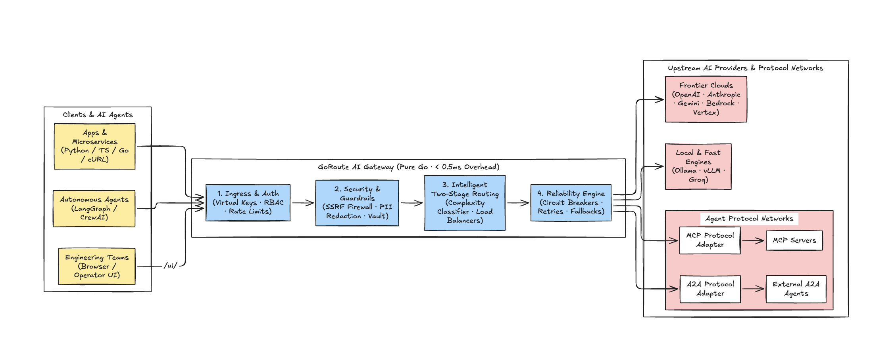

<p align="center">
  
</p>

# GoRoute AI Gateway

*The ultra-fast, lightweight AI Gateway, MCP Hub, and Agent-to-Agent Router in 100% Pure Go with Embedded Operator Web UI.*

Call 30+ hosted and local model providers through a unified OpenAI-compatible API with sub-millisecond routing, distributed Redis rate limiting, 3-state circuit breakers, strict micro-dollar FinOps, and an embedded modern streaming playground.

[](https://pkg.go.dev/github.com/goroute-ai/ai-gateway-go/pkg/gateway)
[](https://go.dev/)
[](https://github.com/goroute-ai/ai-gateway-go/releases/tag/v1.21.0)
[](https://github.com/goroute-ai/ai-gateway-go/pkgs/container/ai-gateway-go)
[](http://localhost:8080/ui/)
[](./docs/openapi/README.md)
[](./CLAUDE.md)
[](./LICENSE)

---

## What is GoRoute AI Gateway?

**GoRoute AI Gateway** is a fast, lightweight enterprise control plane and high-throughput data plane for AI applications. It sits between your client applications and frontier AI providers (OpenAI, Anthropic, Google Gemini, AWS Bedrock, GCP Vertex AI, Azure OpenAI, Cohere, Groq, Mistral, Ollama), giving you **one single, standardized API** to call any model.

Instead of writing fragmented provider code, managing disparate API keys, or suffering downtime during provider rate limits, you connect to GoRoute once. GoRoute handles **dynamic load balancing**, **sliding-window rate limiting**, **automatic circuit-breaker failovers**, **exact integer micro-dollar token accounting**, and provides a **zero-dependency embedded Operator Web UI & Streaming Chat Playground** out of the box.

<p align="center">
  
</p>

---

## Quick Start (3 Developer Ingress Paths)

### Path 1: 1-Line Embedded Go SDK (`pkg/gateway`)

Embed GoRoute directly inside your Go microservices with zero proxy hops, full type safety, and sub-millisecond execution:

```bash
go get github.com/goroute-ai/ai-gateway-go/pkg/gateway@v1.21.0
```

```go
package main

import (
	"context"
	"fmt"
	"log"

	"github.com/goroute-ai/ai-gateway-go/pkg/gateway"
)

func main() {
	ctx := context.Background()

	// Initialize embedded gateway with model aliases and environment variables
	gw, err := gateway.New(
		gateway.WithModelList(
			gateway.ModelEntry{ModelName: "fast", Model: "gemini/gemini-2.5-flash", APIKey: "os.environ/GEMINI_API_KEY"},
			gateway.ModelEntry{ModelName: "reasoning", Model: "anthropic/claude-sonnet-4-20250514", APIKey: "os.environ/ANTHROPIC_API_KEY"},
		),
		gateway.WithDemoMocksIfEnvMissing(), // Instant zero-config local testing
		gateway.WithSilentLogs(),             // Suppress internal logs in library mode
	)
	if err != nil {
		log.Fatal(err)
	}
	defer gw.Close()

	// 1-Line synchronous completion (with optional routing hints)
	res, err := gw.Chat(ctx, "fast", "In one sentence, explain what an AI Gateway does.")
	if err != nil {
		log.Fatal(err)
	}

	fmt.Printf("[%s] %s (cost: %d µ$, routing: %d µs, reason: %s)\n", res.Provider, res.Content, res.CostMicros, res.RoutingMicros, res.RouteReason)
}
```
> *SDK Routing & Auth Hooks:* `pkg/gateway` also exposes `WithCustomAuthenticator` (`CustomAuthModeOff`/`Auto`/`On`), `WithRoutingPlugin`, `WithPreRouter`, `WithPreRouterMode`, `WithRouterConfig`, `WithDefaultFallbackTargets`, `WithMidStreamContinuation`, `WithHedgeConfig`, `WithSessionAffinity`, and per-request `WithRoutingHints`.

### Path 2: Universal One-Line Shell Installer (macOS, Linux, WSL)

Installs the standalone static binary with automatic OS/architecture detection and SHA-256 verification:

```bash
curl -fsSL https://raw.githubusercontent.com/goroute-ai/ai-gateway-go/main/install.sh | bash
```

Run instantly with local mock fallback and launch the Operator UI:

```bash
export GEMINI_API_KEY="your-gemini-key"
export GATEWAY_DEFAULT_KEY="sk-gw-local-client-key"
export GATEWAY_MASTER_ADMIN_KEY="sk-gw-local-admin-key-change-me"
ai-gateway --config configs/config.yaml
# Open http://localhost:8080/ui/ in your browser
```

*Precompiled static binaries (`darwin`, `linux`, `windows`), `checksums.txt`, and Helm chart packages are available on the [**GitHub Releases Page**](https://github.com/goroute-ai/ai-gateway-go/releases/tag/v1.21.0).*

### Path 3: Container Image (`ghcr.io`) & Production Stack (Docker Compose)

Run the published multi-arch Distroless container image directly from [GitHub Packages](https://github.com/goroute-ai/ai-gateway-go/pkgs/container/ai-gateway-go):

```bash
docker pull ghcr.io/goroute-ai/ai-gateway-go:v1.21.0
# Or track latest stable: docker pull ghcr.io/goroute-ai/ai-gateway-go:latest
```

Or spin up GoRoute (with embedded UI), PostgreSQL 16 (for migrations and spend logs), Redis 7 (for rate limiting and cache), and Prometheus:

```bash
curl -O https://raw.githubusercontent.com/goroute-ai/ai-gateway-go/main/deployments/docker-compose.yml
docker compose up -d
# Open http://localhost:8080/ui/
```

---

## Core Product Features & Implementation

---

### 1. Intelligent Pre-Routing, Candidate Filtering & Load Balancing

#### What It Does

Decouples client applications from rigid upstream provider endpoints. Applications request virtual model aliases (`fast`, `reasoning`, `auto`, `router/semantic`, `router/quality`, `router/adaptive`, or comma-separated models for hedged racing), and GoRoute dynamically selects the optimal provider deployment based on real-time latency, health, region/tags, session affinity, token cost, or remaining quota headroom.

#### How It Works Under the Hood

1. **Stage 0 (`PreRouterRegistry`)**: Resolves virtual model aliases before candidate filtering using `auto` / `router/heuristic` (zero-LLM <0.1ms complexity classifier), `router/semantic` (embedding cosine similarity), `router/quality` (`QualityTier` escalation), `router/adaptive` (Thompson-sampling Beta bandit), or custom registered Go `PreRouterFunc` hooks.
2. **Stage 1–3 (Group Resolution, `DeploymentFilterChain` & Priority Tiers)**: Filters candidates by health & staleness, 3-state circuit breakers, context window fit (deferring rejection when `context_window_fallbacks` exist), region, boolean `&`/`!` tag expressions, per-deployment & per-provider budgets/capacity, session & prompt-cache affinity, and custom `RoutingPlugin` hooks, then walks `Deployment.Priority` tiers in ascending order.
3. **Stage 4 (7 Pluggable Load Balancing Strategies)**: Distributes traffic within the active tier using one of seven strategies:
   - `weighted-shuffle`: Weighted randomized distribution across multiple deployments.
   - `round-robin`: Atomic rotating distribution across healthy peers.
   - `least-busy`: Routes to the deployment with the fewest active in-flight requests.
   - `latency-based`: Tracks exponential moving average (EWMA) time-to-first-token (TTFT) and routes to the fastest provider.
   - `fastest-response`: Dispatches hedged staggered races (`hedge_delay_ms`) and returns the first streaming/non-streaming responder.
   - `usage-based-headroom`: Shifts traffic toward deployments with the largest remaining TPM quota.
   - `lowest-cost`: Selects the cheapest provider capable of serving the prompt.
4. **Stage 5 (`PriorityScheduler`)**: Optional bounded priority-queue scheduler controlling concurrency bursts by request priority.

#### Configuration (`configs/config.yaml`)

```yaml
router:
  pre_router_mode: "heuristic" # or "semantic", "quality", "adaptive"
  default_fast_alias: "fast"
  default_reasoning_alias: "reasoning"
  complexity_threshold: 0.40
  session_affinity_ttl: 30m

model_list:
  - model_name: "fast"
    routing_strategy: "latency-based"
    fallbacks: ["fast-backup"]
    context_window_fallbacks:
      - target: "long-context"
        overrides: { max_tokens: 4096 }
    model_params:
      model: "gemini/gemini-2.5-flash"
      api_key: "os.environ/GEMINI_API_KEY"
      region: "us-central1"
      priority: 0
      tags: ["tier:fast", "low-cost"]
      weight: 80
      rpm: 1000

  - model_name: "fast-backup"
    model_params:
      model: "openai/gpt-4o-mini"
      api_key: "os.environ/OPENAI_API_KEY"
      priority: 1
      weight: 20
```

#### Usage Example

```bash
curl http://localhost:8080/v1/chat/completions \
  -H "Authorization: Bearer $GATEWAY_DEFAULT_KEY" \
  -H "Content-Type: application/json" \
  -H "X-Gateway-Session-Id: sess-123" \
  -d '{
    "model": "auto",
    "messages": [{"role": "user", "content": "Explain raft consensus in 10 words."}]
  }'
```

Every response includes detailed routing attribution headers:

```http
HTTP/1.1 200 OK
X-Gateway-Provider: gemini
X-Gateway-Model: gemini-2.5-flash
X-Gateway-Routing-Micros: 14
X-Gateway-Latency-Ms: 112
X-Gateway-Route-Reason: priority_tier_0
X-Gateway-Fallback-Attempted: false
X-Gateway-Tier-Stepdowns: 0
X-Gateway-Stream-Continued: false
X-Gateway-Cost-Micros: 45
```

---

### 2. Distributed Rate Limiting & Multi-Dimensional Quotas

#### What It Does

Protects upstream provider accounts from `429` bursts and enforces fair, multi-tenant capacity across organizations, teams, projects, users, virtual keys, end-users, tags, model access groups, agent sessions, and MCP servers.

#### How It Works Under the Hood

GoRoute executes single-roundtrip atomic Redis Lua scripts (`check_and_increment.lua`, `check_descriptors.lua`, `reconcile_descriptors.lua`, `renew_descriptors.lua`) inside `{org:<orgID>}` cluster hash slots so multi-scope quota acquisition and settlement never leak partial counters:

1. **Hierarchical & Contextual Scopes**: Enforces per-model `rpm`, `tpm`, input/output-split `itpm`/`otpm`, daily `tpd`, `max_concurrent_requests`, agent session `max_iterations`/`window_ttl_sec`, `/v1/realtime` WebSocket concurrency, `/v1/batches` JSONL enqueued token holds (`batch_enqueued_*.lua`), and MCP server quotas.
2. **Simultaneous Multi-Window Budgets & Cold Recovery**: Enforces stacked `daily`, `weekly`, `monthly`, and sliding `rolling_24h` windows alongside soft-budget webhook alerts, dynamic throttling, budget-triggered fallbacks, and TTL-expiring temporary key budget boosts (`/admin/v1/keys/{id}/temp-budget`). On cold Redis state (or `rolling_24h` sorted-set loss), the gateway atomically reconstructs trailing 24-hour spend from PostgreSQL `spend_logs`.
3. **Saturation-Aware Priority Capacity & PTU Shares**: Reserves per-team provisioned throughput (`deployment_ptu_shares`) with idle borrowing/reclaim and enforces weighted `priority_classes` under congestion.

When a client exceeds their allowance, GoRoute halts execution before calling the upstream model, returning `HTTP 429 Too Many Requests` with `Retry-After` (or a structured JSON-RPC `-32600` envelope on `/mcp/{slug}`).

#### Provisioning a Rate-Limited Virtual Key (Admin API)

```bash
curl -X POST http://localhost:8080/admin/v1/keys \
  -H "Authorization: Bearer $GATEWAY_MASTER_ADMIN_KEY" \
  -H "Content-Type: application/json" \
  -d '{
    "org_id": "org_default",
    "name": "analytics-pipeline",
    "role": "service_account",
    "rpm_limit": 60,
    "tpm_limit": 30000,
    "max_concurrent_requests": 5,
    "max_budget_micros": 10000000,
    "allowed_models": ["fast", "gemini-2.5-flash"]
  }'
```

#### Rate-Limited Response (HTTP 429)

```http
HTTP/1.1 429 Too Many Requests
Content-Type: application/json
Retry-After: 45

{
  "error": {
    "message": "Rate limit exceeded for virtual key. Allowed: 60 RPM. Please retry after 45 seconds.",
    "type": "rate_limit_error",
    "code": "rate_limit_exceeded"
  }
}
```

---

### 3. Resilient Retries, 3-State Circuit Breakers, Failover & Mid-Stream Recovery

#### What It Does

Ensures 99.99% application uptime by isolating failing providers, backing off with per-exception retry policies, stepping through priority tiers and specialized fallback chains, and recovering mid-stream SSE disconnections seamlessly.

#### How It Works Under the Hood

1. **Per-Exception Retries & Priority Tier Step-Down**: Evaluates per-class `RetryPolicy` (`rate_limit_retries`, `timeout_retries`, `server_error_retries`, `auth_error_retries`, `not_found_retries`, `bad_request_retries`) using full-jitter exponential backoff ($t_{\text{sleep}} = \text{random}(0, \min(M, B \times 2^{\text{attempt}}))$) honoring upstream `Retry-After`. Exhausting a priority tier steps automatically to higher numeric `Deployment.Priority` tiers before leaving the group.
2. **3-State Circuit Breakers & Lone-Deployment Safety Net**:
   - `CLOSED`: Normal traffic flow. Upstream failures increment sliding-window counters and 1-minute failure-rate windows (`reqs_1m`/`fails_1m` for `CooldownPolicy.failure_rate_threshold`).
   - `OPEN`: Trips when failure thresholds or adaptive error rates breach bounds—unless only one eligible deployment exists and the lone-deployment safety net keeps traffic flowing.
   - `HALF_OPEN`: When the cooldown expires, an atomic probe lease dispatches a single canary request.
3. **Specialized & Cross-Provider Fallback Chains**: Routes `context_length_exceeded` errors through `context_window_fallbacks`, moderation/content blocks through `content_policy_fallbacks`, and remaining errors through `fallback_targets` (with per-target `overrides`), `fallbacks`, or global `router.default_fallbacks`.
4. **Mid-Stream SSE Continuation**: When `enable_mid_stream_continuation: true` is enabled and a plain-text SSE stream breaks mid-generation, `StreamContinuationManager` re-routes with an assistant prefill and adjusted `max_tokens`, setting `X-Gateway-Stream-Continued: true`.

#### Multi-Cloud Failover Topology (`configs/config.yaml`)

```yaml
router:
  default_max_retries: 2
  base_retry_delay: 50ms
  max_retry_delay: 2s
  default_cooldown: 60s
  failure_threshold: 3

model_list:
  # Primary: Google Gemini
  - model_name: "production-chat"
    fallbacks: ["backup-openai", "backup-anthropic"]
    model_params:
      model: "gemini/gemini-2.5-flash"
      api_key: "os.environ/GEMINI_API_KEY"

  # Fallback 1: OpenAI
  - model_name: "backup-openai"
    model_params:
      model: "openai/gpt-4o-mini"
      api_key: "os.environ/OPENAI_API_KEY"

  # Fallback 2: Anthropic
  - model_name: "backup-anthropic"
    model_params:
      model: "anthropic/claude-sonnet-4-20250514"
      api_key: "os.environ/ANTHROPIC_API_KEY"
```

---

### 4. Strict Micro-Dollar FinOps & Cost Controls

#### What It Does

Eliminates unexpected cloud bills and ensures 100% financial accuracy across multi-tenant teams and services.

#### How It Works Under the Hood

- **Zero Float Drift**: Most API gateways use floating-point types (`float64`), causing rounding errors and balance mismatches over millions of requests. GoRoute uses strict **64-bit integer micro-dollars** ($1\text{ USD} = 1,000,000\ \mu\$$) with internal pico-dollar precision ($10^{-12}\text{ USD}$).
- **Pre-Flight Budget Enforcement**: Checks organization, team, and virtual key remaining budget before executing inference. If exhausted, requests fail fast with `HTTP 402 Payment Required (budget_exceeded)`.
- **Asynchronous Batch Spend Worker**: Decouples database I/O from the request hot path. Spend events are queued into a 16,384-element ring buffer and flushed in atomic batches to Redis and PostgreSQL.
- **Granular Token & Modality Rates**: Tracks input tokens, output tokens, cached prompt discounts, reasoning/thinking tokens, audio seconds, and image resolution units.

#### Querying Live Spend (Admin API)

```bash
curl "http://localhost:8080/admin/v1/spend/summary?org_id=org_default" \
  -H "Authorization: Bearer $GATEWAY_MASTER_ADMIN_KEY"
```

Response:

```json
{
  "org_id": "org_default",
  "total_spend_micros": 4125890,
  "budget_limit_micros": 50000000,
  "budget_remaining_micros": 45874110,
  "active_keys": 8,
  "total_requests": 14205,
  "total_prompt_tokens": 1284500,
  "total_completion_tokens": 341200
}
```

---

### 5. Dual-Boundary Security, Enterprise Identity Federation, Vault & SSRF Firewall

#### What It Does

Authenticates human operators, workload JWTs, reverse-proxy identities, and service keys across isolated tenant boundaries; encrypts upstream credentials and temporary OAuth tokens at rest; and blocks Server-Side Request Forgery (SSRF) across provider and media egress.

#### How It Works Under the Hood

1. **Inbound Authentication, Federation & Lifecycle**:
   - *Data Plane Ingress*: Supports Virtual API Keys (`sk-gw-...`, optional custom header), multi-issuer OIDC/JWT verification (`RS256`–`EdDSA` / `HS256` with discovery, stale-JWKS grace caching, claim-to-key mappings, and issuer-bound `(org_id, oidc_issuer, oidc_subject)` resolution), RFC 7662 token introspection / UserInfo, CIDR-guarded reverse-proxy headers, and embedded SDK `WithCustomAuthenticator`.
   - *Control Plane SSO & Sessions (`/auth/*`)*: Provides OIDC Authorization Code + PKCE browser login, CLI device sign-in (`/auth/cli/*`), operator password sessions with `goroute_session` cookies + CSRF protection, Redis login throttling, and server-side HIBP 5-character SHA-1 prefix screening (`/auth/password`).
   - *Identity Governance & Key Lifecycle*: Supports `key_type` capability presets (`llm_api`, `management`, `read_only`, `service_account`), manual grace-period rotation and scheduled HTTPS key-rotation webhooks, SCIM v2 `/scim/v2/{Users,Groups}` provisioning, `team_admin` delegation, dynamic access rules, M:N `team_memberships` + `projects`, and audited operator impersonation.
2. **Outbound Credentials, Opt-In Cloud IAM & Vault**:
   - Upstream provider secrets are envelope-encrypted in PostgreSQL with AES-256-GCM (KEK/DEK), while upstream OAuth `client_credentials` and RFC 8693 token exchanges are cached encrypted in Redis (`DistributedTokenCache`).
   - Ambient cloud credentials (AWS Bedrock IMDS/ECS/IRSA, GCP Vertex ADC, Azure Managed Identity, and AWS RDS IAM) are **disabled by default** (`auth.allow_ambient_cloud_iam: false`) and must be explicitly enabled.
3. **Outbound SSRF Protection Engine**: Centralized in `internal/security/network`:
   - Enforces DNS resolution IP pinning at connect time to prevent DNS rebinding attacks.
   - Automatically blocks RFC 1918 private subnets (`10.0.0.0/8`, `172.16.0.0/12`, `192.168.0.0/16`), loopback (`127.0.0.1`), and link-local/metadata endpoints (`169.254.169.254`, `fd00:ec2::254`).

#### Preflight Upstream Credential Validation

Test raw API keys against upstream provider APIs *before* storing them in the vault:

```bash
curl -X POST http://localhost:8080/admin/v1/credentials/validate \
  -H "Authorization: Bearer $GATEWAY_MASTER_ADMIN_KEY" \
  -H "Content-Type: application/json" \
  -d '{
    "provider": "openai",
    "api_key": "sk-proj-...",
    "base_url": "https://api.openai.com/v1"
  }'
```

Returns:

```json
{
  "provider": "openai",
  "valid": true,
  "validation_status": "success",
  "discovered_models": 24,
  "latency_ms": 118
}
```

---

### 6. Unified Multi-Modal Data Plane (`24` `/v1` OpenAPI Paths)

The gateway registers the following primary `/v1` operations. Contract parity across `/v1` (`24` paths), `/admin/v1` (`72` paths), and `/auth` (`10` paths) is enforced by `make specgen` (`106` Unified OpenAPI paths). Provider and model callability varies by operation, adapter/profile, configuration, and account access; catalogue presence alone does not guarantee a callable route.

| Operation group | Routes |
| :--- | :--- |
| Chat and text | `POST /v1/chat/completions`, `POST /v1/completions` |
| Embeddings and model inventory | `POST /v1/embeddings`, `GET /v1/models` |
| Anthropic Messages ingress | `POST /v1/messages`, `POST /v1/messages/count_tokens` |
| Audio | `POST /v1/audio/transcriptions`, `POST /v1/audio/translations`, `POST /v1/audio/speech` |
| Images | `POST /v1/images/generations`, `POST /v1/images/edits`, `POST /v1/images/variations` |
| Rerank, moderation, and tokenization | `POST /v1/rerank`, `POST /v1/moderations`, `POST /v1/tokenize` |
| Files | `POST /v1/files`, `GET /v1/files`, `GET /v1/files/{file_id}`, `GET /v1/files/{file_id}/content`, `DELETE /v1/files/{file_id}` |
| Batches | `POST /v1/batches`, `GET /v1/batches`, `GET /v1/batches/{batch_id}`, `POST /v1/batches/{batch_id}/cancel` |
| Responses and realtime | `POST /v1/responses`, `GET /v1/realtime` (WebSocket upgrade) |

The generated OpenAPI interfaces exist as contract artifacts. Live handlers and route registration are still partly handwritten; see the [OpenAPI workflow and known gaps](./docs/openapi/README.md).

#### Audio Transcription (Whisper STT with Disk Spooling)

Multipart audio uploads are spooled to disk with zero heap exhaustion and billed per integer duration second:

```bash
curl -X POST http://localhost:8080/v1/audio/transcriptions \
  -H "Authorization: Bearer $GATEWAY_DEFAULT_KEY" \
  -F "file=@meeting.mp3" \
  -F "model=whisper-1" \
  -F "language=en"
```

#### Document Reranking (Cohere v2 Bridge)

Enables semantic search reranking over document sets:

```bash
curl -X POST http://localhost:8080/v1/rerank \
  -H "Authorization: Bearer $GATEWAY_DEFAULT_KEY" \
  -H "Content-Type: application/json" \
  -d '{
    "model": "rerank-v3.5",
    "query": "How does GoRoute prevent SSRF?",
    "documents": [
      "GoRoute uses IP pinning and blocks RFC 1918 subnets.",
      "GoRoute is written in pure Python.",
      "GoRoute supports Docker Compose."
    ],
    "top_n": 2
  }'
```

#### Realtime Bidirectional WebSocket Protocol

Connects full-duplex speech and text sessions with `nhooyr.io/websocket` connection hijacking:

```bash
# Connect over WebSockets with virtual key authorization
wscat -c "ws://localhost:8080/v1/realtime?model=gpt-4o-realtime-preview" \
  -H "Authorization: Bearer $GATEWAY_DEFAULT_KEY"
```

---

### 7. Agentic Protocol Hub (MCP & A2A)

#### Model Context Protocol (MCP 2026-07-28 Hub)

GoRoute functions as a production MCP Virtual Hub aggregating multiple upstream Streamable HTTP (`2026-07-28`) and SSE (`2025-11-25`) MCP tool servers, encrypting Model Resumption Tokens (AEAD), pinning SHA-256 tool schemas, and bridging tools into plain REST (`mcp.allow_stdio_servers` remains fail-closed by default in Release 1):

```bash
# 1. List aggregated tools across all registered MCP servers
curl http://localhost:8080/mcp-rest/tools/list \
  -H "Authorization: Bearer $GATEWAY_DEFAULT_KEY"

# 2. Call an MCP tool directly via lightweight REST bridge
curl -X POST http://localhost:8080/mcp-rest/tools/call \
  -H "Authorization: Bearer $GATEWAY_DEFAULT_KEY" \
  -H "Content-Type: application/json" \
  -d '{
    "server_slug": "github-tools",
    "tool_name": "create_issue",
    "arguments": {"repo": "goroute/gateway", "title": "Add feature"}
  }'
```

#### Linux Foundation Agent-to-Agent Protocol (A2A v1.0)

GoRoute exposes RFC 8785 JCS canonicalized and RFC 7515 JWS signed Agent Cards, dual HTTP+JSON and JSON-RPC dispatch, and an OpenAI Compatibility Bridge:

```bash
# Discover cryptographic Agent Card
curl http://localhost:8080/.well-known/agent-card.json

# Call an A2A agent using standard OpenAI chat completions
curl -X POST http://localhost:8080/v1/chat/completions \
  -H "Authorization: Bearer $GATEWAY_DEFAULT_KEY" \
  -H "Content-Type: application/json" \
  -d '{
    "model": "a2a/financial-analyst",
    "messages": [{"role": "user", "content": "Analyze quarterly portfolio spend."}]
  }'
```

---

### 8. Embedded Operator Web UI & Streaming Chat Playground

GoRoute embeds a production React 18 + TypeScript + Tailwind single-page application directly inside the Go binary via `go:embed`. Launch the gateway and open **`http://localhost:8080/ui/`** (supporting OIDC SSO buttons, operator password sign-in, and emergency break-glass master key unlock):

```
┌────────────────────────────────────────────────────────────────────────────────────────┐
│  GoRoute Operator Console (http://localhost:8080/ui/)                                  │
├─────────────────┬──────────────────────────────────────────────────────────────────────┤
│  ⚡ Overview     │  • Real-Time Gateway Vitals, Active Requests & P95 Latency           │
│  💬 Playground   │  • Multi-Turn Streaming Chat with Cost & Routing Attribution Headers │
│  📦 Catalogue    │  • Model Directory, Priority Tiers, Specialized Fallbacks & Budgets  │
│  🔑 Virtual Keys │  • key_type Presets, Grace-Period Rotation, Soft Caps & Temp Boosts  │
│  💰 FinOps       │  • Spend Breakdowns, Per-Model Quotas (ITPM/OTPM/TPD) & Multi-Window │
│  🛡️ Guardrails   │  • Baseline Policy, 19-Driver Registry, Tool Policies & Simulator │
│  🔐 Credentials  │  • AES-256-GCM Vault with Live Preflight Provider Validation         │
│  🤖 Agentic      │  • MCP Tool Hub Explorer & A2A Agent Card Discovery                  │
└─────────────────┴──────────────────────────────────────────────────────────────────────┘
```

- **Zero Node.js Runtime Overhead**: Static bundles are compiled at build time and served directly from memory.
- **Interactive Guardrail Studio & Simulator**: Configure baseline PII/secret/toxicity policies, manage named cloud/OSS/Starlark guardrails and tool trust policies, simulate requests via `/v1/guardrails/apply`, and track micro-dollar guardrail usage.
- **Strict Bundle Budget**: The production frontend bundle is enforced within `<= 500 KB` uncompressed (`<= 150 KB` gzipped) via `web/scripts/check-budget.mjs`.

---

## Multi-Language SDK Ingress

Point any standard SDK or client to `http://localhost:8080/v1`:

### Python (Official `openai` SDK)

```python
import os
from openai import OpenAI

client = OpenAI(
    api_key=os.environ.get("GATEWAY_DEFAULT_KEY", "sk-gw-local-client-key"),
    base_url="http://localhost:8080/v1"
)

response = client.chat.completions.create(
    model="fast",
    messages=[{"role": "user", "content": "Explain GoRoute in 10 words."}],
    temperature=0.7
)
print(response.choices[0].message.content)
```

### TypeScript / Node.js (Official `openai` SDK)

```typescript
import OpenAI from "openai";

const client = new OpenAI({
  apiKey: process.env.GATEWAY_DEFAULT_KEY || "sk-gw-local-client-key",
  baseURL: "http://localhost:8080/v1",
});

async function main() {
  const stream = await client.chat.completions.create({
    model: "fast",
    messages: [{ role: "user", content: "Stream me a haiku about performance." }],
    stream: true,
  });

  for await (const chunk of stream) {
    process.stdout.write(chunk.choices[0]?.delta?.content || "");
  }
}
main();
```

---

## Claude Code & Coding Agent Guidance

The repository keeps shared coding guidance for Claude Code and other coding agents:

- **`CLAUDE.md`**: Concise project guide that imports shared repository instructions from `AGENTS.md`.
- **Scoped Rules (`.claude/rules/`)**: Path-specific rules for Go backend (`go-backend.md`), React Operator UI (`frontend-web.md`), and API contracts (`api-contracts.md`).
- **Rapid Verification Loop**: Standardized commands for formatting (`gofmt`), static analysis (`go vet`), contract generation and verification (`make specgen`), race-detector tests, and frontend bundle budgets.
- **Cross-Agent Standards**: Shared invariants are maintained in [AGENTS.md](./AGENTS.md), with Claude Code-specific rule loading documented in `CLAUDE.md`.

---

## Complete Documentation Hub

Explore the comprehensive technical specifications and operational runbooks:

| Guide                                                                                           | What It Covers                                                                                  |
| :---------------------------------------------------------------------------------------------- | :---------------------------------------------------------------------------------------------- |
| **[Documentation Hub (`docs/README.md`)](./docs/README.md)**                             | Master index for all guides, specs, and architectural overviews.                                |
| **[API Reference (`docs/API_REFERENCE.md`)](./docs/API_REFERENCE.md)**                   | Unified REST (`/v1`), Operator SSO (`/auth`), SCIM v2 (`/scim/v2`), MCP, A2A, and Admin Control Plane reference (`106` OpenAPI paths). |
| **[Configuration Guide (`docs/CONFIGURATION_GUIDE.md`)](./docs/CONFIGURATION_GUIDE.md)** | Complete reference table for all YAML options (`auth.*`, `router.*`, `rate_limit.*`, `finops.*`), `pkg/gateway` SDK options (`WithCustomAuthenticator`, routing hooks), and env vars. |
| **[System Architecture (`docs/ARCHITECTURE.md`)](./docs/ARCHITECTURE.md)**               | High-Level (HLD) and Low-Level (LLD) enterprise architecture with SQL schemas (`0001`–`0034`) and Redis cluster keyspace. |
| **[Subsystem Internals (`docs/INTERNALS.md`)](./docs/INTERNALS.md)**                     | Deep-dive code tours, sequence diagrams, and mathematical specifications for identity federation, quota descriptors, and routing engines. |
| **[Upgrade & Rollback Guide (`docs/UPGRADING.md`)](./docs/UPGRADING.md)**                | Safe upgrade procedures (`0022`–`0034`), issuer-binding rules, migration `0034` rollback preflight, and breaking/default behavior changes. |
| **[Testing & Verification Guide (`docs/TESTING.md`)](./docs/TESTING.md)**                | 5-tier verification workflow: race unit tests, live Postgres/Redis E2E, Playwright UI E2E, 2-replica HA chaos/k6 containers, and canaries. |
| **[OpenAPI Specifications (`docs/openapi/`)](./docs/openapi/README.md)**                 | Formal OpenAPI 3.0/3.1 contracts (`gateway.openapi.yaml` = `106` paths) and vendor protocol specifications. |
| **[Codebase Map (`docs/CODEBASE_MAP.md`)](./docs/CODEBASE_MAP.md)**                      | Package locations, sources of truth, and developer change paths.                                |

---

## License

Licensed under the [Apache License, Version 2.0](./LICENSE).
