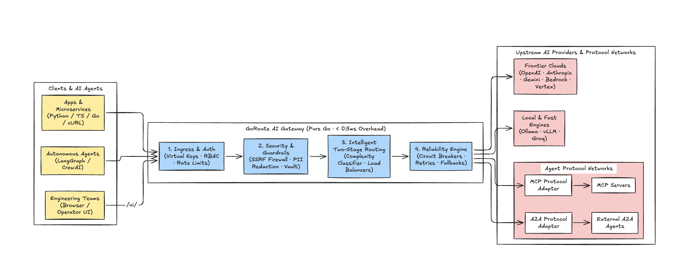

<p align="center">
  
</p>

# GoRoute AI Gateway

*The ultra-fast, lightweight AI Gateway, MCP Hub, and Agent-to-Agent Router in 100% Pure Go with Embedded Operator Web UI.*

Call 30+ hosted and local model providers through a unified OpenAI-compatible API with sub-millisecond routing, distributed Redis rate limiting, 3-state circuit breakers, strict micro-dollar FinOps, and an embedded modern streaming playground.

[](https://pkg.go.dev/github.com/goroute-ai/ai-gateway-go/pkg/gateway)
[](https://go.dev/)
[](https://github.com/goroute-ai/ai-gateway-go/releases/tag/v1.5.0)
[](http://localhost:8080/ui/)
[](./docs/openapi/README.md)
[](./CLAUDE.md)
[](./LICENSE)

---

## What is GoRoute AI Gateway?

**GoRoute AI Gateway** is a fast, lightweight enterprise control plane and high-throughput data plane for AI applications. It sits between your client applications and frontier AI providers (OpenAI, Anthropic, Google Gemini, AWS Bedrock, GCP Vertex AI, Azure OpenAI, Cohere, Groq, Mistral, Ollama), giving you **one single, standardized API** to call any model.

Instead of writing fragmented provider code, managing disparate API keys, or suffering downtime during provider rate limits, you connect to GoRoute once. GoRoute handles **dynamic load balancing**, **sliding-window rate limiting**, **automatic circuit-breaker failovers**, **exact integer micro-dollar token accounting**, and provides a **zero-dependency embedded Operator Web UI & Streaming Chat Playground** out of the box.

<p align="center">
  
</p>

---

## Quick Start (3 Developer Ingress Paths)

### Path 1: 1-Line Embedded Go SDK (`pkg/gateway`)

Embed GoRoute directly inside your Go microservices with zero proxy hops, full type safety, and sub-millisecond execution:

```bash
go get github.com/goroute-ai/ai-gateway-go/pkg/gateway@v1.5.0
```

```go
package main

import (
	"context"
	"fmt"
	"log"

	"github.com/goroute-ai/ai-gateway-go/pkg/gateway"
)

func main() {
	ctx := context.Background()

	// Initialize embedded gateway with model aliases and environment variables
	gw, err := gateway.New(
		gateway.WithModelList(
			gateway.ModelEntry{ModelName: "fast", Model: "gemini/gemini-2.5-flash", APIKey: "os.environ/GEMINI_API_KEY"},
			gateway.ModelEntry{ModelName: "reasoning", Model: "anthropic/claude-sonnet-4-20250514", APIKey: "os.environ/ANTHROPIC_API_KEY"},
		),
		gateway.WithDemoMocksIfEnvMissing(), // Instant zero-config local testing
		gateway.WithSilentLogs(),             // Suppress internal logs in library mode
	)
	if err != nil {
		log.Fatal(err)
	}
	defer gw.Close()

	// 1-Line synchronous completion
	res, err := gw.Chat(ctx, "fast", "In one sentence, explain what an AI Gateway does.")
	if err != nil {
		log.Fatal(err)
	}

	fmt.Printf("[%s] %s (cost: %d µ$, routing: %d µs)\n", res.Provider, res.Content, res.CostMicros, res.RoutingMicros)
}
```

### Path 2: Universal One-Line Shell Installer (macOS, Linux, WSL)

Installs the standalone static binary with automatic OS/architecture detection and SHA-256 verification:

```bash
curl -fsSL https://raw.githubusercontent.com/goroute-ai/ai-gateway-go/main/install.sh | bash
```

Run instantly with local mock fallback and launch the Operator UI:

```bash
export GEMINI_API_KEY="your-gemini-key"
export GATEWAY_DEFAULT_KEY="sk-gw-local-client-key"
export GATEWAY_MASTER_ADMIN_KEY="sk-gw-local-admin-key-change-me"
ai-gateway --config configs/config.yaml
# Open http://localhost:8080/ui/ in your browser
```

*Precompiled static binaries are also available on the [**GitHub Releases Page**](https://github.com/goroute-ai/ai-gateway-go/releases/tag/v1.5.0).*

### Path 3: Production Multi-Tenant Stack (Docker Compose)

Spins up GoRoute (with embedded UI), PostgreSQL 16 (for migrations and spend logs), Redis 7 (for rate limiting and cache), and Prometheus:

```bash
curl -O https://raw.githubusercontent.com/goroute-ai/ai-gateway-go/main/deployments/docker-compose.yml
docker compose up -d
# Open http://localhost:8080/ui/
```

---

## Core Product Features & Implementation

---

### 1. Intelligent Dynamic Routing & Load Balancing

#### What It Does

Decouples client applications from rigid upstream provider endpoints. Applications request virtual model aliases (`fast`, `reasoning`, or `auto`), and GoRoute dynamically selects the optimal provider deployment based on real-time latency, provider health, token cost, or remaining quota headroom.

#### How It Works Under the Hood

1. **Stage 1 (Zero-LLM Complexity Classifier)**: Evaluates incoming prompts using an in-process heuristic classifier (< 0.1ms overhead) measuring prompt token length, reasoning markers, and code syntax blocks. Requests sent to `model: "auto"` are automatically routed to `fast` (e.g. Gemini 2.5 Flash) or `reasoning` (e.g. Claude 3.5 Sonnet / O3-Mini).
2. **Stage 2 (Pluggable Load Balancing Algorithms)**: Filters healthy deployments and distributes load using one of five strategies:
   - `weighted-shuffle`: Weighted randomized distribution across multiple deployments.
   - `least-busy`: Routes to the deployment with the fewest active in-flight requests.
   - `lowest-latency`: Tracks exponential moving average (EWMA) time-to-first-token (TTFT) and routes to the fastest provider.
   - `lowest-cost`: Selects the cheapest provider capable of serving the prompt.
   - `usage-based-headroom`: Shifts traffic toward deployments with the largest remaining TPM quota.

#### Configuration (`configs/config.yaml`)

```yaml
router:
  default_fast_alias: "fast"
  default_reasoning_alias: "reasoning"
  complexity_threshold: 0.40

model_list:
  - model_name: "fast"
    routing_strategy: "lowest-latency"
    fallbacks: ["fast-backup"]
    model_params:
      model: "gemini/gemini-2.5-flash"
      api_key: "os.environ/GEMINI_API_KEY"
      weight: 80
      rpm: 1000

  - model_name: "fast-backup"
    model_params:
      model: "openai/gpt-4o-mini"
      api_key: "os.environ/OPENAI_API_KEY"
      weight: 20
```

#### Usage Example

```bash
curl http://localhost:8080/v1/chat/completions \
  -H "Authorization: Bearer $GATEWAY_DEFAULT_KEY" \
  -H "Content-Type: application/json" \
  -d '{
    "model": "auto",
    "messages": [{"role": "user", "content": "Explain raft consensus in 10 words."}]
  }'
```

Every response includes detailed routing attribution headers:

```http
HTTP/1.1 200 OK
X-Gateway-Provider: gemini
X-Gateway-Model: gemini-2.5-flash
X-Gateway-Routing-Time: 14 µs
X-Gateway-Cost-Micros: 45
```

---

### 2. Distributed Rate Limiting & Quotas

#### What It Does

Protects upstream provider accounts from rate limits (`429`) and enforces fair usage across distributed microservices, internal teams, and external API consumers.

#### How It Works Under the Hood

GoRoute uses a single-roundtrip atomic Redis Lua script (`check_and_increment.lua`) that checks and increments counters in a single network hop, completely preventing race conditions. It enforces limits across four hierarchical tiers:

1. **Virtual Key Tier**: Individual client keys (`rpm_limit`, `tpm_limit`, `max_concurrent_requests`).
2. **Team Tier**: Departmental limits aggregating all team members.
3. **Organization Tier**: Enterprise-wide tenant capacity caps.
4. **Upstream Deployment Tier**: Prevents exceeding provider account tier limits.

When a client exceeds their allowance, GoRoute immediately halts execution before calling the upstream model, returning standard `HTTP 429 Too Many Requests` with a precise `Retry-After` header.

#### Provisioning a Rate-Limited Virtual Key (Admin API)

```bash
curl -X POST http://localhost:8080/admin/v1/keys \
  -H "Authorization: Bearer $GATEWAY_MASTER_ADMIN_KEY" \
  -H "Content-Type: application/json" \
  -d '{
    "org_id": "org_default",
    "name": "analytics-pipeline",
    "role": "service_account",
    "rpm_limit": 60,
    "tpm_limit": 30000,
    "max_concurrent_requests": 5,
    "max_budget_micros": 10000000,
    "allowed_models": ["fast", "gemini-2.5-flash"]
  }'
```

#### Rate-Limited Response (HTTP 429)

```http
HTTP/1.1 429 Too Many Requests
Content-Type: application/json
Retry-After: 45

{
  "error": {
    "message": "Rate limit exceeded for virtual key. Allowed: 60 RPM. Please retry after 45 seconds.",
    "type": "rate_limit_error",
    "code": "rate_limit_exceeded"
  }
}
```

---

### 3. Resilient Retries, 3-State Circuit Breakers & Failover

#### What It Does

Ensures 99.99% application uptime by isolating failing providers, automatically backing off during transient network blips, and seamlessly rerouting requests across providers when upstream outages occur.

#### How It Works Under the Hood

1. **Intra-Group Full-Jitter Retries**: Automatically retries transient network errors (`502`, `503`, `504`) and rate limits (`429`) using exponential backoff with full jitter ($t_{\text{sleep}} = \text{random}(0, \min(M, B \times 2^{\text{attempt}}))$).
2. **3-State Circuit Breakers**:
   - `CLOSED`: Normal traffic flow. Upstream failures increment a sliding-window failure counter.
   - `OPEN`: If consecutive failures reach `failure_threshold` (default `3`), the circuit trips open. Subsequent requests bypass the deployment immediately for `default_cooldown` (default `60s`), shielding the upstream and preventing request timeouts.
   - `HALF_OPEN`: When the cooldown expires, a single canary probe is dispatched. If successful, the circuit resets to `CLOSED`; if it fails, it returns to `OPEN`.
3. **Cross-Provider Failover Chains**: If all retries within the active model group fail or the circuit is open, GoRoute automatically steps down through the configured `fallbacks: [...]` chain across entirely different AI clouds.

#### Multi-Cloud Failover Topology (`configs/config.yaml`)

```yaml
router:
  default_max_retries: 2
  base_retry_delay: 50ms
  max_retry_delay: 2s
  default_cooldown: 60s
  failure_threshold: 3

model_list:
  # Primary: Google Gemini
  - model_name: "production-chat"
    fallbacks: ["backup-openai", "backup-anthropic"]
    model_params:
      model: "gemini/gemini-2.5-flash"
      api_key: "os.environ/GEMINI_API_KEY"

  # Fallback 1: OpenAI
  - model_name: "backup-openai"
    model_params:
      model: "openai/gpt-4o-mini"
      api_key: "os.environ/OPENAI_API_KEY"

  # Fallback 2: Anthropic
  - model_name: "backup-anthropic"
    model_params:
      model: "anthropic/claude-sonnet-4-20250514"
      api_key: "os.environ/ANTHROPIC_API_KEY"
```

---

### 4. Strict Micro-Dollar FinOps & Cost Controls

#### What It Does

Eliminates unexpected cloud bills and ensures 100% financial accuracy across multi-tenant teams and services.

#### How It Works Under the Hood

- **Zero Float Drift**: Most API gateways use floating-point types (`float64`), causing rounding errors and balance mismatches over millions of requests. GoRoute uses strict **64-bit integer micro-dollars** ($1\text{ USD} = 1,000,000\ \mu\$$) with internal pico-dollar precision ($10^{-12}\text{ USD}$).
- **Pre-Flight Budget Enforcement**: Checks organization, team, and virtual key remaining budget before executing inference. If exhausted, requests fail fast with `HTTP 402 Payment Required (budget_exceeded)`.
- **Asynchronous Batch Spend Worker**: Decouples database I/O from the request hot path. Spend events are queued into a 16,384-element ring buffer and flushed in atomic batches to Redis and PostgreSQL.
- **Granular Token & Modality Rates**: Tracks input tokens, output tokens, cached prompt discounts, reasoning/thinking tokens, audio seconds, and image resolution units.

#### Querying Live Spend (Admin API)

```bash
curl "http://localhost:8080/admin/v1/spend/summary?org_id=org_default" \
  -H "Authorization: Bearer $GATEWAY_MASTER_ADMIN_KEY"
```

Response:

```json
{
  "org_id": "org_default",
  "total_spend_micros": 4125890,
  "budget_limit_micros": 50000000,
  "budget_remaining_micros": 45874110,
  "active_keys": 8,
  "total_requests": 14205,
  "total_prompt_tokens": 1284500,
  "total_completion_tokens": 341200
}
```

---

### 5. Dual-Boundary Security, Credential Vault & SSRF Firewall

#### What It Does

Isolates client applications from infrastructure secrets, encrypts credentials at rest, and prevents Server-Side Request Forgery (SSRF) attacks.

#### How It Works Under the Hood

1. **Dual Boundary Authentication**:
   - *Boundary 1 (Client Ingress)*: External callers authenticate with Virtual API Keys (`sk-gw-...`). Callers never receive or see upstream provider keys.
   - *Boundary 2 (Provider Egress)*: The gateway replaces the virtual key with provider-specific API keys or SigV4 signatures dynamically fetched from the vault.
2. **AES-256-GCM Envelope Encryption**: Upstream provider secrets stored in PostgreSQL are encrypted using AES-256-GCM authenticated encryption with a 32-byte Master Key Encryption Key (KEK).
3. **Outbound SSRF Protection Engine**: Centralized in `internal/security/network`:
   - Enforces DNS resolution IP pinning at connect time to prevent DNS rebinding attacks.
   - Automatically blocks RFC 1918 private subnets (`10.0.0.0/8`, `172.16.0.0/12`, `192.168.0.0/16`), loopback (`127.0.0.1`), and link-local addresses.
   - Specifically blocks cloud instance metadata endpoints (`169.254.169.254`, `fd00:ec2::254`).

#### Preflight Upstream Credential Validation

Test raw API keys against upstream provider APIs *before* storing them in the vault:

```bash
curl -X POST http://localhost:8080/admin/v1/credentials/validate \
  -H "Authorization: Bearer $GATEWAY_MASTER_ADMIN_KEY" \
  -H "Content-Type: application/json" \
  -d '{
    "provider": "openai",
    "api_key": "sk-proj-...",
    "base_url": "https://api.openai.com/v1"
  }'
```

Returns:

```json
{
  "provider": "openai",
  "valid": true,
  "validation_status": "success",
  "discovered_models": 24,
  "latency_ms": 118
}
```

---

### 6. Unified Multi-Modal Data Plane (23 Paths, 26 Operations)

The gateway registers the following primary `/v1` operations. The OpenAPI contract and CI currently enforce route parity for this group. Provider and model callability varies by operation, adapter/profile, configuration, and account access; catalogue presence alone does not guarantee a callable route.

| Operation group | Routes |
| :--- | :--- |
| Chat and text | `POST /v1/chat/completions`, `POST /v1/completions` |
| Embeddings and model inventory | `POST /v1/embeddings`, `GET /v1/models` |
| Anthropic Messages ingress | `POST /v1/messages`, `POST /v1/messages/count_tokens` |
| Audio | `POST /v1/audio/transcriptions`, `POST /v1/audio/translations`, `POST /v1/audio/speech` |
| Images | `POST /v1/images/generations`, `POST /v1/images/edits`, `POST /v1/images/variations` |
| Rerank, moderation, and tokenization | `POST /v1/rerank`, `POST /v1/moderations`, `POST /v1/tokenize` |
| Files | `POST /v1/files`, `GET /v1/files`, `GET /v1/files/{file_id}`, `GET /v1/files/{file_id}/content`, `DELETE /v1/files/{file_id}` |
| Batches | `POST /v1/batches`, `GET /v1/batches`, `GET /v1/batches/{batch_id}`, `POST /v1/batches/{batch_id}/cancel` |
| Responses and realtime | `POST /v1/responses`, `GET /v1/realtime` (WebSocket upgrade) |

The generated OpenAPI interfaces exist as contract artifacts. Live handlers and route registration are still partly handwritten; see the [OpenAPI workflow and known gaps](./docs/openapi/README.md).

#### Audio Transcription (Whisper STT with Disk Spooling)

Multipart audio uploads are spooled to disk with zero heap exhaustion and billed per integer duration second:

```bash
curl -X POST http://localhost:8080/v1/audio/transcriptions \
  -H "Authorization: Bearer $GATEWAY_DEFAULT_KEY" \
  -F "file=@meeting.mp3" \
  -F "model=whisper-1" \
  -F "language=en"
```

#### Document Reranking (Cohere v2 Bridge)

Enables semantic search reranking over document sets:

```bash
curl -X POST http://localhost:8080/v1/rerank \
  -H "Authorization: Bearer $GATEWAY_DEFAULT_KEY" \
  -H "Content-Type: application/json" \
  -d '{
    "model": "rerank-v3.5",
    "query": "How does GoRoute prevent SSRF?",
    "documents": [
      "GoRoute uses IP pinning and blocks RFC 1918 subnets.",
      "GoRoute is written in pure Python.",
      "GoRoute supports Docker Compose."
    ],
    "top_n": 2
  }'
```

#### Realtime Bidirectional WebSocket Protocol

Connects full-duplex speech and text sessions with `nhooyr.io/websocket` connection hijacking:

```bash
# Connect over WebSockets with virtual key authorization
wscat -c "ws://localhost:8080/v1/realtime?model=gpt-4o-realtime-preview" \
  -H "Authorization: Bearer $GATEWAY_DEFAULT_KEY"
```

---

### 7. Agentic Protocol Hub (MCP & A2A)

#### Model Context Protocol (MCP 2026-07-28 Hub)

GoRoute functions as a production MCP Virtual Hub aggregating multiple upstream MCP tool servers, running local tools in sandboxed Stdio processes, and bridging tools into plain REST:

```bash
# 1. List aggregated tools across all registered MCP servers
curl http://localhost:8080/mcp-rest/tools/list \
  -H "Authorization: Bearer $GATEWAY_DEFAULT_KEY"

# 2. Call an MCP tool directly via lightweight REST bridge
curl -X POST http://localhost:8080/mcp-rest/tools/call \
  -H "Authorization: Bearer $GATEWAY_DEFAULT_KEY" \
  -H "Content-Type: application/json" \
  -d '{
    "server_slug": "github-tools",
    "tool_name": "create_issue",
    "arguments": {"repo": "goroute/gateway", "title": "Add feature"}
  }'
```

#### Linux Foundation Agent-to-Agent Protocol (A2A v1.0)

GoRoute exposes RFC 8785 JCS canonicalized and RFC 7515 JWS signed Agent Cards, dual HTTP+JSON and JSON-RPC dispatch, and an OpenAI Compatibility Bridge:

```bash
# Discover cryptographic Agent Card
curl http://localhost:8080/.well-known/agent-card.json

# Call an A2A agent using standard OpenAI chat completions
curl -X POST http://localhost:8080/v1/chat/completions \
  -H "Authorization: Bearer $GATEWAY_DEFAULT_KEY" \
  -H "Content-Type: application/json" \
  -d '{
    "model": "a2a/financial-analyst",
    "messages": [{"role": "user", "content": "Analyze quarterly portfolio spend."}]
  }'
```

---

### 8. Embedded Operator Web UI & Streaming Chat Playground

GoRoute embeds a production React 19 + TypeScript + Tailwind single-page application directly inside the Go binary via `go:embed`. Launch the gateway and open **`http://localhost:8080/ui/`**:

```
┌────────────────────────────────────────────────────────────────────────────────────────┐
│  GoRoute Operator Console (http://localhost:8080/ui/)                                  │
├─────────────────┬──────────────────────────────────────────────────────────────────────┤
│  ⚡ Overview     │  • Real-Time Gateway Vitals, Active Requests & P95 Latency           │
│  💬 Playground   │  • Multi-Turn Streaming Chat with Token Counts & Latency Meter       │
│  📦 Catalogue    │  • 100+ Models Directory with Pricing, Context Windows & Modalities  │
│  🔑 Virtual Keys │  • Issue Scoped Virtual Keys with RPM/TPM and Micro-Dollar Budgets   │
│  💰 FinOps       │  • Real-Time Spend Breakdown by Team, Model, and Provider            │
│  🛡️ Guardrails   │  • Interactive PII & Secret Redaction Simulator                      │
│  🔐 Credentials  │  • AES-256-GCM Vault with Live Preflight Provider Validation         │
│  🤖 Agentic      │  • MCP Tool Hub Explorer & A2A Agent Card Discovery                  │
└─────────────────┴──────────────────────────────────────────────────────────────────────┘
```

- **Zero Node.js Runtime Overhead**: Static bundles are compiled at build time and served directly from memory.
- **Interactive Guardrail Simulator**: Test prompts against regex-based PII, secret leak, and prompt injection policies without making upstream LLM calls.
- **Strict Bundle Budget**: The production frontend bundle is verified under 400 KB (< 110 KB gzipped) via `web/scripts/check-budget.mjs`.

---

## Multi-Language SDK Ingress

Point any standard SDK or client to `http://localhost:8080/v1`:

### Python (Official `openai` SDK)

```python
import os
from openai import OpenAI

client = OpenAI(
    api_key=os.environ.get("GATEWAY_DEFAULT_KEY", "sk-gw-local-client-key"),
    base_url="http://localhost:8080/v1"
)

response = client.chat.completions.create(
    model="fast",
    messages=[{"role": "user", "content": "Explain GoRoute in 10 words."}],
    temperature=0.7
)
print(response.choices[0].message.content)
```

### TypeScript / Node.js (Official `openai` SDK)

```typescript
import OpenAI from "openai";

const client = new OpenAI({
  apiKey: process.env.GATEWAY_DEFAULT_KEY || "sk-gw-local-client-key",
  baseURL: "http://localhost:8080/v1",
});

async function main() {
  const stream = await client.chat.completions.create({
    model: "fast",
    messages: [{ role: "user", content: "Stream me a haiku about performance." }],
    stream: true,
  });

  for await (const chunk of stream) {
    process.stdout.write(chunk.choices[0]?.delta?.content || "");
  }
}
main();
```

---

## Claude Code & Coding Agent Ready

GoRoute AI Gateway is engineered to be 100% compatible with [Claude Code Best Practices](https://code.claude.com/docs/en/best-practices) and autonomous developer agents:

- **`CLAUDE.md`**: Concise, high-density root guide (< 100 lines) with common commands, invariants, and verification steps.
- **Scoped Rules (`.claude/rules/`)**: Path-specific modular rules for Go backend (`go-backend.md`), React Operator UI (`frontend-web.md`), and API contracts (`api-contracts.md`).
- **Rapid Verification Loop**: Standardized commands for formatting (`gofmt`), static analysis (`go vet`), contract generation and verification (`make specgen`), race-detector tests, and frontend bundle budgets.
- **Cross-Agent Standards**: Fully compatible with [AGENTS.md](./AGENTS.md) for Cursor, Zed, Antigravity, and autonomous pair-programming tools.

---

## Complete Documentation Hub

Explore the comprehensive technical specifications and operational runbooks:

| Guide                                                                                           | What It Covers                                                                                  |
| :---------------------------------------------------------------------------------------------- | :---------------------------------------------------------------------------------------------- |
| **[Documentation Hub (`docs/README.md`)](./docs/README.md)**                             | Master index for all guides, specs, and architectural overviews.                                |
| **[API Reference (`docs/API_REFERENCE.md`)](./docs/API_REFERENCE.md)**                   | Reference for the 23 primary data-plane paths, Admin Control Plane groups, and UI; see documented contract gaps.         |
| **[Configuration Guide (`docs/CONFIGURATION_GUIDE.md`)](./docs/CONFIGURATION_GUIDE.md)** | Complete reference table for all 70+ YAML options and environment variables.                    |
| **[System Architecture (`docs/ARCHITECTURE.md`)](./docs/ARCHITECTURE.md)**               | High-Level (HLD) and Low-Level (LLD) enterprise architecture with explicit SQL schemas.         |
| **[Subsystem Internals (`docs/INTERNALS.md`)](./docs/INTERNALS.md)**                     | Deep-dive code tours, sequence diagrams, and mathematical specifications for all 19 subsystems. |
| **[OpenAPI Specifications (`docs/openapi/`)](./docs/openapi/README.md)**                 | Formal OpenAPI 3.0/3.1 contracts and vendor protocol specifications.                            |
| **[Codebase Map (`docs/CODEBASE_MAP.md`)](./docs/CODEBASE_MAP.md)**                      | Package locations, sources of truth, and developer change paths.                                |

---

## License

Licensed under the [Apache License, Version 2.0](./LICENSE).
