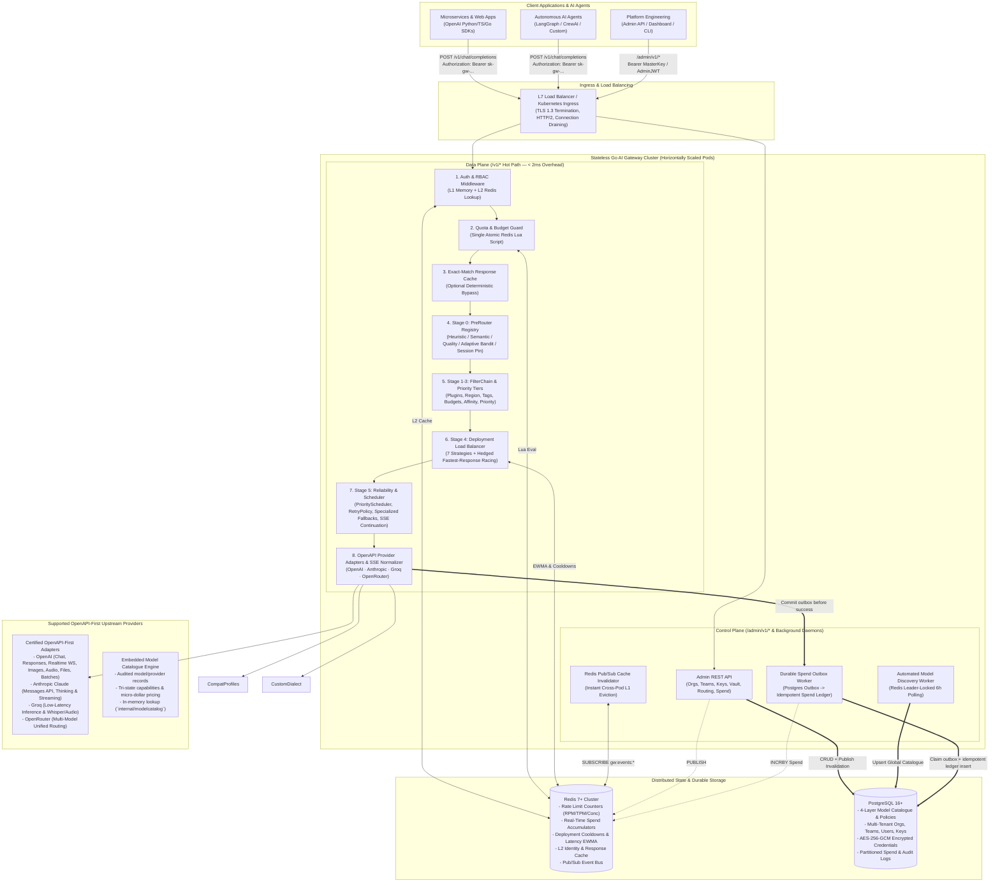
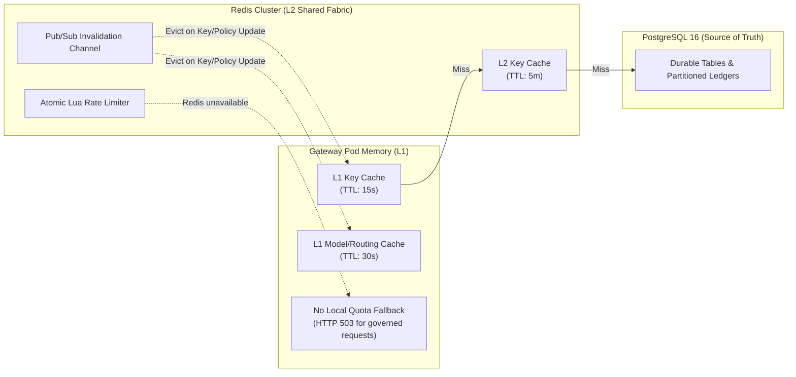
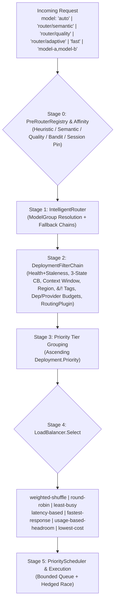
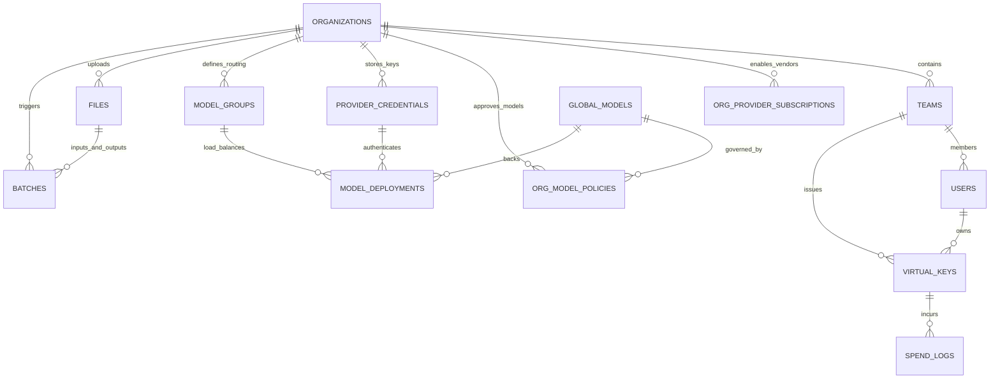
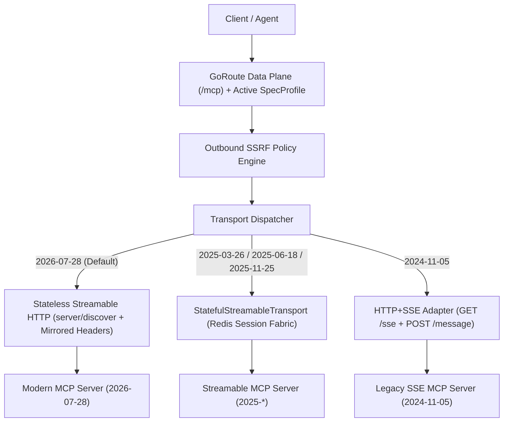
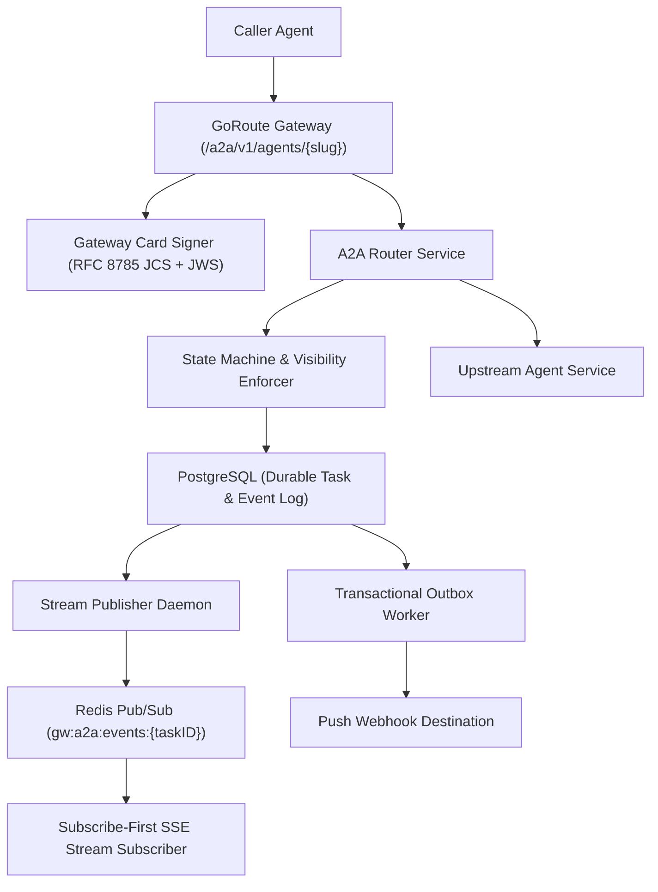

# Enterprise AI Gateway (Pure Go) — Complete High-Level & Low-Level Architecture Specification

> **Document Status**: Production Reference Architecture (`v0.1.0`)  
> **Target Runtime**: Go version declared in `go.mod` (`net/http` + `go-chi/chi/v5`), PostgreSQL 16+, Redis 7+  
> **Provider Integrations**: OpenAPI-first adapters under `internal/adapter/` (`openai`, `anthropic`, `groq`, `openrouter`); consult those packages for exact wire translation.  
> **Contract Architecture**: Gateway and provider OpenAPI contracts are maintained under `docs/openapi/`. `make specgen` regenerates gateway/provider DTOs and multi-release MCP types (`cmd/mcpgen`), validates all contracts, and checks `/v1`, `/admin/v1`, `/auth`, and provider alias route parity (`127` OpenAPI paths). A2A protobuf generation is documented in `docs/specs/a2a/v1.0/generate.go`.

---

## Table of Contents

1. [Executive Summary & Architectural Vision](#1-executive-summary--architectural-vision)
2. [High-Level System Design (HLD)](#2-high-level-system-design-hld)
   - [2.1 Enterprise AI Control Plane & Multi-Protocol Architecture](#21-enterprise-ai-control-plane--multi-protocol-architecture)
   - [2.2 Data Plane vs. Control Plane Topology](#22-data-plane-vs-control-plane-topology)
   - [2.3 End-to-End Request Lifecycle (Synchronous vs. Asynchronous Paths)](#23-end-to-end-request-lifecycle-synchronous-vs-asynchronous-paths)
   - [2.4 Horizontal Scalability, Caching Hierarchy & Fault Tolerance](#24-horizontal-scalability-caching-hierarchy--fault-tolerance)
3. [Low-Level Design (LLD) — Component-by-Component Engineering](#3-low-level-design-lld--component-by-component-engineering)
   - [3.1 Component 1: OpenAPI Specification & Provider Adapter Engine](#31-component-1-openapi-specification--provider-adapter-engine)
   - [3.2 Component 2: 4-Layer Model Management & Automated Discovery Service](#32-component-2-4-layer-model-management--automated-discovery-service)
   - [3.3 Component 3: 6-Stage Routing Engine (PreRouter, FilterChain, Tiers & Load Balancer)](#33-component-3-6-stage-routing-engine-prerouter-filterchain-tiers--load-balancer)
   - [3.4 Component 4: Reliability Manager (Retries, Priority Tiers, Fallbacks & Mid-Stream Continuation)](#34-component-4-reliability-manager-retries-priority-tiers-fallbacks--mid-stream-continuation)
   - [3.5 Component 5: Dual-Boundary Authentication, Identity, RBAC & Credential Vault](#35-component-5-dual-boundary-authentication-identity-rbac--credential-vault)
   - [3.6 Component 6: Distributed Rate Limiting & Quota Engine (Redis Lua)](#36-component-6-distributed-rate-limiting--quota-engine-redis-lua)
   - [3.7 Component 7: FinOps Cost Calculation & Durable Spend Pipeline](#37-component-7-finops-cost-calculation--durable-spend-pipeline)
   - [3.8 Component 8: Exact-Match Response Caching](#38-component-8-exact-match-response-caching)
   - [3.9 Component 9: Embedded Operator Web UI & Streaming Chat Playground](#39-component-9-embedded-operator-web-ui--streaming-chat-playground)
4. [Storage Architecture: PostgreSQL Schema & Redis Keyspace](#4-storage-architecture-postgresql-schema--redis-keyspace)
   - [4.1 Entity-Relationship Diagram](#41-entity-relationship-diagram)
   - [4.2 PostgreSQL Table Definitions](#42-postgresql-table-definitions)
   - [4.3 Redis Keyspace & TTL Matrix](#43-redis-keyspace--ttl-matrix)
5. [Model Context Protocol (MCP Multi-Release Spec-Generated Engine)](#5-model-context-protocol-mcp-multi-release-spec-generated-engine)
6. [Agent-to-Agent Protocol (A2A v1.0) Service Engine](#6-agent-to-agent-protocol-a2a-v10-service-engine)
7. [Codebase Structure & Operational Runbook](#7-codebase-structure--operational-runbook)

---

## 1. Executive Summary & Architectural Vision

Modern production AI systems interact with multiple frontier and high-throughput LLM providers (`OpenAI`, `Anthropic`, `Groq`, and `OpenRouter`). Directly coupling client applications to individual provider SDKs creates severe operational bottlenecks:
- **Fragmented APIs**: Divergent request schemas, tool-calling formats, system prompt conventions, and streaming wire protocols (SSE vs. NDJSON).
- **Reliability Risks**: Single-provider outages, regional `429 Too Many Requests` rate limits, and `529 Overloaded` errors directly impact end users without automated multi-region retries and cross-provider fallback chains.
- **Security & Governance Gaps**: Distributing raw OpenAI or Anthropic master API keys across dozens of microservices makes rotation, revocation, and per-service model access control impossible.
- **Uncontrolled AI Spend**: Lack of real-time token accounting, per-team/per-key budgets, and pre-request quota enforcement leads to runaway cloud bills.

The design aims for low-overhead routing, resilient streaming, typed contracts, and single-binary deployment. Treat this document as architectural intent; use the current code and [codebase map](./CODEBASE_MAP.md) to confirm runtime behavior.

This gateway implements the complete **Tier-1 Enterprise AI Gateway stack in pure Go**, combining:
1. **OpenAPI-First Foundation (in progress)**: Gateway and selected provider/protocol contracts live under `docs/openapi/`. The gateway contract generates DTOs and standard-library/strict server interfaces through pinned `oapi-codegen` v2.8.0. `GatewayServer` still registers chi routes by hand and does not yet implement or register the generated interface for all operations. `cmd/specgen` validates the remaining documents and verifies that generated A2A code exists.
2. **Low-Overhead Data Plane**: Redis and in-memory caches keep policy lookups fast. Spend accounting synchronously commits a compact event to a PostgreSQL outbox before the gateway reports success; a background worker delivers each event idempotently to the spend ledger.

---

## 2. High-Level System Design (HLD)

### 2.1 Enterprise AI Control Plane & Multi-Protocol Architecture

The gateway is structured as a cohesive **Enterprise AI Control Plane** maintaining a central policy, identity, and shared execution layer surrounded by thin protocol adapters:

```
             MCP Clients       OpenAI Clients       A2A Clients
                  │                  │                   │
                  ▼                  ▼                   ▼
             MCP Adapter       OpenAI Adapter       A2A Adapter
           (JSON-RPC / REST)  (Inference/Bridge)    (HTTP/gRPC)
                  │                  │                   │
                  └──────────────────┼───────────────────┘
                                     │
                                     ▼
                        [Unified Gateway Core Engine]
                  ┌──────────────────┬──────────────────┐
                  │ Identity Context │ RBAC & Guardrails│
                  │ Rate Limiters    │ FinOps Ledger    │
                  └──────────────────┴──────────────────┘
                                     │
                                     ▼
                          [Shared Execution Layer]
                  ┌──────────────────┬──────────────────┐
                  │ Inference Router │ MCP Hub Engine   │
                  │ (Reliability)    │ (List/Call Tools)│
                  │ A2A Router Svc   │ Tool Loop Engine │
                  └──────────────────┴──────────────────┘
                                     │
                                     ▼
                        [Upstream Transport Layer]
                  ┌──────────────────┬──────────────────┐
                  │ Streamable HTTP  │ AWS SigV4 Signer │
                  │ OpenAPI Adapter  │ Enterprise OAuth │
                  │ gRPC Client      │ Stdio Sandbox    │
                  └──────────────────┴──────────────────┘
```

The gateway is partitioned into nine foundational subsystems:

| Subsystem | Core Responsibilities | Primary Go Packages |
| :--- | :--- | :--- |
| **1. AI Traffic Gateway** | Unified OpenAI-compatible API (`127` OpenAPI paths: `27` `/v1`, `88` `/admin/v1`, `8` `/auth`, `4` provider aliases, plus `/scim/v2/*`), 6-stage intelligent pre-routing & modality routing (`PreRouter`, `DeploymentFilterChain`, `Deployment.Priority` tiers, 7 LB strategies, hedged racing, `PriorityScheduler`, PTU priority capacity), retries, specialized fallbacks, mid-stream SSE continuation & translation, and uniform `X-RateLimit-*` headers. | `internal/server`, `internal/router`, `internal/adapter`, `internal/openapi` |
| **2. AI Governance & Security** | Dual-boundary authentication, Virtual API Keys (`sk-gw-...` + grace-period rotation + `KeySecretSink`), Multi-tenant RBAC (Org $\rightarrow$ Team $\rightarrow$ Project $\rightarrow$ User $\rightarrow$ Key with `team_member_permissions` and self-service enforcement), `(org_id, oidc_issuer, oidc_subject)` federated OIDC/SSO/CLI login with PKCE `S256`, SCIM v2 provisioning, impersonation/delegation, `CustomAuthenticator`, 4-layer model access control, AES-256-GCM credential vault & transactional Master KEK rotation. | `internal/auth`, `internal/modelmgmt`, `pkg/gateway` |
| **3. AI FinOps & Quotas** | Integer micro-dollar precision token cost calculation ($1 = 1,000,000\ \mu\$$), multi-dimensional & per-model quota descriptors, simultaneous multi-window budgets (`hourly`, `daily`, `weekly`, `monthly`, `rolling_24h`, `never`) with atomic PostgreSQL cold recovery, soft budget alerts/throttling, temporary key budget boosts, PTU team shares, and priority classes. | `internal/finops`, `internal/ratelimit`, `internal/router` |
| **4. AI Model Lifecycle Automation** | Scheduled background discovery of new/deprecated models from provider APIs, capability & pricing registry enrichment, tenant subscription filtering. | `internal/modelmgmt` |
| **5. AI Observability & Audit** | W3C distributed trace propagation (`traceparent`/`tracestate`), OpenMetrics Prometheus scraping, structured logs, immutable spend and governance audit ledgers. | `internal/observability`, `internal/finops`, `internal/server` |
| **6. MCP Hub & Tool Registry** | Spec-generated 5-release MCP hub (`2024-11-05`–`2026-07-28`, UI-switchable via `PUT /admin/v1/mcp/spec`), Plain REST Bridge (`/mcp-rest/*`), Progressive Tool Discovery (`/v1/goroute/mcp/registry` & 256-bit handles), Governed OpenAPI adapter, Stdio process sandboxing, tool pinning. | `cmd/mcpgen`, `internal/mcp/spec`, `internal/mcp` |
| **7. A2A Protocol Engine** | Linux Foundation A2A v1.0, Native gRPC Service (`lf.a2a.v1.A2AService`), OpenAI Chat Completions bridge (`model: "a2a/{slug}"`), JCS/JWS cryptographic cards, Subscribe-First SSE task streaming, transactional outbox with DLQ. | `internal/a2a` |
| **8. Autonomous Orchestrator & Enterprise Auth** | Server-side recursive tool loop orchestrator with zero double-billing FinOps ledger accounting, `DistributedTokenCache` & opt-in AWS RDS IAM, AWS SigV4 signing, CIMD with S256 PKCE, RFC 9207 & 8707 validation, RFC 8693 token exchange. | `internal/orchestrator`, `internal/auth/upstream`, `internal/storage` |
| **9. Operator Web UI & Playground** | Embedded SPA console at `/ui/` (`internal/ui`, `web`), OIDC SSO & Break-Glass Key sign-in (`LoginView`), CLI device approval (`/ui/cli`, `CLILoginView`), multi-turn streaming chat playground with token & latency telemetry, interactive model catalog & PTU/priority explorer, FinOps & multi-window quota/scope controls (`QuotasTab`, `TempBudgetModal`), 4-tab Guardrails Console, upstream credentials preflight validator, and read-only `ConfigView`. | `internal/ui`, `web` |

---

### 2.2 Data Plane vs. Control Plane Topology



---

### 2.3 End-to-End Request Lifecycle (Synchronous vs. Asynchronous Paths)

#### Synchronous Hot Path (Steps 1–7)
1. **Ingress & Request Normalization**:
   - The HTTP server assigns a unique `X-Gateway-Request-Id` (UUIDv4), initializes request context timeouts, and parses the incoming OpenAI-compatible JSON body into `domain.CanonicalChatRequest`.
2. **Boundary 1 Authentication (`internal/auth`)**:
   - Extracts `Authorization: Bearer sk-gw-...`.
   - Computes `SHA-256(token)` in ~150ns.
   - Queries **L1 In-Memory Cache** (per-pod `sync.Map` with TTL). On miss, queries **L2 Redis** (`gw:auth:key:<hash>`). On miss, queries **PostgreSQL** and populates L2 + L1.
   - Validates that the Virtual Key, its parent Team, and its Organization are `is_active = true` and `expires_at > now()`.
3. **4-Layer RBAC & Model Policy Check (`internal/auth/rbac.go`)**:
   - Verifies that the requested model (or routing alias `auto`/`fast`/`reasoning`) is permitted by:
     1. Virtual Key's `allowed_models` list (if restricted),
     2. Team's `allowed_models` list (if restricted),
     3. Organization's **Layer 3 Model Policy** (`org_model_policies.is_enabled = true`),
     4. Organization's **Layer 2 Provider Subscription** (`org_provider_subscriptions.is_enabled = true`).
   - **Fail-Closed Guarantee**: If repository queries fail due to database timeout or connection errors, GoRoute immediately fails closed with `HTTP 500 auth_repository_error`, preventing unauthorized model access during degraded states.
4. **Pre-Flight Token Estimation & Atomic Rate-Limit / Budget Check (`internal/ratelimit`)**:
   - Computes fast prompt token estimate (`EstimateRequestTokens(req)`).
   - Executes `check_and_increment.lua` on Redis in a **single network round-trip**:
     - Verifies Virtual Key, Team, and Organization accumulated spend is below `max_budget_micros`.
     - Verifies and increments `RPM` (+1), `TPM` (+estimated tokens), and `Concurrent Requests` (+1) across Key, Team, and Org scopes.
   - If any threshold is breached, immediately short-circuits with `HTTP 429 Too Many Requests` (`Retry-After` header + standard OpenAI error payload).
5. **Exact-Match Response Cache Lookup (`internal/cache`)**:
   - For deterministic requests (`temperature == 0` or `X-Gateway-Cache-Control: enabled`) and non-streaming calls, computes a canonical SHA-256 cache key over the organization and the complete canonical request, excluding per-call `RequestID` and non-cacheable `Stream`. Unencodable requests bypass the cache.
   - On cache hit, returns the cached `CanonicalChatResponse` immediately (`X-Gateway-Cache: HIT`) with zero upstream cost.
   - L1 and Redis entries carry global, organization, and model epochs. Each hit validates those epochs against shared Redis state; Redis errors and epoch mismatches become cache misses. Invalidation atomically increments shared epochs, so stale L1 values on other replicas are rejected on their next lookup without relying on Pub/Sub delivery.
6. **6-Stage Model Routing & Candidate Filtering (`internal/router`)**:
   - **Stage 0 (PreRouterRegistry)**: Resolves virtual aliases (`auto`, `router/heuristic`, `router/semantic`, `router/quality`, `router/adaptive`, or custom `PreRouter` hooks) and session affinity pins (`AffinityStore`). Also supports comma-separated hedged racing (`model-a,model-b`) and dynamic `provider/model` auto-provisioning from the embedded 5,493-record catalogue (`internal/modelcatalog`) if the tenant has an active credential. Fails closed (HTTP 404) on unconfigured explicit models or uncallable providers without custom endpoints.
   - **Stages 1–3 (Group Resolution, Filter Chain & Priority Tiers)**: `DeploymentFilterChain` evaluates `RBACEngine.AuthorizeDeployment` (fail-closed on repo errors), health & staleness (`health_staleness_threshold`), 3-state CB cooldowns, context windows, region, `&`/`!` tag expressions, deployment RPM/TPM/budget caps & provider budgets, affinity hints, and registered `RoutingPlugin` filters. Surviving candidates are grouped by ascending `Deployment.Priority` tier.
   - **Stages 4–5 (Load Balancer & Scheduler)**: Selects the optimal deployment using the configured strategy (`weighted-shuffle`, `round-robin`, `least-busy`, `latency-based`, `fastest-response`, `usage-based-headroom`, or `lowest-cost`), optionally bounded by `PriorityScheduler`. Adaptive signals, affinity pins, and bandit updates use Redis with graceful fallback to process-local observations (`gw_routing_signal_degraded_total` counter + warning log).
7. **Reliability Loop, Specialized Fallbacks & SSE Continuation (`internal/router/reliability.go` + `internal/adapter`)**:
   - Decrypts the deployment's upstream API key from the in-memory/vault cache (`internal/auth/vault.go`) and transforms `CanonicalChatRequest` into the target provider's OpenAPI or protocol schema.
   - Executes the request (or `fastest-response` hedged race):
     - Evaluates per-exception `RetryPolicy` (`rate_limit_retries`, `timeout_retries`, `server_error_retries`, etc.) with full-jitter backoff + `Retry-After` handling, adaptive failure-rate `CooldownPolicy` + lone-deployment safety net, and ascending `Deployment.Priority` tier step-downs (`X-Gateway-Tier-Stepdowns`).
     - If all tiers in the primary `ModelGroup` are exhausted, walks `context_window_fallbacks`, `content_policy_fallbacks`, `fallback_targets` (with per-target `overrides`), `fallback_group_ids`, or `router.default_fallbacks` (`X-Gateway-Fallback-Attempted: true`).
     - If `enable_mid_stream_continuation: true` is active and a plain-text SSE stream breaks mid-response, `StreamContinuationManager` stitches an assistant-prefill continuation (`X-Gateway-Stream-Continued: true`).

#### Post-Processing Path (Steps 8–9)
8. **Quota Reconciliation**:
   - Decrements the in-flight concurrency counter (`DECR gw:rl:conc:<key_id>`).
   - Adjusts the current minute's TPM counter by `(ActualTotalTokens - EstimatedPromptTokens)`.
9. **FinOps Cost Calculation & Durable Outbox (`internal/finops`)**:
   - Computes exact micro-dollar cost from `(PromptTokens, CachedTokens, CompletionTokens, ReasoningTokens)` using the model's pricing rates.
   - Commits each `SpendEvent` to `spend_event_outbox` before the request reports success. A persistence failure is returned to the request handler.
   - Background workers claim outbox rows using `FOR UPDATE SKIP LOCKED`, insert into `spend_logs` idempotently by event ID, and mark rows delivered. Bounded retries use backoff; exhausted rows enter `dead_letter`. Expired processing leases are reclaimed after restart.

---

### 2.4 Horizontal Scalability, Caching Hierarchy & Fault Tolerance



1. **Zero-State Pod Scaling**: Any number of Gateway instances can run concurrently. No sticky sessions are required.
2. **Redis Circuit Breaker (`sony/gobreaker`)**:
   - Every Redis operation is wrapped in a fast timeout (`50ms`) and circuit breaker (trips after 5 consecutive network failures, resets after `10s`).
   - When Redis is unavailable, requests with configured limits fail with HTTP 503. The gateway does not switch to per-process counters because replica-local state cannot preserve tenant-wide limits.
3. **Outbound Connection Pooling**:
   - Each provider adapter uses a dedicated, tuned `*http.Client` with `MaxIdleConns: 1000`, `MaxIdleConnsPerHost: 256`, `IdleConnTimeout: 90s`, and `ForceAttemptHTTP2: true`, avoiding ephemeral port exhaustion and TLS handshake latency under high load.
4. **Multi-Pod Real-Time Cache Invalidation**:
   - When virtual keys or policies are revoked via the control plane, GoRoute broadcasts an `InvalidationEvent` containing `KeyHash`, `KeyID`, and `OrgID` over Redis Pub/Sub (`gw:events:invalidation`).
   - All gateway instances immediately evict the key from their local L1 in-process memory map, guaranteeing instant cluster-wide revocation without polling.

---

## 3. Low-Level Design (LLD) — Component-by-Component Engineering

---

### 3.1 Component 1: OpenAPI Specification & Provider Adapter Engine

#### 3.1.1 Centralized OpenAPI Specification Hub (`docs/openapi/`)
All official upstream and public gateway OpenAPI 3.0 / 3.1 YAML specifications are organized in `docs/openapi/`:

| Specification File | OpenAPI Version | Upstream Vendor | Key Operations Modeled |
| :--- | :--- | :--- | :--- |
| `docs/openapi/gateway.openapi.yaml` | `3.1.0` | **Public Unified Gateway** | `27` `/v1` paths, `88` `/admin/v1` paths, `8` `/auth` paths, `4` provider aliases (`127` total paths, verified via `cmd/specgen`) |
| `docs/openapi/openai.openapi.yaml` | `3.0.0` | **OpenAI** | `createChatCompletion` (`/v1/chat/completions`), `createEmbedding` (`/v1/embeddings`), `listModels` (`/v1/models`) |
| `docs/openapi/anthropic.openapi.yaml` | `3.0.0` | **Anthropic Claude** | `POST /v1/messages` (`MessageRequestBody`, `MessageResponse`), `POST /v1/messages/count_tokens`, `GET /v1/models` |
| `docs/openapi/groq.openapi.yaml` | `3.0.3` | **Groq** | `POST /openai/v1/chat/completions`, `POST /openai/v1/completions`, `POST /openai/v1/audio/*`, `GET /openai/v1/models` |
| `docs/openapi/openrouter.openapi.yaml` | `3.0.3` | **OpenRouter** | `POST /api/v1/chat/completions`, `GET /api/v1/models` |

#### 3.1.2 Build-Time Code Generation (`cmd/specgen`, `cmd/mcpgen` + `go generate`)
Executing `make specgen` generates the gateway types/interfaces from `docs/openapi/gateway.openapi.yaml`, provider DTOs from `docs/openapi/*.openapi.yaml`, and all 5 MCP release packages from `docs/specs/mcp/*/schema.yaml`, then runs `cmd/specgen` to validate all OpenAPI contracts, MCP YAML schemas, and A2A protobuf descriptors. The generated gateway output is:
- `internal/openapi/gateway.gen.go` (generated with pinned `oapi-codegen` v2.8.0)

Checked-in provider wire DTO packages:
- `internal/openapi/providers/openai_types.gen.go`
- `internal/openapi/providers/anthropic_types.gen.go`
- `internal/openapi/providers/groq_types.gen.go`
- `internal/openapi/providers/openrouter_types.gen.go`

Generated DTOs/interfaces do not make the runtime spec-driven by themselves. Runtime route registration, gateway request decoding, and response writing remain handwritten in `internal/server/`; the generated server interface is not yet wired to those handlers. The gateway contract also does not yet cover every registered admin, alias, MCP, or A2A route.

#### 3.1.3 Semantic Translation Deep-Dive

##### A. Anthropic Claude (`anthropic.openapi.yaml` $\leftrightarrow$ Canonical OpenAI Schema)
1. **Authentication & Version Headers**:
   - Injects `x-api-key: <decrypted_key>` and `anthropic-version: 2023-06-01` (as mandated by `AnthropicVersionHeader` in `anthropic.openapi.yaml`).
   - If `reasoning_effort` or thinking budget is requested, injects `thinking: {"type": "enabled", "budget_tokens": N}`.
   - **Thinking Parameter Compatibility**: When thinking is active, Anthropic forbids customized temperatures. The adapter automatically omits `temperature` and `top_p` to avoid upstream 400 rejection.
2. **System Prompt Extraction**:
   - Anthropic `/v1/messages` forbids `role: "system"` inside the `messages` array. The adapter extracts all `system` and `developer` messages from `CanonicalChatRequest.Messages`, concatenates them into Anthropic's top-level `system` field, and ensures strictly alternating `user` / `assistant` roles.
3. **Tool Definitions & Tool Results**:
   - OpenAI `tools[].function.{name, description, parameters}` $\rightarrow$ Anthropic `tools[].{name, description, input_schema}`.
   - Assistant `tool_calls` $\rightarrow$ Anthropic `assistant` message with `content: [{type: "tool_use", id, name, input}]`.
   - **Strict Role Alternation on Tool Results**: OpenAI outputs consecutive `role: "tool"` messages for parallel tool calls. Because Anthropic strictly requires user/assistant turn alternation, the adapter merges consecutive tool results into a single `user` message with multiple `tool_result` content blocks.
4. **Real-Time SSE Event State Machine**:
   - Anthropic emits typed SSE events (`event: message_start`, `event: content_block_start`, `event: content_block_delta`, `event: message_delta`, `event: message_stop`).
   - The adapter parses each event and emits standard OpenAI `chat.completion.chunk` frames:
     - `message_start` $\rightarrow$ captures `message.usage.input_tokens` and emits initial chunk with `delta: {role: "assistant"}`.
     - `content_block_start` (`type == "tool_use"`) $\rightarrow$ emits chunk with `delta.tool_calls[{index, id, type: "function", function: {name: ...}}]`.
     - `content_block_delta` (`text_delta`) $\rightarrow$ emits `delta.content`.
     - `content_block_delta` (`thinking_delta`) $\rightarrow$ emits `delta.reasoning_content`.
     - `content_block_delta` (`input_json_delta`) $\rightarrow$ emits `delta.tool_calls[{index, function: {arguments: partial_json}}]`.
     - `message_delta` $\rightarrow$ captures `usage.output_tokens`, maps `stop_reason` (`end_turn` $\rightarrow$ `stop`, `max_tokens` $\rightarrow$ `length`, `tool_use` $\rightarrow$ `tool_calls`), and emits final chunk + `data: [DONE]\n\n`.

##### B. Groq & OpenRouter (`groq.openapi.yaml` & `openrouter.openapi.yaml` $\leftrightarrow$ Canonical OpenAI Schema)
- **Groq (`internal/adapter/groq`)**: Dispatches OpenAI-compatible chat, legacy completion, audio transcription/translation, and `/openai/v1/models` discovery using `groq_types.gen.go` DTOs and high-speed Bearer auth.
- **OpenRouter (`internal/adapter/openrouter`)**: Dispatches unified multi-model requests via `/api/v1/chat/completions` and `/api/v1/models` using `openrouter_types.gen.go` DTOs, translating `reasoning_effort` hints (`openrouter_reasoning`) and extracting credit/usage metadata.

##### C. OpenAI Reasoning Models (`o1`, `o3`, `o3-mini`)
1. **Developer Role Mapping**:
   - Reasoning models reject `role: "system"`. The adapter automatically normalizes `system` messages into `role: "developer"`.
2. **Completion Token & Sampling Parameter Normalization**:
   - Automatically maps `max_tokens` to `max_completion_tokens`.
   - Strips unsupported sampling parameters (`temperature`, `top_p`) that cause upstream 400 parameter validation errors on reasoning models.

---

### 3.2 Component 2: 4-Layer Model Management & Automated Discovery Service

To serve multi-tenant enterprises cleanly, model governance is architected across **4 orthogonal layers**:

1. **Layer 1 — Global Model Catalogue (`global_models`)**:
   - The master inventory of known models across `openai`, `anthropic`, `groq`, and `openrouter`.
   - Tracks `provider`, `model_name`, `display_name`, `max_input_tokens`, `max_output_tokens`, capabilities (`supports_streaming`, `supports_tools`, `supports_vision`, `supports_reasoning`, `supports_embeddings`), default pricing (`input_cost_micros_per_1m`, `output_cost_micros_per_1m`, `cached_input_cost_micros_per_1m`), and `lifecycle_status` (`discovered`, `active`, `preview`, `deprecated`, `retired`).
2. **Layer 2 — Organization Provider Subscriptions (`org_provider_subscriptions`)**:
   - Defines which LLM vendors an organization is subscribed to (e.g., Org A is subscribed to `openai` and `anthropic`; Org B enables `groq` and `openrouter`).
3. **Layer 3 — Organization Model Availability Policies (`org_model_policies`)**:
   - Even if an organization subscribes to OpenAI and the Global Catalogue discovers a brand-new preview model, that model is **not** exposed to the organization's developers until enabled in `org_model_policies` (or matched by an org auto-approval policy).
   - `GET /v1/models` returns **strictly** the intersection of `Layer 1 (Active) ∩ Layer 2 (Org Subscribed Providers) ∩ Layer 3 (Org Enabled Models) ∩ VirtualKey/Team Allowed Models`.
4. **Layer 4 — Customer Deployments & Model Groups (`model_groups` & `model_deployments`)**:
   - Maps a logical model alias (`gpt-4.1`, `fast`, `reasoning`, `auto`) to one or more concrete provider endpoints, each bound to an encrypted `ProviderCredential`, regional base URL, traffic `weight`, `rpm_capacity`, and `tpm_capacity`.

---

### 3.3 Component 3: 6-Stage Routing Engine (PreRouter, FilterChain, Tiers & Load Balancer)



---

### 3.4 Component 4: Reliability Manager (Retries, Priority Tiers, Fallbacks & Mid-Stream Continuation)

The Reliability Manager wraps deployment execution with five coordinated recovery mechanisms:

1. **Per-Exception `RetryPolicy` & Intra-Tier Retries**:
   - Evaluates per-class retry budgets (`rate_limit_retries`, `timeout_retries`, `server_error_retries`, `auth_error_retries`, `not_found_retries`, `bad_request_retries`, `default_retries`).
   - Uses **Full-Jitter Exponential Backoff** (`sleep = rand(0, min(maxDelay, baseDelay * 2^attempt))`), honoring upstream `Retry-After` headers when present and within `maxDelay`.
2. **Sliding-Window + Failure-Rate Circuit Breaker & Lone-Deployment Safety Net**:
   - Trips a deployment to **Cooldown** (`gw:router:{dep:<dep_id>}:cooldown`) when failures reach `failure_threshold` (`allowed_fails`), on `401`/`403` auth errors, or when 1-minute failure rates (`fails_1m / reqs_1m`) exceed `cooldown_policy.failure_rate_threshold` at or above `min_requests_per_minute`.
   - Enforces a **lone-deployment safety net** so transient non-auth errors on the sole remaining deployment never permanently blackhole all traffic.
3. **Priority Tier Step-Down (`Deployment.Priority`)**:
   - Exhausts all eligible candidates and retries in tier `0` before stepping to tier `1`, `2`, etc., recording `X-Gateway-Tier-Stepdowns` and `X-Gateway-Route-Reason: priority_tier_stepdown`.
4. **Specialized & Cross-Provider Fallback Chains (`fallback_chains.go`)**:
   - Routes `context_length_exceeded` errors through `context_window_fallbacks`, content/safety blocks through `content_policy_fallbacks`, and remaining errors through `fallback_targets` (supporting per-target parameter `overrides`), `fallback_group_ids`, or global `router.default_fallbacks`, setting `X-Gateway-Fallback-Attempted: true`.
5. **Mid-Stream SSE Continuation (`stream_continuation.go`)**:
   - When `enable_mid_stream_continuation: true` is active and a plain-text SSE stream disconnects after emitting tokens, `StreamContinuationManager` re-routes with accumulated assistant prefill and adjusted `max_tokens`, emitting `X-Gateway-Stream-Continued: true`.

---

### 3.5 Component 5: Dual-Boundary Authentication, Identity, RBAC & Credential Vault

#### Boundary 1: Client $\rightarrow$ Gateway Authentication & Enterprise Identity
- **Virtual API Keys (`sk-gw-<8char_id>-<36char_secret>`)**:
  - Generated using `crypto/rand`; only `SHA-256(full_key)` is persisted (`virtual_keys.key_hash`) and compared via `crypto/subtle.ConstantTimeCompare`.
  - **Multi-Source Extraction & Grace Rotation**: Extracts keys consistently across `Authorization: Bearer`, `x-api-key`, `api-key`, `x-goog-api-key`, or `auth.custom_api_key_header`, rejecting contradictory multi-header credentials. Scheduled or manual rotations record prior hashes in `virtual_key_deprecated_hashes` and emit `X-Gateway-Key-Deprecated` / `X-Gateway-Key-Revoke-At` headers during grace.
- **Federated OIDC & Token Introspection**:
  - Multi-issuer asymmetric OIDC/JWT verification (`RS256`–`PS512`, `ES256`–`ES512`, `EdDSA`; `auth.oidc_issuers[]`, `auth.enable_data_plane_jwt`) binds subjects explicitly via `(org_id, oidc_issuer, oidc_subject)` (`0034`), supports explicit claim-to-key mappings (`jwt_key_mappings`) and ABAC rules (`access_group_rules`), and prevents implicit cross-issuer email account linking.
  - Supports RFC 7662 token introspection / OIDC UserInfo (`auth.introspection` with lazy OIDC Discovery endpoint resolution), SCIM 2.0 `/scim/v2/*` provisioning with single-transaction tenant-scoped group updates, and service-key impersonation/delegation (`X-Gateway-Impersonate-*`, `X-Gateway-Delegated-*`).
- **Operator OIDC SSO Sessions & Embedded SDK Auth**:
  - Browser & CLI sign-in (`/auth/sso/*`, `/auth/cli/*`) enforces OpenID Connect PKCE `S256`, `nonce`, and `at_hash` verification, issues signed `goroute_session` cookies (`operator_sessions`) with CSRF protection (`X-CSRF-Token`), and supports RP-Initiated Logout (`end_session_url`) alongside `GATEWAY_MASTER_ADMIN_KEY` break-glass access.
  - Embedded SDK callers can install `gateway.WithCustomAuthenticator` (`CustomAuthModeOff`/`On`/`Auto`, `AuthDecision`, `RunPostChecks`).

#### Boundary 2: Gateway $\rightarrow$ Provider Credential Vault (`internal/auth/vault.go`) & Cloud IAM
- Upstream API keys (`sk-proj-...`, `sk-ant-...`, `gsk_...`, `sk-or-...`) are never stored in plaintext in PostgreSQL.
- **Envelope Encryption Scheme**:
  1. Generate a fresh 256-bit **Data Encryption Key (DEK)** via `crypto/rand`.
  2. Encrypt the raw provider API key with the DEK using **AES-256-GCM** (`nonce_data` + `ciphertext_data`).
  3. Encrypt the DEK itself with the gateway's 256-bit **Master Key Encryption Key (KEK)** using **AES-256-GCM** (`nonce_dek` + `ciphertext_dek`).
  4. Zero out the plaintext DEK in memory after encryption.
- **Cloud IAM & `DistributedTokenCache`**: Opt-in `storage.rds_iam` and `auth.allow_ambient_cloud_iam` resolve short-lived PostgreSQL AWS RDS IAM credentials, while `internal/auth/upstream.DistributedTokenCache` (`gw:upstream_token:*`) coalesces and shares upstream OAuth2 and token-exchange credentials across replicas.

---

### 3.6 Component 6: Distributed Rate Limiting & Quota Engine (Redis Lua)

Rate limiting and spend budgets are enforced atomically across **Virtual Key**, **Team**, **User**, **Organization**, **End User**, **Tag**, **Model Access Group**, and **Agent Session** descriptors (including per-model patterns via `quota_policies`) for:
- **RPM, TPM, ITPM, OTPM, TPD**, **Max Concurrent In-Flight Requests**, and **Session Iteration Caps**
- **Hierarchical Hard Budgets, Temporary Increases & Multi-Window Budgets (`hourly`, `daily`, `weekly`, `monthly`, `rolling_24h`, `never`)**
- **Soft Budget Webhooks, Throttling & Model Fallbacks** (`finops.soft_budget_*`, `X-Gateway-Budget-Throttled`, `X-Gateway-Budget-Fallback`, `X-Gateway-Original-Model`) and **PTU / Priority Capacity Sharing** (`deployment_ptu_shares`, `priority_classes`)

All descriptor checks execute inside `internal/ratelimit/scripts/check_descriptors.lua` (with `check_and_increment.lua` for fast-path checks and `reconcile_descriptors.lua` / `renew_descriptors.lua` for post-call settlement and streaming reservation leases) in a **single atomic Redis `EVALSHA` call**, guaranteeing zero race conditions across concurrent gateway pods.

#### Rolling 24-Hour Window Cold Recovery Boundary
- **`rolling_24h` Windows**: Unlike periodic `daily`, `weekly`, and `monthly` limits, `rolling_24h` spend entries expire individually 24 hours (`86,400,000 ms`) after each settled spend timestamp in `gw:dq:{org:<org_id>}:r24h:<entity>` rather than resetting on `window_reset_at`.
- **Atomic Cold Recovery & Missing-Set Detection**: `check_descriptors.lua` stores a `rolling_initialized` marker (`"__init__:0"`) directly inside `r24h_zset` (rather than a separate key) so evicting or deleting the spend sorted set automatically triggers a cold reload instead of reading an empty set as zero spend. On cold/missing state, `AcquireDescriptors` loads timestamped spend from PostgreSQL `spend_logs` (plus any unexpired migration `rolling_hold_micros`) and initializes Redis atomically with admission (`ROLLING_WINDOW_COLD` handshake), keeping concurrent replica initialization idempotent and counting surviving in-flight reservations separately from settled spend. If the repository cannot load history, admission fails closed with `503 quota_policy_unavailable`.
- **Recovery Boundary**: PostgreSQL restores persisted spend after complete Redis state loss; in-flight reservations and settlements that existed only in Redis cannot be reconstructed from that PostgreSQL history.

---

### 3.7 Component 7: FinOps Cost Calculation & Durable Spend Pipeline

- **Micro-Dollar Ledger Arithmetic (`int64`)**:
  - $1.00 USD = `1,000,000` micro-dollars (`1 µ$ = $10^{-6}`).
  - Pricing rates in `global_models` are stored as micro-dollars per 1,000,000 tokens (which numerically equals **nano-dollars per token**, or **$USD per 1M tokens $\times 1,000,000$**).
  - Example: If GPT-4.1 input costs $\$2.00$ per 1M tokens (`2,000,000` micros/1M) and output costs $\$8.00$ per 1M tokens (`8,000,000` micros/1M), then a call with `1,500` prompt tokens and `500` completion tokens costs:
    $$\text{Cost}_{\mu\$} = \left\lceil \frac{1500 \times 2{,}000{,}000 + 500 \times 8{,}000{,}000}{1{,}000{,}000} \right\rceil = 3 + 4 = 7\ \mu\$\ (\$0.000007)$$
- **Durable Outbox Worker (`internal/finops/spend_worker.go`)**:
  - Commits each event to `spend_event_outbox` before success. The worker claims batches, retries failed ledger writes with bounded backoff, and acknowledges delivery only after a successful ledger write.
  - Stable event IDs and `ON CONFLICT DO NOTHING` make replay safe if the process crashes between ledger insertion and outbox acknowledgment.
  - Processing rows carry a lease and are reclaimed after expiry. After 12 failed delivery attempts, a row moves to `dead_letter` for operator inspection.

---

### 3.8 Component 8: Exact-Match Response Caching

- Enabled when `request.Temperature == 0` (or explicitly requested via header `X-Gateway-Cache-Control: enabled`) on non-streaming requests.
- Computes deterministic hash `SHA-256(org_id + model + canonical_json(messages, tools, tool_choice, response_format, max_tokens, stop))`.
- Stores serialized `CanonicalChatResponse` in L1 memory + Redis (`gw:cache:resp:<sha256>`) with configurable TTL (default `1 hour`).

---

### 3.9 Component 9: Embedded Operator Web UI & Streaming Chat Playground

The gateway embeds a modern, single-page application (SPA) operator console directly into the compiled Go binary, mounted at `/ui/`:

```
                    Browser Client (http://localhost:8080/ui/)
                                      │
                                      ▼
                        [Chi Router: RegisterRoutes]
                                      │
                   ┌──────────────────┴──────────────────┐
                   ▼                                     ▼
        Path: /ui/assets/*                       Path: /ui/* (SPA route)
   Cache-Control: immutable, 1yr             HTML5 History API Fallback
                   │                                     │
                   └──────────────────┬──────────────────┘
                                      │
                                      ▼
                       [internal/ui: embed.FS (dist/)]
                                      │
         ┌────────────┬───────────────┼───────────────┬────────────┐
         ▼            ▼               ▼               ▼            ▼
     Overview    Playground        Catalogue      Guardrails  Credentials
    (Vitals)   (Streaming SSE)  (Models/Pricing)  (Simulator)   (Vault)
```

#### Core Design & Operational Principles:
1. **Single-Binary Zero-Dependency Embedding**:
   - The React 18 + TypeScript + Vite frontend in `web/` uses route-based `React.lazy` + `Suspense` code splitting, compiled into static assets and synchronized to `internal/ui/dist/`.
   - Go's `embed.FS` embeds all assets directly into the Go executable (`//go:embed all:dist`).
   - The gateway serves the full UI from memory without requiring Node.js, npm, or external CDN dependencies at runtime.
2. **Deterministic Caching & Client-Side Routing**:
   - Assets in `/ui/assets/` carry content hashes and are served with `Cache-Control: public, max-age=31536000, immutable`. Directory paths (e.g., `/ui/assets/`) return `404 Not Found` instead of directory listings.
   - Dynamic client-side routes (e.g. `/ui/playground`, `/ui/organizations`, `/ui/models`, `/ui/guardrails`) fall back to `index.html` with `Cache-Control: no-cache` using HTML5 History API semantics (`window.location.pathname` + `history.pushState`), enabling deep-linking and browser navigation.
3. **Frontend Bundle Budget Enforcement**:
   - Strict size constraints are enforced by `web/scripts/check-budget.mjs` during `make ui-build`.
   - Total uncompressed bundle size is constrained to `<= 700 KB` (gzipped `<= 185 KB`, CSS `<= 35 KB` / `<= 8 KB` gzipped, single JS chunk `<= 150 KB` / `<= 45 KB` gzipped), preventing binary bloat and keeping memory consumption compact inside the host process.
4. **Reproducible Container Builds**:
   - The production container (`deployments/Dockerfile`) builds solely via `golang:alpine`. Compiled frontend assets are checked into `internal/ui/dist/`, eliminating Node.js toolchains from Docker builds and reducing build times from minutes to seconds.
5. **Interactive Operator Capabilities**:
   - **Streaming Chat Playground**: Real-time Server-Sent Events (SSE) streaming with multi-turn history, parameter tuning (temperature, max tokens), system instructions, escaped code export, and live token, cost (`costMicros`), guardrail action, and latency telemetry.
   - **Organizations, Teams, Users & Policies**: Multi-tenant management for organizations, teams, users, micro-dollar budgets, provider subscriptions, and org model allow/block policies.
   - **Live Model Catalogue & Routing**: Filterable directory of AI models across OpenAI, Anthropic, Groq, and OpenRouter, showing real-time capability tags, context window sizes, input/output micro-dollar pricing, model groups, and deployment attachment.
   - **Guardrails Console & Simulator**: Configure baseline PII/secret/toxicity policies, manage the 15-driver registry and hierarchical bindings, define tool trust policies, simulate requests via `/guardrails/simulate` and `/v1/guardrails/apply`, and inspect micro-dollar guardrail usage metrics.
   - **Provider Credentials Vault & Preflight Validator**: Form-based credential management with live preflight validation against upstream provider endpoints and key rotation.

---

## 4. Storage Architecture: PostgreSQL Schema & Redis Keyspace

### 4.1 Entity-Relationship Diagram



### 4.2 PostgreSQL Table Definitions

The persistent relational schema is managed through ordered SQL migrations (`migrations/0001` through `0041`). Rollback of `0034` (`0034_auth_quota_reconciliation.down.sql`) runs inside a transaction with `LOCK TABLE users IN SHARE ROW EXCLUSIVE MODE` and aborts if duplicate nonempty `(org_id, oidc_subject)` bindings exist so operator identity resolution is never corrupted; `0035` (`0035_production_governance_hardening`) adds `teams.team_member_permissions`, `audit_logs.before_value`/`after_value`, and virtual key lifecycle columns; `0036` (`0036_production_routing_hardening`) adds deployment slot/capacity fields (`max_parallel_requests`, `itpm_capacity`, `otpm_capacity`), group saturation/cooldown/param flags, `rpd_limit`, team/key routing affinity bounds, and `sensitive_route_target`; `0037` (`0037_prune_unsupported_providers`) prunes removed legacy provider/rerank/cloud-guardrail rows and drops legacy Azure/rerank columns while seeding default Groq/OpenRouter models; `0038` (`0038_mcp_runtime_spec`) adds the `mcp_runtime_settings` table for UI-selectable MCP specification releases; `0039` (`0039_drop_user_credentials`) drops the legacy local `user_credentials` table in favor of OIDC-only authentication; `0040` (`0040_operator_sessions_oidc_metadata`) adds `provider_id`, `encrypted_id_token`, and `encrypted_id_token_dek` to `operator_sessions` for seamless RP-Initiated Logout (`id_token_hint`); and `0041` (`0041_authorization_parity`) adds group-to-role mappings, authorization parity columns, and audit enhancements.

#### 1. Multi-Tenant Identity, Federation, SSO & RBAC
- **`organizations` & `teams`** (`0001`, `0015`, `0022`, `0023`, `0030`, `0031`): Root tenant and departmental boundaries with integer micro-dollar budgets (`max_budget_micros`, `spent_micros`, `soft_budget_micros`, `budget_duration_seconds`, `budget_reset_at`), RPM/TPM/TPD/concurrency limits, and default fallback models.
- **`team_memberships` & `projects`** (`0027`): Many-to-many user-to-team memberships and project sub-containers (`project_id` FK on `virtual_keys`).
- **`users`** (`0001`, `0013`, `0022`–`0024`, `0028`, `0030`, `0034`): Identity members indexed by `(org_id, oidc_issuer, oidc_subject)` (`0034`), SCIM attributes, impersonation flags, and per-user budgets/limits.
- **`operator_sessions`** (`0033`, `0039`): Durable, revocable control-plane OIDC operator sessions (`csrf_token`, expiration, revocation; legacy `user_credentials` dropped in `0039`).
- **`virtual_keys` & `virtual_key_deprecated_hashes`** (`0001`, `0022`–`0025`, `0027`, `0028`, `0030`, `0031`, `0034`): Client ingress API keys (`sk-gw-...`), temporary budget overrides (`temp_budget_increase_micros`, `temp_budget_expires_at`), key rotation grace schedules & staged replacement envelopes (`0025`/`0034`), soft budgets, and deprecated grace hashes.
- **`jwt_key_mappings` & `access_group_rules`** (`0024`, `0026`): Explicit tenant-scoped `(org_id, issuer, claim_name, claim_value) -> virtual_key_id` bindings and dynamic ABAC model/access-group rules.
- **`org_provider_subscriptions` & `org_model_policies`** (`0001`): Layer 2 vendor enablement and Layer 3 model availability policies per organization.

#### 2. Vault, Routing & Deployments
- **`provider_credentials`** (`0001`, `0037`): AES-256-GCM encrypted provider keys. Columns: `id` (VARCHAR PK), `provider` (VARCHAR), `encrypted_api_key` (TEXT), `base_url` (TEXT), `headers_json` (TEXT), `created_at`, `updated_at`.
- **`model_groups`** (`0001`, `0020`): Virtual model aliases (`fast`, `reasoning`). Columns: `id` (VARCHAR PK), `name` (UNIQUE), `routing_strategy` (VARCHAR), `fallback_group_ids` (TEXT[]), `context_window_fallbacks` (JSONB), `content_policy_fallbacks` (JSONB), `fallback_targets` (JSONB), `retry_policy` (JSONB), `cooldown_policy` (JSONB), timestamps.
- **`model_deployments`** (`0001`, `0021`): Backing physical instances. Columns: `id` (VARCHAR PK), `model_group_id` (FK), `global_model_id` (VARCHAR), `provider_credential_id` (FK), `priority` (INT), `weight` (INT), `region` (VARCHAR), `tags` (TEXT[]), `max_budget_micros` (INT8), `budget_reset_period` (TEXT), `rpm_limit` (INT), `tpm_limit` (INT), `healthy` (BOOL), timestamps.

#### 3. Global Catalogue, Capabilities & Pricing Provenance
- **`global_models`** (`0001`, `0004`, `0005`, `0006`, `0007`, `0021`): Verified model registry including `quality_tier` (`INT`), context windows, tri-state capability references, modality pricing, and lifecycle status.
- **`model_capabilities`** (`0005`): Tri-state capability matrix (`supported`, `unsupported`, `unknown`). Columns: `global_model_id` (FK PK), `supports_streaming`, `supports_tools`, `supports_structured_outputs`, `supports_vision`, `supports_audio_input`, `supports_audio_output`, `supports_reasoning`, timestamps.
- **`model_pricing_history`** (`0005`): Immutable pricing audit revision log. Columns: `id` (VARCHAR PK), `global_model_id` (FK), `version` (INT), `input_cost_micros_per_1m` (INT8), `output_cost_micros_per_1m` (INT8), `cached_input_cost_micros_per_1m` (INT8), `reasoning_cost_micros_per_1m` (INT8), `pricing_status` (VARCHAR), `provenance_source` (VARCHAR), `effective_date` (DATE), `created_at`.
- **`spend_event_outbox`** (`0008`): Durable inference/MCP event queue. Columns: stable `id`, `payload_json`, status (`pending`, `processing`, `delivered`, `dead_letter`), `attempt_count`, `next_attempt_at`, `locked_at`, `last_error`, and timestamps. A successful inference event is committed here before the request returns success.

#### 4. Quotas, Audit, Security & FinOps Ledgers
- **`quota_policies` & `budget_window_limits`** (`0029`, `0030`, `0034`): Per-model & multi-scope quota descriptors and simultaneous multi-window budgets (`hourly`, `daily`, `weekly`, `monthly`, `rolling_24h`, `never`), including `rolling_hold_micros` and `rolling_hold_expires_at` (`0034`) for uninterrupted migration upgrades.
- **`end_users`, `tags`, `model_access_groups`, & `model_access_group_members`** (`0031`): Persisted first-class quota scopes and model access groupings with independent budgets and RPM/TPM/TPD limits.
- **`deployment_ptu_shares` & `priority_classes`** (`0032`): Provisioned Throughput Unit team capacity reservations and priority scheduling weights.
- **`spend_logs`** (`0001`, `0007`, `0031`, `0034`): Append-only inference accounting ledger (`request_id`, `trace_id`, `protocol`, `org_id`, `team_id`, `user_id`, `virtual_key_id`, `end_user_id`, `tags`, `endpoint`, `modality`, `requested_model`, `resolved_model`, `provider`, `deployment_id`, `prompt_tokens`, `completion_tokens`, `cached_prompt_tokens`, `reasoning_tokens`, `cost_micros`, `latency_ms`, `ttft_ms`, `status_code`, `is_stream`, `cache_hit`, `fallback_attempted`, `retry_count`, `created_at`) plus covering `(org_id, created_at)` indexes (`0034`) for fast `rolling_24h` cold recovery.
- **`guardrail_policies`** (`0002`, `0010`, `0016`): Prompt safety baseline policies. Columns: `id` (VARCHAR PK), `org_id` (FK UNIQUE), `mode` (`enforce`, `logging_only`), `scan_all_roles` (BOOL), `enable_prompt_injection` (BOOL), `prompt_injection_action`, `enable_pii_detection` (BOOL), `pii_action`, `enable_secret_detection` (BOOL), `secret_action`, `redact_output_pii` (BOOL), `enable_toxicity_filter` (BOOL), `toxicity_action`, `toxicity_threshold` (`low`, `medium`, `high`), `enabled_content_categories` (TEXT[]), `content_exceptions` (TEXT[]), timestamps.
- **`guardrail_definitions` & `guardrail_bindings`** (`0017`, `0037`): Multi-provider named guardrail registry (15 drivers, Vault-encrypted secrets, `event_hooks`, `stream_scope`, `mode_rule`, `weight`) and hierarchical scope attachments (`team_id`, `virtual_key_id`, `end_user_id`, `model_group_id`, `tag`, `is_locked`).
- **`tool_policies`** (`0018`): Scoped cross-turn tool trust rules (`input_policy`: `blocked|untrusted|trusted`, `output_policy`: `untrusted|trusted`) driving `ToolLoopOrchestrator` taint-chain enforcement.
- **`daily_guardrail_metrics`, `daily_guardrail_usage_units`, & `spend_log_guardrails`** (`0019`): Daily guardrail evaluation/block/redaction/flag/error counts, integer micro-dollar (`cost_micros BIGINT`) usage unit attribution, and spend-log guardrail join records.
- **`audit_logs`** (`0002`): Administrative audit trails. Columns: `id` (VARCHAR PK), `org_id` (VARCHAR), `user_id` (VARCHAR), `action` (VARCHAR), `resource_type` (VARCHAR), `resource_id` (VARCHAR), `details` (JSONB), `created_at`.

#### 5. Protocols, Stateful Assets & Batch Processing
- **`mcp_servers` & `mcp_tools`** (`0003`) & **`mcp_runtime_settings`** (`0038`): MCP Hub registry, per-server protocol/transport definitions, SHA-256 tool digests, and UI-selected Gateway active MCP specification (`active_protocol_version`, `strict_schema_validation`).
- **`a2a_agents`, `a2a_tasks`, `a2a_task_events`, `a2a_outbox`** (`0003`): Durable Agent-to-Agent state machines, task lifecycles, and transactional outbox for reliable webhook delivery.
- **`files`** (`0007`): Stateful multi-tenant file assets. Columns: `id` (VARCHAR PK), `org_id` (VARCHAR), `team_id` (VARCHAR), `user_id` (VARCHAR), `bytes` (INT8), `filename` (VARCHAR), `purpose` (VARCHAR), `status` (VARCHAR), `content_sha256` (VARCHAR), `storage_path` (TEXT), `upstream_id` (VARCHAR), `upstream_provider` (VARCHAR), `expires_at` (TIMESTAMPTZ), `created_at`.
- **`batches`** (`0007`): Asynchronous batch processing jobs. Columns: `id` (VARCHAR PK), `org_id` (VARCHAR), `team_id` (VARCHAR), `input_file_id` (FK), `output_file_id` (VARCHAR), `error_file_id` (VARCHAR), `endpoint` (VARCHAR), `status` (`validating`, `in_progress`, `completed`, `failed`, `cancelled`), `completion_window` (VARCHAR), `request_counts` (JSONB), `metadata` (JSONB), `upstream_id` (VARCHAR), `upstream_provider` (VARCHAR), `created_at`, `completed_at`.

### 4.3 Redis Keyspace & TTL Matrix

`RedisFabric` (`internal/storage/redis.go`) uses `go-redis` `UniversalClient` (`redis.NewUniversalClient`), supporting standalone Redis (`storage.redis_addr`), Redis Cluster (`storage.redis_addrs` with multiple seed nodes or `GATEWAY_REDIS_ADDRS`), and Redis Sentinel (`storage.redis_master_name` or `GATEWAY_REDIS_MASTER_NAME`).

All multi-key Lua scripts use Redis Cluster hash tags so every key touched in an atomic script hashes to the same CRC16 slot:
- Rate-limiting, concurrency, budget reservation, and spend keys share `{org:<OrgID>}` (falling back to `{org:default}` when `OrgID` is empty), aligning all 13 keys in `check_and_increment.lua`, 10 keys in `reconcile.lua`, and 6 keys in `record_spend.lua`.
- Per-deployment circuit-breaker keys share `{dep:<depID>}` (falling back to `{dep:default}` when `depID` is empty), aligning all 3 keys (`:circuit`, `:cooldown`, `:probe`) across `allow_circuit_probe`, `trip_circuit`, `close_circuit`, and `reopen_half_open`.

| Redis Key Pattern | Data Type | TTL | Description |
| :--- | :--- | :--- | :--- |
| `gw:auth:key:v2:{sha256}` | `STRING` (JSON) | `300s` | Cached `VirtualKeyContext` (Key + Team + Org quotas & permissions) |
| `gw:auth:{org_epoch,team_epoch}:{id}` | `STRING` (Int64) | Persistent | Epoch counters invalidating team/org auth caches cleanly on updates |
| `gw:auth:session:{active,revoked}:{jti}` | `STRING` | Session TTL | Active/revoked operator `goroute_session` state |
| `gw:auth:login_throttle:{count,lock}:{hash}` | `STRING` | Window | Password login failure rate limiting & brute-force lockout counters |
| `gw:auth:introspect:{sha256}` | `STRING` (JSON) | Configured | Cached RFC 7662 token introspection / UserInfo verification decisions |
| `gw:sso:state:{state}` & `gw:cli:{login,poll}:{id}` | `STRING` (JSON) | Short TTL | Browser OIDC PKCE/nonce state and CLI device login handshake tokens |
| `gw:rbac:{subs,policies,access_rules}:{org_id}` | `STRING` (JSON) | Cached | Cached tenant provider subscriptions, model policies, and ABAC access rules |
| `gw:lock:key_rotation` & `gw:upstream_token:{hash}` | `STRING` | Lease / TTL | Distributed rotation worker lock and shared Cloud IAM/OAuth2 upstream token cache (`DistributedTokenCache`) |
| `gw:rl:{org:<org_id>}:rpm:{scope}:{id}:{min}` | `STRING` (Int64) | `120s` | Fixed/Sliding minute request counter (`scope` $\in \{\text{key},\text{team},\text{user},\text{org}\}$) |
| `gw:rl:{org:<org_id>}:tpm:{scope}:{id}:{min}` | `STRING` (Int64) | `120s` | Minute token counter (`scope` $\in \{\text{key},\text{team},\text{user},\text{org}\}$) |
| `gw:rl:{org:<org_id>}:conc:{id}` | `STRING` (Int64) | `300s` | Active in-flight concurrent request counter (Key, Team, Org scopes) |
| `gw:spend:{org:<org_id>}:{scope}:{id}` | `STRING` (Int64) | `3600s` | Real-time accumulated spend in micro-dollars |
| `gw:budget:{org:<org_id>}:reservations:{scope}:{id}` | `ZSET` | `3660s` | In-flight budget reservation sorted set |
| `gw:budget:soft_alert:{org:<org_id>}:{scope}:{id}:{period}` | `STRING` | Cooldown | Soft budget webhook deduplication cooldown key |
| `gw:dq:{org:<org_id>}:{rpm,tpm,itpm,otpm,tpd,conc,iter,spend,res}:<entity>` | Mixed | Window/TTL | Descriptor-engine RPM/TPM/ITPM/OTPM/TPD/concurrency/session/budget & reservation state (`check_descriptors.lua`) |
| `gw:dq:{org:<org_id>}:r24h:<entity>` | `ZSET` (ms score) | `90000s` | Trailing 24h settled spend, active migration holds, and `__init__:0` marker (recovered atomically from PostgreSQL on missing/cold state) |
| `gw:budget:{org:<org_id>}:dep:{dep_id}:{period}` | `STRING` (Int64) | Period | Per-deployment spend window counter (`DeploymentBudgetTracker`) |
| `gw:budget:{org:<org_id>}:prov:{provider}:{period}` | `STRING` (Int64) | Period | Per-provider spend window counter (`provider_budgets`) |
| `gw:router:{dep:<dep_id>}:circuit` | `STRING` | `60s` | Circuit breaker state (`open` / `half_open`) |
| `gw:router:{dep:<dep_id>}:cooldown` | `STRING` | `60s` | Cooldown state for an unhealthy deployment |
| `gw:router:{dep:<dep_id>}:probe` | `STRING` | `300s` | Half-open recovery probe lease token |
| `gw:router:{dep:<dep_id>}:failures` | `STRING` (Int64) | `30s` | Sliding window failure counter |
| `gw:router:{dep:<dep_id>}:reqs_1m` / `fails_1m` | `STRING` (Int64) | `60s` | 1-minute rolling request and failure counts for adaptive failure-rate cooldowns |
| `gw:routing:signals:<sha256>` | `HASH` | `600s` | Shared adaptive LB signals (`in_flight`, `used_rpm`, `used_tpm`, `ewma_latency_ms`, `ewma_ttft_ms`) |
| `gw:affinity:{org:<org_id>}:{session,resp,pcache}:*` | `STRING` | `1800s` | Session, Responses API, and prompt-cache deployment affinity pins |
| `gw:router:semantic:{org:<org_id>}:centroids` | `HASH` / `STRING` | Cached | Normalized centroid vectors for `SemanticPreRouter` |
| `gw:router:bandit:{org:<org_id>}:{bucket}` | `HASH` | Persistent | Thompson-sampling Beta posterior state for `BanditPreRouter` |
| `gw:cache:resp:{sha256}` | `STRING` (JSON) | `3600s` | Exact-match cached chat response (plus `gw:cache:{epochs}:*` epoch invalidation) |
| `gw:lock:discovery` | `STRING` (UUID) | `60s` | Distributed mutex for automated model discovery worker |
| `gw:events:invalidation` | `PUBSUB` | — | Broadcast channel for instant L1 cache eviction across pods |
| `gw:mcp25:sess:{sessionID}` | `STRING` (JSON) | `3600s` | MCP 2025 stateful session mapping isolated by principal digest |
| `gw:mcp:mrtr:jti:{jti}` | `STRING` | `300s` | Single-use anti-replay token registry for MRTR resumption |
| `gw:mcp:cache:{bin_hmac}` | `STRING` (JSON) | `300s` | Delimiter-collision-proof binary length-prefixed MCP response cache |
| `gw:a2a:events:{taskID}` | `PUBSUB` | — | Redis Pub/Sub broadcast channel for Subscribe-First task event streams |

---

## 5. Model Context Protocol (MCP Multi-Release Spec-Generated Engine)

### 5.1 Spec-Generated Multi-Release Transport Architecture



1. **Code-Generated Official Schemas (`cmd/mcpgen` -> `internal/mcp/spec`)**: Vendors all 5 official MCP JSON Schemas (`2024-11-05`, `2025-03-26`, `2025-06-18`, `2025-11-25`, `2026-07-28`) and compiles typed Go structs + embedded `jsonschema/v6` validators. Operators switch the active Gateway spec live in the Web UI (`PUT /admin/v1/mcp/spec`), persisted in `mcp_runtime_settings` (`0038`) and broadcast across pods via Redis Pub/Sub.
2. **Modern Default (`2026-07-28`)**: Stateless Streamable HTTP over `POST` with `server/discover`, `subscriptions/listen` SSE, `resultType`/`cacheScope`/`ttlMs`, and mirrored `Mcp-Method`/`Mcp-Name`/`Mcp-Param-*` headers with base64 sentinel framing (`=?base64?...?=`).
3. **Stateful Streamable Transport (`2025-03-26`, `2025-06-18`, `2025-11-25`)**: `StatefulStreamableTransport` manages upstream `initialize` + `Mcp-Session-Id` lifecycles in Redis with caller principal digest isolation, enforces release-specific batching (`2025-03-26` allowed, `2025-06-18+` rejected with `-32600`), and translates upstream 404/410 into `-32025`. Cross-version `Hub` shaping automatically bridges between the active Gateway spec and each server's configured `protocol_version`.
3. **Virtual Hub Aggregation (`POST /mcp`)**: Fan-out discovery across all registered upstream servers. Merges tools, resources, and prompts, attaching `_meta["goroute.ai/server_outcomes"]` detailing success and per-server partial failure status without aborting overall aggregation.
4. **AEAD Model Resumption Tokens (MRTR)**: Encrypts execution resumption tokens using AES-256-GCM authenticated encryption with key rotation (`kid`), caller identity binding, and single-use `jti` anti-replay protection.
5. **Security & Guardrails**:
   - **Anti-Tool-Poisoning Scanner**: Rejects tool schemas containing prompt injections, executable scripts, and Unicode bidirectional override Trojans (`\u202E`).
   - **Cryptographic Tool Pinning**: Computes deterministic SHA-256 hashes of tool schemas upon admin synchronization. Blocks execution if upstream tool definitions drift.
   - **Precision Preservation**: Preserves arbitrary decimal precision and IEEE-754 overflow using Go's `big.Rat` and `json.Number`.

---

## 6. Agent-to-Agent Protocol (A2A v1.0) Service Engine

### 6.1 Protocol Architecture & Trust Boundaries



1. **Separated Cryptographic Trust**:
   - Upstream Agent Cards signed by external keys are verified by `UpstreamCardVerifier` against trusted public keys (`ES256`, `RS256`, `EdDSA`).
   - The gateway strips external signatures, rewrites endpoint interfaces to the gateway's namespace (`GET /a2a/v1/agents/{slug}/tasks/{id}:subscribe`), applies RFC 8785 JSON Canonicalization Scheme (JCS), and signs with the Gateway's own Vault/KMS key.
2. **Dual-Binding Engine**:
   - Transparently handles both HTTP+JSON (`application/json`) and JSON-RPC 2.0 dispatch on `POST /a2a/v1/agents/{agentSlug}`.
   - Built on official `lf.a2a.v1` generated code with strict `protojson` unknown-field rejection (`DiscardUnknown: false`).
3. **Stateful Durability & Monotonic Event Sequencing**:
   - Tasks and event logs are durably sequenced in PostgreSQL with atomic sequence increments (`last_event_seq`).
   - Enforces legal state machine transitions (`submitted` -> `working` -> `completed` / `failed` / `canceled`). Terminal states cannot transition.
4. **Subscribe-First SSE Streaming**:
   - Clients subscribing via `GET /tasks/{taskID}:subscribe` subscribe to the Redis Pub/Sub channel FIRST to buffer in-flight events.
   - Historical events are backfilled from persistent PostgreSQL snapshots, deduplicating against buffered live events to guarantee zero message loss or duplicate deliveries across reconnects.
5. **Transactional Outbox & Safety Controls**:
   - Webhook push notifications are committed within the same database transaction as the task event.
   - An asynchronous outbox worker drains pending deliveries (`FOR UPDATE SKIP LOCKED`) with exponential backoff and a dead-letter queue.
   - Immediate administrative kill-switch overrides (`POST /admin/v1/a2a/agents/{id}/kill-switch`) instantly reject callers across all gateway pods with `HTTP 503 agent_killed`.


---

## 7. Codebase Structure & Operational Runbook

### 7.1 Repository Directory Layout
```text
ai-gateway-go/
├── README.md                         # Project overview, Quickstart, Go SDK & Config reference
├── LICENSE                           # Apache-2.0 License
├── CHANGELOG.md                      # Versioned release notes
├── cmd/
│   ├── gateway/main.go               # Main AI Gateway server & background workers entry point
│   ├── goroute/main.go               # Operator & developer CLI (PKCE login, profile/key management, chat)
│   └── specgen/main.go               # Build-time OpenAPI/protocol contract validator
├── pkg/
│   └── gateway/                      # Public Go SDK (gateway.New, gateway.NewClient, Chat, StreamChat, WithCustomAuthenticator, WithCustomAuthorizer)
├── docs/
│   ├── API_REFERENCE.md              # Complete REST, /auth, SCIM v2, MCP, A2A, Admin & Metrics API reference
│   ├── ARCHITECTURE.md               # This HLD & LLD reference architecture
│   ├── INTERNALS.md                  # Subsystem internals, algorithms, and sequence diagrams
│   ├── CONFIGURATION_GUIDE.md        # Comprehensive YAML, Go SDK & environment configuration guide
│   ├── UPGRADING.md                  # Zero-downtime upgrade guide & migration rollback safety runbook
│   ├── TESTING.md                    # Multi-tier verification manual (static/contracts, unit & Postgres/Redis E2E, Chromium UI, prod Docker)
│   ├── openapi/                      # Official OpenAPI 3.0/3.1 YAML contracts (Gateway 127 paths + MCP + A2A + 4 Providers)
│   └── specs/                        # Pinned vendor specifications (MCP 2024-11-05..2026-07-28 & A2A v1.0 protobuf)
├── migrations/
│   └── 0001..0041_*.{up,down}.sql    # Ordered PostgreSQL 16 schema migrations (through 0041_authorization_parity)
├── tests/
│   ├── e2e/                          # End-to-end live PostgreSQL + Redis, federation, SCIM, quota & cluster suites
│   ├── guardrails/                   # Isolated guardrail unit/integration suite
│   ├── prod-docker/                  # Production-like HA Docker OIDC, authz parity & CLI verification suites (Suites 1-10 + 99)
│   └── ui-e2e/                       # Playwright headless Chromium Operator Web UI E2E suite
├── web/                              # React 18 + TypeScript + Vite Operator Console SPA source & bundle budget check
├── internal/
│   ├── config/                       # YAML + Env configuration & declarative model_list parser
│   ├── domain/                       # Canonical structs, identity models, quotas, 4-layer model structures, errors
│   ├── openapi/                      # Generated Go types from OpenAPI specs
│   ├── adapter/                      # OpenAI, Anthropic, Groq, and OpenRouter (OpenAPI-first adapters)
│   ├── auth/                         # Virtual keys, OIDC/SSO, SCIM, rotation, L1/L2 cache, RBAC, Credential Vault & upstream IAM
│   ├── mcp/                          # Multi-release MCP engine (2024-11-05..2026-07-28), spec_profile, MRTR, Cache & Hub
│   ├── a2a/                          # A2A v1.0 engine, Card signer/verifier, RouterService, Streams & Outbox
│   ├── security/                     # Centralized outbound SSRF network policy engine & safe HTTP client
│   ├── guardrails/                   # Two-layer guardrail pipeline, 15 drivers, Starlark custom_code, tool/MCP governance & stream windowing
│   ├── ratelimit/                    # Redis Lua multi-descriptor atomic rate limiter, rolling_24h recovery + tokenizer
│   ├── cache/                        # Exact-match deterministic response cache
│   ├── modelmgmt/                    # 4-Layer model catalogue, org policies & automated discovery worker
│   ├── router/                       # Stage 0–5 Intelligent Router, FilterChain, PTU/Load Balancer, Reliability Manager
│   ├── finops/                       # Micro-dollar cost calculator, soft budgets & durable spend outbox worker
│   ├── storage/                      # PostgreSQL (+ RDS IAM), Redis, and In-Memory unified storage repositories
│   ├── ui/                           # Embedded compiled SPA assets (//go:embed all:dist)
│   └── server/                       # Chi HTTP router (/v1, /auth, /scim/v2, /admin/v1, /mcp, /a2a, /ui) & handlers
├── configs/
│   ├── config.yaml                   # Default gateway configuration
│   └── config.example.yaml           # Annotated production configuration template
├── deployments/
│   ├── Dockerfile                    # Multi-stage distroless container build
│   ├── docker-compose.yml            # Full stack: Gateway + PostgreSQL 16 + Redis 7 + Prometheus
│   ├── docker-compose.test.yml       # Integration test stack
│   ├── helm/goroute/                 # Production Helm chart (Deployment, HPA, PDB, NetworkPolicy, Migration Job)
│   ├── k8s/                          # Raw Kubernetes manifests & Kustomize overlay
│   └── prometheus/prometheus.yml     # Prometheus scrape configuration
├── Makefile                          # Build, codegen, test, UI bundle check, and docker targets
└── go.mod
```
