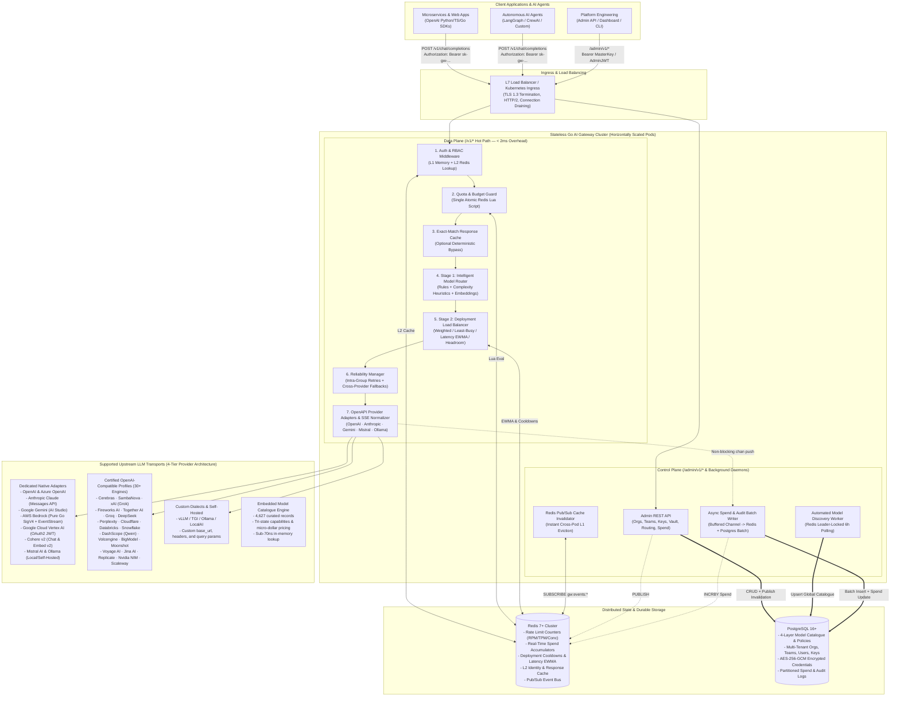
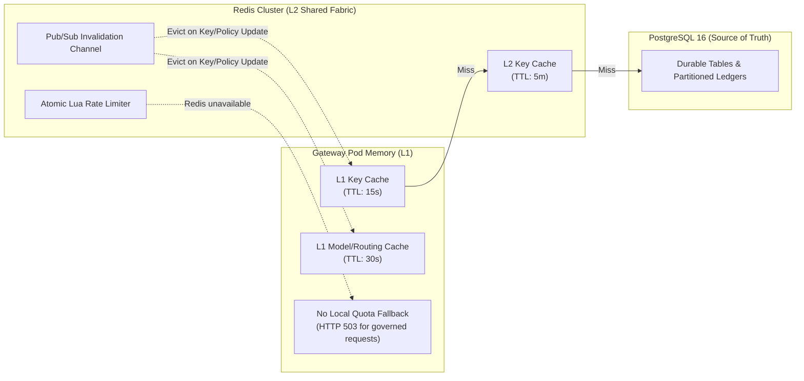
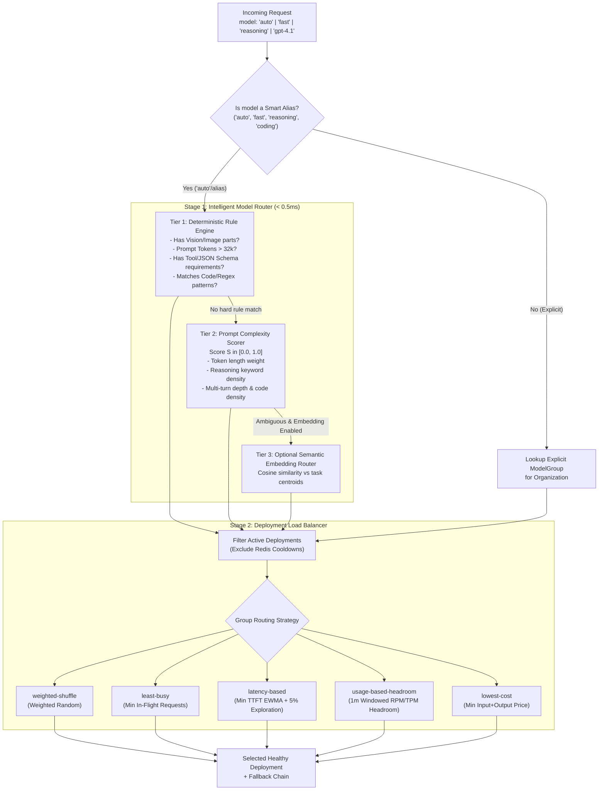
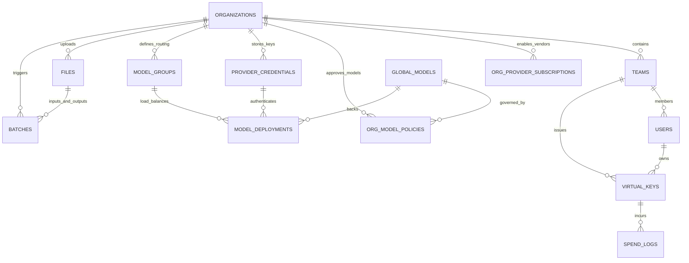
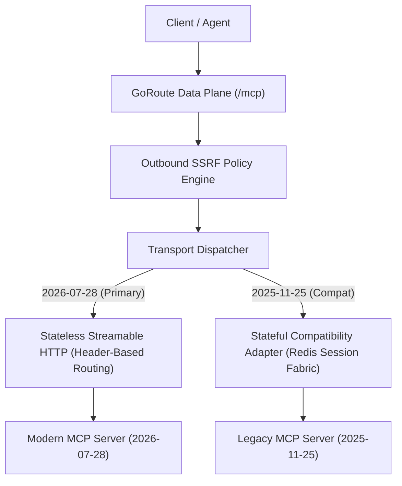
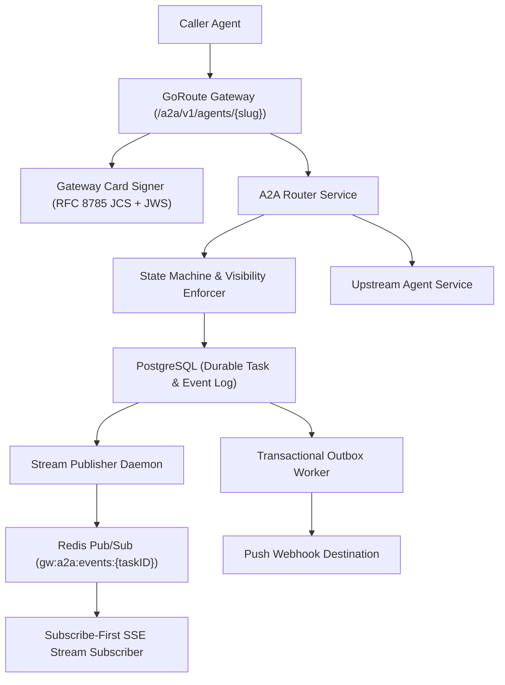

# Enterprise AI Gateway (Pure Go) — Complete High-Level & Low-Level Architecture Specification

> **Document Status**: Production Reference Architecture (v1.0)  
> **Target Runtime**: Go version declared in `go.mod` (`net/http` + `go-chi/chi/v5`), PostgreSQL 16+, Redis 7+  
> **Provider Integrations**: Dedicated adapters and OpenAI-compatible dialect profiles under `internal/adapter/`; consult those packages for the current implementation set.  
> **Contract Architecture**: Gateway and provider OpenAPI contracts are maintained under `docs/openapi/`. `make specgen` regenerates gateway DTOs/interfaces, validates contracts, and checks primary `/v1` route parity. A2A protobuf generation is documented in `docs/specs/a2a/v1.0/generate.go`.

---

## Table of Contents

1. [Executive Summary & Architectural Vision](#1-executive-summary--architectural-vision)
2. [High-Level System Design (HLD)](#2-high-level-system-design-hld)
   - [2.1 Five-Module Enterprise AI Control Plane](#21-five-module-enterprise-ai-control-plane)
   - [2.2 Data Plane vs. Control Plane Topology](#22-data-plane-vs-control-plane-topology)
   - [2.3 End-to-End Request Lifecycle (Synchronous vs. Asynchronous Paths)](#23-end-to-end-request-lifecycle-synchronous-vs-asynchronous-paths)
   - [2.4 Horizontal Scalability, Caching Hierarchy & Fault Tolerance](#24-horizontal-scalability-caching-hierarchy--fault-tolerance)
3. [Low-Level Design (LLD) — Component-by-Component Engineering](#3-low-level-design-lld--component-by-component-engineering)
   - [3.1 Component 1: OpenAPI Specification & Provider Adapter Engine](#31-component-1-openapi-specification--provider-adapter-engine)
   - [3.2 Component 2: 4-Layer Model Management & Automated Discovery Service](#32-component-2-4-layer-model-management--automated-discovery-service)
   - [3.3 Component 3: Two-Stage Routing Engine (Intelligent Router + Load Balancer)](#33-component-3-two-stage-routing-engine-intelligent-router--load-balancer)
   - [3.4 Component 4: Reliability Manager (Retries, Fallbacks & Circuit Breakers)](#34-component-4-reliability-manager-retries-fallbacks--circuit-breakers)
   - [3.5 Component 5: Dual-Boundary Authentication, Identity, RBAC & Credential Vault](#35-component-5-dual-boundary-authentication-identity-rbac--credential-vault)
   - [3.6 Component 6: Distributed Rate Limiting & Quota Engine (Redis Lua)](#36-component-6-distributed-rate-limiting--quota-engine-redis-lua)
   - [3.7 Component 7: FinOps Cost Calculation & Asynchronous Spend Pipeline](#37-component-7-finops-cost-calculation--asynchronous-spend-pipeline)
   - [3.8 Component 8: Exact-Match Response Caching](#38-component-8-exact-match-response-caching)
   - [3.9 Component 9: Embedded Operator Web UI & Streaming Chat Playground](#39-component-9-embedded-operator-web-ui--streaming-chat-playground)
4. [Storage Architecture: PostgreSQL Schema & Redis Keyspace](#4-storage-architecture-postgresql-schema--redis-keyspace)
   - [4.1 Entity-Relationship Diagram](#41-entity-relationship-diagram)
   - [4.2 PostgreSQL Table Definitions](#42-postgresql-table-definitions)
   - [4.3 Redis Keyspace & TTL Matrix](#43-redis-keyspace--ttl-matrix)
5. [Codebase Structure & Operational Runbook](#5-codebase-structure--operational-runbook)

---

## 1. Executive Summary & Architectural Vision

Modern production AI systems interact with multiple frontier and local LLM providers (OpenAI, Anthropic, Google Gemini, Mistral, Ollama). Directly coupling client applications to individual provider SDKs creates severe operational bottlenecks:
- **Fragmented APIs**: Divergent request schemas, tool-calling formats, system prompt conventions, and streaming wire protocols (SSE vs. NDJSON).
- **Reliability Risks**: Single-provider outages, regional `429 Too Many Requests` rate limits, and `529 Overloaded` errors directly impact end users without automated multi-region retries and cross-provider fallback chains.
- **Security & Governance Gaps**: Distributing raw OpenAI or Anthropic master API keys across dozens of microservices makes rotation, revocation, and per-service model access control impossible.
- **Uncontrolled AI Spend**: Lack of real-time token accounting, per-team/per-key budgets, and pre-request quota enforcement leads to runaway cloud bills.

The design aims for low-overhead routing, resilient streaming, typed contracts, and single-binary deployment. Treat this document as architectural intent; use the current code and [codebase map](./CODEBASE_MAP.md) to confirm runtime behavior.

This gateway implements the complete **Tier-1 Enterprise AI Gateway stack in pure Go**, combining:
1. **OpenAPI-First Foundation (in progress)**: Gateway and selected provider/protocol contracts live under `docs/openapi/`. The gateway contract generates DTOs and standard-library/strict server interfaces through pinned `oapi-codegen` v2.8.0. `GatewayServer` still registers chi routes by hand and does not yet implement or register the generated interface for all operations. `cmd/specgen` validates the remaining documents and verifies that generated A2A code exists.
2. **Sub-2ms Hot-Path Data Plane**: Zero synchronous PostgreSQL queries on the inference path using a 2-tier cache (L1 In-Memory + L2 Redis with Pub/Sub invalidation), single-roundtrip Redis Lua rate limiting, and asynchronous batched PostgreSQL `COPY`/`INSERT` spend logging.

---

## 2. High-Level System Design (HLD)

### 2.1 Enterprise AI Control Plane & Multi-Protocol Architecture

The gateway is structured as a cohesive **Enterprise AI Control Plane** maintaining a central policy, identity, and shared execution layer surrounded by thin protocol adapters:

```
             MCP Clients       OpenAI Clients       A2A Clients
                  │                  │                   │
                  ▼                  ▼                   ▼
             MCP Adapter       OpenAI Adapter       A2A Adapter
           (JSON-RPC / REST)  (Inference/Bridge)    (HTTP/gRPC)
                  │                  │                   │
                  └──────────────────┼───────────────────┘
                                     │
                                     ▼
                        [Unified Gateway Core Engine]
                  ┌──────────────────┬──────────────────┐
                  │ Identity Context │ RBAC & Guardrails│
                  │ Rate Limiters    │ FinOps Ledger    │
                  └──────────────────┴──────────────────┘
                                     │
                                     ▼
                          [Shared Execution Layer]
                  ┌──────────────────┬──────────────────┐
                  │ Inference Router │ MCP Hub Engine   │
                  │ (Reliability)    │ (List/Call Tools)│
                  │ A2A Router Svc   │ Tool Loop Engine │
                  └──────────────────┴──────────────────┘
                                     │
                                     ▼
                        [Upstream Transport Layer]
                  ┌──────────────────┬──────────────────┐
                  │ Streamable HTTP  │ AWS SigV4 Signer │
                  │ OpenAPI Adapter  │ Enterprise OAuth │
                  │ gRPC Client      │ Stdio Sandbox    │
                  └──────────────────┴──────────────────┘
```

The gateway is partitioned into nine foundational subsystems:

| Subsystem | Core Responsibilities | Primary Go Packages |
| :--- | :--- | :--- |
| **1. AI Traffic Gateway** | Unified OpenAI-compatible API (23 primary data-plane paths / 26 HTTP operations), two-stage intelligent & modality routing, retries, fallbacks, SSE streaming translation. | `internal/server`, `internal/router`, `internal/adapter`, `internal/openapi` |
| **2. AI Governance & Security** | Dual-boundary authentication, Virtual API Keys (`sk-gw-...`), Multi-tenant RBAC (Org $\rightarrow$ Team $\rightarrow$ User $\rightarrow$ Key), 4-layer model access control, AES-256-GCM provider credential vault. | `internal/auth`, `internal/modelmgmt` |
| **3. AI FinOps & Quotas** | Integer micro-dollar precision token cost calculation ($1 = 1,000,000\ \mu\$$), real-time budget enforcement, hierarchical RPM/TPM rate limiting, automated budget reset schedules. | `internal/finops`, `internal/ratelimit` |
| **4. AI Model Lifecycle Automation** | Scheduled background discovery of new/deprecated models from provider APIs, capability & pricing registry enrichment, tenant subscription filtering. | `internal/modelmgmt` |
| **5. AI Observability & Audit** | W3C distributed trace propagation (`traceparent`/`tracestate`), OpenMetrics Prometheus scraping, structured logs, immutable spend and governance audit ledgers. | `internal/observability`, `internal/finops`, `internal/server` |
| **6. MCP Hub & Tool Registry** | MCP 2026-07-28 stateless hub, 2025/2024 compatibility adapters, Plain REST Bridge (`/mcp-rest/*`), Progressive Tool Discovery (`/v1/goroute/mcp/registry` & 256-bit handles), Governed OpenAPI adapter, Stdio process sandboxing, tool pinning. | `internal/mcp` |
| **7. A2A Protocol Engine** | Linux Foundation A2A v1.0, Native gRPC Service (`lf.a2a.v1.A2AService`), OpenAI Chat Completions bridge (`model: "a2a/{slug}"`), JCS/JWS cryptographic cards, Subscribe-First SSE task streaming, transactional outbox with DLQ. | `internal/a2a` |
| **8. Autonomous Orchestrator & Enterprise Auth** | Server-side recursive tool loop orchestrator with zero double-billing FinOps ledger accounting, AWS SigV4 signing, CIMD with S256 PKCE, RFC 9207 & 8707 validation, RFC 8693 token exchange. | `internal/orchestrator`, `internal/auth/upstream` |
| **9. Operator Web UI & Playground** | Embedded SPA console at `/ui/` (`internal/ui`, `web`), multi-turn streaming chat playground with token & latency telemetry, interactive model catalog browser, guardrails simulator, upstream credentials preflight validator, and FinOps analytics. | `internal/ui`, `web` |

---

### 2.2 Data Plane vs. Control Plane Topology



---

### 2.3 End-to-End Request Lifecycle (Synchronous vs. Asynchronous Paths)

#### Synchronous Hot Path (Steps 1–7)
1. **Ingress & Request Normalization**:
   - The HTTP server assigns a unique `X-Gateway-Request-Id` (UUIDv4), initializes request context timeouts, and parses the incoming OpenAI-compatible JSON body into `domain.CanonicalChatRequest`.
2. **Boundary 1 Authentication (`internal/auth`)**:
   - Extracts `Authorization: Bearer sk-gw-...`.
   - Computes `SHA-256(token)` in ~150ns.
   - Queries **L1 In-Memory Cache** (per-pod `sync.Map` with TTL). On miss, queries **L2 Redis** (`gw:auth:key:<hash>`). On miss, queries **PostgreSQL** and populates L2 + L1.
   - Validates that the Virtual Key, its parent Team, and its Organization are `is_active = true` and `expires_at > now()`.
3. **4-Layer RBAC & Model Policy Check (`internal/auth/rbac.go`)**:
   - Verifies that the requested model (or routing alias `auto`/`fast`/`reasoning`) is permitted by:
     1. Virtual Key's `allowed_models` list (if restricted),
     2. Team's `allowed_models` list (if restricted),
     3. Organization's **Layer 3 Model Policy** (`org_model_policies.is_enabled = true`),
     4. Organization's **Layer 2 Provider Subscription** (`org_provider_subscriptions.is_enabled = true`).
   - **Fail-Closed Guarantee**: If repository queries fail due to database timeout or connection errors, GoRoute immediately fails closed with `HTTP 500 auth_repository_error`, preventing unauthorized model access during degraded states.
4. **Pre-Flight Token Estimation & Atomic Rate-Limit / Budget Check (`internal/ratelimit`)**:
   - Computes fast prompt token estimate (`EstimateRequestTokens(req)`).
   - Executes `check_and_increment.lua` on Redis in a **single network round-trip**:
     - Verifies Virtual Key, Team, and Organization accumulated spend is below `max_budget_micros`.
     - Verifies and increments `RPM` (+1), `TPM` (+estimated tokens), and `Concurrent Requests` (+1) across Key, Team, and Org scopes.
   - If any threshold is breached, immediately short-circuits with `HTTP 429 Too Many Requests` (`Retry-After` header + standard OpenAI error payload).
5. **Exact-Match Response Cache Lookup (`internal/cache`)**:
   - For deterministic requests (`temperature == 0` or `X-Gateway-Cache-Control: enabled`) and non-streaming calls, computes a canonical SHA-256 cache key over `(OrgID, Model, Messages, Tools, Temperature, ResponseFormat)`.
   - L1 and Redis entries carry global, organization, and model epochs. Each hit validates those epochs against shared Redis state; Redis errors and epoch mismatches become cache misses. Invalidation atomically increments shared epochs, so stale L1 values on other replicas are rejected on their next lookup without relying on Pub/Sub delivery.
6. **Two-Stage Model Routing (`internal/router`)**:
   - **Stage 1 (Intelligent Router)**: Resolves virtual aliases (`auto`, `fast`, `reasoning`, `coding`) into a concrete `ModelGroup` using deterministic rules, prompt complexity scoring, or embedding similarity. Also resolves direct `provider/model` requests dynamically by auto-provisioning from the embedded 4,627-record catalogue (`internal/modelcatalog`) if the tenant has an active credential. Fails closed (HTTP 404) on unconfigured explicit models or uncallable providers without custom endpoints.
   - **Stage 2 (Deployment Load Balancer)**: Evaluates healthy deployments using `RBACEngine.AuthorizeDeployment` (fail-closed on repo errors), then selects the optimal deployment (excluding deployments in Redis cooldown) using the configured strategy (`weighted-shuffle`, `least-busy`, `latency-based`, `usage-based-headroom`, or `lowest-cost`).
7. **Reliability Loop & Provider OpenAPI Translation (`internal/router/reliability.go` + `internal/adapter`)**:
   - Decrypts the deployment's upstream API key from the in-memory/vault cache (`internal/auth/vault.go`).
   - Transforms `CanonicalChatRequest` into the target provider's OpenAPI or protocol schema (OpenAI, Anthropic Claude, Google Gemini, AWS Bedrock Converse, GCP Vertex AI, Cohere v2, Mistral, Ollama, or one of 30+ certified OpenAI-compatible profiles).
   - Executes the HTTP request (or opens an SSE stream):
     - On transient upstream failure (`429`, `500`, `502`, `503`, `529`, or dial/headers timeout before the first streamed byte), records the failure in the sliding window counter, triggers a deployment cooldown if the threshold is reached, waits for full-jitter backoff, and **retries another deployment in the same group**.
     - If all healthy deployments in the primary `ModelGroup` are exhausted, walks the configured **`fallback_group_ids` chain** (e.g., failing over seamlessly across providers).

#### Asynchronous Post-Processing Path (Steps 8–9)
8. **Quota Reconciliation**:
   - Decrements the in-flight concurrency counter (`DECR gw:rl:conc:<key_id>`).
   - Adjusts the current minute's TPM counter by `(ActualTotalTokens - EstimatedPromptTokens)`.
9. **FinOps Cost Calculation & Batch Persistence (`internal/finops`)**:
   - Computes exact micro-dollar cost from `(PromptTokens, CachedTokens, CompletionTokens, ReasoningTokens)` using the model's pricing rates.
   - Enqueues a `SpendEvent` onto the non-blocking buffered channel (`spendChan`).
   - Background workers immediately increment Redis spend counters (`INCRBY gw:spend:...`) and flush batched records into PostgreSQL `spend_logs` and entity `spent_micros` columns every 250 events or 500ms.

---

### 2.4 Horizontal Scalability, Caching Hierarchy & Fault Tolerance



1. **Zero-State Pod Scaling**: Any number of Gateway instances can run concurrently. No sticky sessions are required.
2. **Redis Circuit Breaker (`sony/gobreaker`)**:
   - Every Redis operation is wrapped in a fast timeout (`50ms`) and circuit breaker (trips after 5 consecutive network failures, resets after `10s`).
   - When Redis is unavailable, requests with configured limits fail with HTTP 503. The gateway does not switch to per-process counters because replica-local state cannot preserve tenant-wide limits.
3. **Outbound Connection Pooling**:
   - Each provider adapter uses a dedicated, tuned `*http.Client` with `MaxIdleConns: 1000`, `MaxIdleConnsPerHost: 256`, `IdleConnTimeout: 90s`, and `ForceAttemptHTTP2: true`, avoiding ephemeral port exhaustion and TLS handshake latency under high load.
4. **Multi-Pod Real-Time Cache Invalidation**:
   - When virtual keys or policies are revoked via the control plane, GoRoute broadcasts an `InvalidationEvent` containing `KeyHash`, `KeyID`, and `OrgID` over Redis Pub/Sub (`gw:events:invalidation`).
   - All gateway instances immediately evict the key from their local L1 in-process memory map, guaranteeing instant cluster-wide revocation without polling.

---

## 3. Low-Level Design (LLD) — Component-by-Component Engineering

---

### 3.1 Component 1: OpenAPI Specification & Provider Adapter Engine

#### 3.1.1 Centralized OpenAPI Specification Hub (`docs/openapi/`)
All official upstream and public gateway OpenAPI 3.0 / 3.1 YAML specifications are organized in `docs/openapi/`:

| Specification File | OpenAPI Version | Upstream Vendor | Key Operations Modeled |
| :--- | :--- | :--- | :--- |
| `docs/openapi/gateway.openapi.yaml` | `3.1.0` | **Public Unified Gateway** | 23 primary `/v1` paths; selected admin operations (control-plane contract coverage remains incomplete) |
| `docs/openapi/openai.openapi.yaml` | `3.0.0` | **OpenAI** | `createChatCompletion` (`/v1/chat/completions`), `createEmbedding` (`/v1/embeddings`), `listModels` (`/v1/models`) |
| `docs/openapi/anthropic.openapi.yaml` | `3.0.0` | **Anthropic Claude** | `POST /v1/messages` (`MessageRequestBody`, `MessageResponse`), `POST /v1/messages/count_tokens`, `GET /v1/models` |
| `docs/openapi/gemini.openapi.yaml` | `3.0.3` | **Google Gemini** | `GenerateContent` (`/v1beta/models/{model}:generateContent`), `StreamGenerateContent`, `EmbedContent`, `ListModels` |
| `docs/openapi/mistral.openapi.yaml` | `3.1.0` | **Mistral AI** | `chat_completion_v1_chat_completions_post`, `embeddings_v1_embeddings_post`, `list_models_v1_models_get` |
| `docs/openapi/ollama.openapi.yaml` | `3.1.0` | **Ollama** | `POST /api/chat`, `POST /api/embed`, `GET /api/tags` |

#### 3.1.2 Build-Time Code Generation (`cmd/specgen` + `go generate`)
Executing `go generate ./...` generates the gateway types and interfaces from `docs/openapi/gateway.openapi.yaml`, then runs `cmd/specgen` to validate the other selected contracts and check generated A2A code. The generated gateway output is:
- `internal/openapi/gateway.gen.go` (generated with pinned `oapi-codegen` v2.8.0)

Selected provider data structures are checked in under:
- `internal/openapi/providers/openai_types.gen.go`
- `internal/openapi/providers/anthropic_types.gen.go`
- `internal/openapi/providers/gemini_types.gen.go`
- `internal/openapi/providers/mistral_types.gen.go`
- `internal/openapi/providers/ollama_types.gen.go`

Generated DTOs/interfaces do not make the runtime spec-driven by themselves. Runtime route registration, gateway request decoding, and response writing remain handwritten in `internal/server/`; the generated server interface is not yet wired to those handlers. The gateway contract also does not yet cover every registered admin, alias, MCP, or A2A route.

#### 3.1.3 Semantic Translation Deep-Dive

##### A. Anthropic Claude (`anthropic_api.yaml` $\leftrightarrow$ Canonical OpenAI Schema)
1. **Authentication & Version Headers**:
   - Injects `x-api-key: <decrypted_key>` and `anthropic-version: 2023-06-01` (as mandated by `AnthropicVersionHeader` in `anthropic_api.yaml`).
   - If `reasoning_effort` or thinking budget is requested, injects `thinking: {"type": "enabled", "budget_tokens": N}`.
   - **Thinking Parameter Compatibility**: When thinking is active, Anthropic forbids customized temperatures. The adapter automatically omits `temperature` and `top_p` to avoid upstream 400 rejection.
2. **System Prompt Extraction**:
   - Anthropic `/v1/messages` forbids `role: "system"` inside the `messages` array. The adapter extracts all `system` and `developer` messages from `CanonicalChatRequest.Messages`, concatenates them into Anthropic's top-level `system` field, and ensures strictly alternating `user` / `assistant` roles.
3. **Tool Definitions & Tool Results**:
   - OpenAI `tools[].function.{name, description, parameters}` $\rightarrow$ Anthropic `tools[].{name, description, input_schema}`.
   - Assistant `tool_calls` $\rightarrow$ Anthropic `assistant` message with `content: [{type: "tool_use", id, name, input}]`.
   - **Strict Role Alternation on Tool Results**: OpenAI outputs consecutive `role: "tool"` messages for parallel tool calls. Because Anthropic strictly requires user/assistant turn alternation, the adapter merges consecutive tool results into a single `user` message with multiple `tool_result` content blocks.
4. **Real-Time SSE Event State Machine**:
   - Anthropic emits typed SSE events (`event: message_start`, `event: content_block_start`, `event: content_block_delta`, `event: message_delta`, `event: message_stop`).
   - The adapter parses each event and emits standard OpenAI `chat.completion.chunk` frames:
     - `message_start` $\rightarrow$ captures `message.usage.input_tokens` and emits initial chunk with `delta: {role: "assistant"}`.
     - `content_block_start` (`type == "tool_use"`) $\rightarrow$ emits chunk with `delta.tool_calls[{index, id, type: "function", function: {name: ...}}]`.
     - `content_block_delta` (`text_delta`) $\rightarrow$ emits `delta.content`.
     - `content_block_delta` (`thinking_delta`) $\rightarrow$ emits `delta.reasoning_content`.
     - `content_block_delta` (`input_json_delta`) $\rightarrow$ emits `delta.tool_calls[{index, function: {arguments: partial_json}}]`.
     - `message_delta` $\rightarrow$ captures `usage.output_tokens`, maps `stop_reason` (`end_turn` $\rightarrow$ `stop`, `max_tokens` $\rightarrow$ `length`, `tool_use` $\rightarrow$ `tool_calls`), and emits final chunk + `data: [DONE]\n\n`.

##### B. Google Gemini (`gemini_api_v1.1.0.yaml` $\leftrightarrow$ Canonical OpenAI Schema)
1. **Endpoint & Auth**:
   - Sync: `POST /v1beta/models/{model}:generateContent` with `x-goog-api-key: <decrypted_key>`.
   - Stream: `POST /v1beta/models/{model}:streamGenerateContent?alt=sse` with `x-goog-api-key: <decrypted_key>`.
   - Tuned HTTP client timeout aligned to **120s** (matching OpenAI/Anthropic/Mistral) to prevent premature cancellation during deep thinking or high-token generation.
2. **Payload Mapping**:
   - `system` messages $\rightarrow$ `systemInstruction: {parts: [{text: "..."}]}`.
   - `user` / `assistant` messages $\rightarrow$ `contents: [{role: "user"|"model", parts: [...]}]`.
   - `Temperature`, `TopP`, `MaxTokens`, `Stop`, `ResponseFormat` $\rightarrow$ `generationConfig: {temperature, topP, maxOutputTokens, stopSequences, responseMimeType, responseSchema}`.
   - OpenAI `tools` $\rightarrow$ `tools: [{functionDeclarations: [...]}]`.
   - Gemini `usageMetadata.{promptTokenCount, candidatesTokenCount, totalTokenCount, thoughtsTokenCount}` $\rightarrow$ `CanonicalChatResponse.Usage`.
3. **Safety Block Interception**:
   - If a prompt triggers Gemini content safety filters, Gemini returns zero candidates with `promptFeedback.blockReason`. The adapter intercepts this condition and translates it into a standard `GatewayError` (`type: "safety_violation"`, `code: "prompt_blocked"`, HTTP 400), preventing downstream client nil-pointer crashes.

##### C. Mistral AI (`mistral_api.yaml` $\leftrightarrow$ Canonical OpenAI Schema)
1. **Endpoint & Parameter Normalization**:
   - Targets `POST /v1/chat/completions`, `POST /v1/embeddings`, and `GET /v1/models`.
   - Translates `MaxTokens` to Mistral's `max_tokens` (`ChatCompletionRequest` in `mistral_api.yaml`), normalizes `safe_prompt`, and maps SSE `data:` chunks to canonical chunks.

##### D. Ollama (`ollama.openapi.yaml` $\leftrightarrow$ Canonical OpenAI Schema)
1. **Wire Protocol Conversion (NDJSON $\rightarrow$ SSE)**:
   - Ollama's native `/api/chat` streams **Newline-Delimited JSON (NDJSON)** where each line is a complete JSON object `{"model":"...","message":{"role":"assistant","content":"..."},"done":false}` followed by a final object with `"done":true,"prompt_eval_count":X,"eval_count":Y`.
   - The Ollama adapter reads the NDJSON stream line-by-line via `bufio.Scanner` (with 2MB buffer) and translates each line in real time into an OpenAI-compatible `chat.completion.chunk` SSE frame (`data: {...}\n\n`), extracting `prompt_eval_count` and `eval_count` from the final frame.

##### E. OpenAI Reasoning Models (`o1`, `o3`, `o3-mini`)
1. **Developer Role Mapping**:
   - Reasoning models reject `role: "system"`. The adapter automatically normalizes `system` messages into `role: "developer"`.
2. **Completion Token & Sampling Parameter Normalization**:
   - Automatically maps `max_tokens` to `max_completion_tokens`.
   - Strips unsupported sampling parameters (`temperature`, `top_p`) that cause upstream 400 parameter validation errors on reasoning models.

---

### 3.2 Component 2: 4-Layer Model Management & Automated Discovery Service

To serve multi-tenant enterprises cleanly, model governance is architected across **4 orthogonal layers**:

1. **Layer 1 — Global Model Catalogue (`global_models`)**:
   - The master inventory of all known models across OpenAI, Anthropic, Gemini, Mistral, and Ollama.
   - Tracks `provider`, `model_name`, `display_name`, `max_input_tokens`, `max_output_tokens`, capabilities (`supports_streaming`, `supports_tools`, `supports_vision`, `supports_reasoning`, `supports_embeddings`), default pricing (`input_cost_micros_per_1m`, `output_cost_micros_per_1m`, `cached_input_cost_micros_per_1m`), and `lifecycle_status` (`discovered`, `active`, `preview`, `deprecated`, `retired`).
2. **Layer 2 — Organization Provider Subscriptions (`org_provider_subscriptions`)**:
   - Defines which LLM vendors an organization is subscribed to (e.g., Org A is subscribed to `openai` and `anthropic`; Org B is subscribed to `gemini`, `mistral`, and `ollama`).
3. **Layer 3 — Organization Model Availability Policies (`org_model_policies`)**:
   - Even if an organization subscribes to OpenAI and the Global Catalogue discovers a brand-new preview model, that model is **not** exposed to the organization's developers until enabled in `org_model_policies` (or matched by an org auto-approval policy).
   - `GET /v1/models` returns **strictly** the intersection of `Layer 1 (Active) ∩ Layer 2 (Org Subscribed Providers) ∩ Layer 3 (Org Enabled Models) ∩ VirtualKey/Team Allowed Models`.
4. **Layer 4 — Customer Deployments & Model Groups (`model_groups` & `model_deployments`)**:
   - Maps a logical model alias (`gpt-4.1`, `fast`, `reasoning`, `auto`) to one or more concrete provider endpoints, each bound to an encrypted `ProviderCredential`, regional base URL, traffic `weight`, `rpm_capacity`, and `tpm_capacity`.

---

### 3.3 Component 3: Two-Stage Routing Engine (Intelligent Router + Load Balancer)



---

### 3.4 Component 4: Reliability Manager (Retries, Fallbacks & Circuit Breakers)

The Reliability Manager wraps Stage 2 deployment execution with three nested safety nets:

1. **Intra-Group Retries (Same Model Group, Alternate Deployment)**:
   - If Deployment A in `prod-gpt-4.1` returns `429`, `500`, `502`, `503`, `529`, or times out before the first streamed token, the Reliability Manager immediately marks a failure sample against Deployment A and selects Deployment B from the **same** `ModelGroup` (so the caller still receives the exact model they requested).
   - Uses **Full-Jitter Exponential Backoff** (`sleep = rand(0, min(maxDelay, baseDelay * 2^attempt))`), honoring upstream `Retry-After` headers when present and within `maxDelay`.
2. **Sliding-Window Circuit Breaker & Distributed Cooldown**:
   - If a deployment accumulates $\ge N$ failures (default `3`) within a sliding window of $W$ seconds (default `30s`), or returns `401`/`403` (invalid upstream API key), the deployment is placed into **Cooldown** (`gw:router:cooldown:<dep_id>`, default `60s`).
   - All gateway pods immediately stop routing traffic to that deployment until the cooldown TTL expires, at which point a single **Half-Open Probe** request tests recovery.
3. **Inter-Group Fallback Chains (Cross-Model / Cross-Provider Failover)**:
   - Every `ModelGroup` defines an ordered `fallback_group_ids` slice (e.g., `gpt-4.1` $\rightarrow$ `claude-sonnet-4` $\rightarrow$ `gemini-2.5-pro`).
   - If all deployments in the primary group fail or are in cooldown, the Reliability Manager automatically re-translates the canonical request for the fallback provider and executes it seamlessly, setting response headers `X-Gateway-Fallback-Attempted: true` and `X-Gateway-Resolved-Model: <fallback_model>`.

---

### 3.5 Component 5: Dual-Boundary Authentication, Identity, RBAC & Credential Vault

#### Boundary 1: Client $\rightarrow$ Gateway Authentication
- **Virtual API Keys (`sk-gw-<8char_id>-<36char_secret>`)**:
  - Generated using `crypto/rand`.
  - Only `SHA-256(full_key)` is persisted in PostgreSQL (`virtual_keys.key_hash`).
  - Constant-time comparison (`crypto/subtle.ConstantTimeCompare`) protects against timing side-channel attacks.
- **Admin Control Plane Authentication**:
  - Supports `Authorization: Bearer <GATEWAY_MASTER_KEY>` or signed Admin JWTs (`HMAC-SHA256` / OIDC).

#### Boundary 2: Gateway $\rightarrow$ Provider Credential Vault (`internal/auth/vault.go`)
- Upstream API keys (`sk-proj-...`, `sk-ant-...`, `AIza...`) are never stored in plaintext in PostgreSQL.
- **Envelope Encryption Scheme**:
  1. For every new credential, generate a fresh 256-bit **Data Encryption Key (DEK)** via `crypto/rand`.
  2. Encrypt the raw provider API key with the DEK using **AES-256-GCM** (`nonce_data` + `ciphertext_data`).
  3. Encrypt the DEK itself with the gateway's 256-bit **Master Key Encryption Key (KEK)** using **AES-256-GCM** (`nonce_dek` + `ciphertext_dek`).
  4. Zero out the plaintext DEK in memory after encryption.

---

### 3.6 Component 6: Distributed Rate Limiting & Quota Engine (Redis Lua)

Rate limiting is enforced hierarchically across **Virtual Key**, **Team**, and **Organization** scopes for:
- **RPM** (Requests Per Minute)
- **TPM** (Tokens Per Minute)
- **Max Concurrent In-Flight Requests**
- **Max Budget Ceiling (Micro-Dollars)**

All checks execute inside `internal/ratelimit/scripts/check_and_increment.lua` in a **single atomic Redis `EVALSHA` call**, guaranteeing zero race conditions across 100+ concurrent gateway pods and keeping Redis latency under `0.5ms`.

---

### 3.7 Component 7: FinOps Cost Calculation & Asynchronous Spend Pipeline

- **Micro-Dollar Ledger Arithmetic (`int64`)**:
  - $1.00 USD = `1,000,000` micro-dollars (`1 µ$ = $10^{-6}`).
  - Pricing rates in `global_models` are stored as micro-dollars per 1,000,000 tokens (which numerically equals **nano-dollars per token**, or **$USD per 1M tokens $\times 1,000,000$**).
  - Example: If GPT-4.1 input costs $\$2.00$ per 1M tokens (`2,000,000` micros/1M) and output costs $\$8.00$ per 1M tokens (`8,000,000` micros/1M), then a call with `1,500` prompt tokens and `500` completion tokens costs:
    $$\text{Cost}_{\mu\$} = \left\lceil \frac{1500 \times 2{,}000{,}000 + 500 \times 8{,}000{,}000}{1{,}000{,}000} \right\rceil = 3 + 4 = 7\ \mu\$\ (\$0.000007)$$
- **Asynchronous Batch Writer (`internal/finops/spend_worker.go`)**:
  - Decouples database I/O from the HTTP response lifecycle via a buffered channel (`capacity: 16,384`).
  - Flushes in batches of `250` events or every `500ms`, updating `virtual_keys.spent_micros`, `teams.spent_micros`, `organizations.spent_micros`, and inserting detailed rows into `spend_logs`.

---

### 3.8 Component 8: Exact-Match Response Caching

- Enabled when `request.Temperature == 0` (or explicitly requested via header `X-Gateway-Cache-Control: enabled`) on non-streaming requests.
- Computes deterministic hash `SHA-256(org_id + model + canonical_json(messages, tools, tool_choice, response_format, max_tokens, stop))`.
- Stores serialized `CanonicalChatResponse` in L1 memory + Redis (`gw:cache:resp:<sha256>`) with configurable TTL (default `1 hour`).

---

### 3.9 Component 9: Embedded Operator Web UI & Streaming Chat Playground

The gateway embeds a modern, single-page application (SPA) operator console directly into the compiled Go binary, mounted at `/ui/`:

```
                    Browser Client (http://localhost:8080/ui/)
                                      │
                                      ▼
                        [Chi Router: RegisterRoutes]
                                      │
                   ┌──────────────────┴──────────────────┐
                   ▼                                     ▼
        Path: /ui/assets/*                       Path: /ui/* (SPA route)
   Cache-Control: immutable, 1yr             HTML5 History API Fallback
                   │                                     │
                   └──────────────────┬──────────────────┘
                                      │
                                      ▼
                       [internal/ui: embed.FS (dist/)]
                                      │
         ┌────────────┬───────────────┼───────────────┬────────────┐
         ▼            ▼               ▼               ▼            ▼
     Overview    Playground        Catalogue      Guardrails  Credentials
    (Vitals)   (Streaming SSE)  (Models/Pricing)  (Simulator)   (Vault)
```

#### Core Design & Operational Principles:
1. **Single-Binary Zero-Dependency Embedding**:
   - The React 19 + TypeScript + Vite frontend in `web/` is compiled into static assets and synchronized to `internal/ui/dist/`.
   - Go's `embed.FS` embeds all assets directly into the Go executable (`//go:embed all:dist`).
   - The gateway serves the full UI from memory without requiring Node.js, npm, or external CDN dependencies at runtime.
2. **Deterministic Caching & Client-Side Routing**:
   - Assets in `/ui/assets/` carry content hashes and are served with `Cache-Control: public, max-age=31536000, immutable`.
   - Dynamic client-side routes (e.g. `/ui/playground`, `/ui/models`, `/ui/guardrails`) fall back to `index.html` with `Cache-Control: no-cache` using HTML5 History API semantics, enabling deep-linking and browser navigation.
3. **Frontend Bundle Budget Enforcement**:
   - Strict size constraints are enforced by `web/scripts/check-budget.mjs` during `make ui-build`.
   - Total uncompressed bundle size is constrained to `< 400 KB` (gzipped `< 110 KB`), preventing binary bloat and keeping memory consumption under 2 MB inside the host process.
4. **Reproducible Container Builds**:
   - The production container (`deployments/Dockerfile`) builds solely via `golang:alpine`. Compiled frontend assets are checked into `internal/ui/dist/`, eliminating Node.js toolchains from Docker builds and reducing build times from minutes to seconds.
5. **Interactive Operator Capabilities**:
   - **Streaming Chat Playground**: Real-time Server-Sent Events (SSE) streaming with multi-turn history, parameter tuning (temperature, max tokens), system instructions, and live token/latency metrics.
   - **Live Model Catalogue**: Filterable directory of 100+ AI models across 12+ providers, showing real-time capability tags, context window sizes, and input/output micro-dollar pricing.
   - **Interactive Guardrail Simulator**: Stateless prompt evaluator testing regex PII redaction, secret detection, and prompt injection rules without incurring upstream LLM costs.
   - **Provider Credentials Vault & Preflight Validator**: Form-based credential management with live preflight validation against upstream provider endpoints before persistence.

---

## 4. Storage Architecture: PostgreSQL Schema & Redis Keyspace

### 4.1 Entity-Relationship Diagram



### 4.2 PostgreSQL Table Definitions

The persistent relational schema is managed through ordered SQL migrations (`migrations/0001` through `0007`):

#### 1. Multi-Tenant Identity & RBAC
- **`organizations`** (`0001`): Root enterprise tenant boundary. Columns: `id` (VARCHAR PK), `name`, `max_budget_micros` (INT8), `spent_micros` (INT8), `created_at`, `updated_at`.
- **`teams`** (`0001`): Departmental division within an org. Columns: `id` (VARCHAR PK), `org_id` (FK), `name`, `max_budget_micros` (INT8), `spent_micros` (INT8), `allowed_models` (TEXT[]), timestamps.
- **`users`** (`0001`): Identity members. Columns: `id` (VARCHAR PK), `org_id` (FK), `team_id` (FK), `email` (UNIQUE), `role` (`admin`, `developer`, `finance_auditor`), timestamps.
- **`virtual_keys`** (`0001`): Client ingress API keys. Columns: `id` (VARCHAR PK), `key_hash` (VARCHAR UNIQUE), `key_prefix` (VARCHAR), `org_id` (FK), `team_id` (FK), `user_id` (FK), `role`, `max_budget_micros` (INT8), `spent_micros` (INT8), `rate_limit_rpm` (INT), `rate_limit_tpm` (INT), `allowed_models` (TEXT[]), `allowed_mcp_servers` (TEXT[]), `allowed_a2a_agents` (TEXT[]), `revoked` (BOOL), timestamps.
- **`org_provider_subscriptions`** (`0001`): Layer 2 vendor enablement per org. Columns: `org_id` (FK), `provider` (VARCHAR), `status` (`active`, `disabled`), `updated_at`. Primary key: `(org_id, provider)`.
- **`org_model_policies`** (`0001`): Layer 3 model-level access rules. Columns: `org_id` (FK), `global_model_id` (VARCHAR), `allowed` (BOOL), `priority` (INT), `max_tokens_override` (INT), timestamps. Primary key: `(org_id, global_model_id)`.

#### 2. Vault, Routing & Deployments
- **`provider_credentials`** (`0001`): AES-256-GCM encrypted provider keys. Columns: `id` (VARCHAR PK), `provider` (VARCHAR), `encrypted_api_key` (TEXT), `base_url` (TEXT), `azure_deployment_name` (VARCHAR), `api_version` (VARCHAR), `headers_json` (TEXT), `created_at`, `updated_at`.
- **`model_groups`** (`0001`): Virtual model aliases (`fast`, `reasoning`). Columns: `id` (VARCHAR PK), `name` (UNIQUE), `routing_strategy` (VARCHAR), `fallback_group_ids` (TEXT[]), timestamps.
- **`model_deployments`** (`0001`): Backing physical instances. Columns: `id` (VARCHAR PK), `model_group_id` (FK), `global_model_id` (VARCHAR), `provider_credential_id` (FK), `priority` (INT), `weight` (INT), `rpm_limit` (INT), `tpm_limit` (INT), `healthy` (BOOL), timestamps.

#### 3. Global Catalogue, Capabilities & Pricing Provenance
- **`global_models`** (`0001`, `0004`, `0005`, `0006`, `0007`): Verified model registry. Columns: `id` (VARCHAR PK), `provider` (VARCHAR), `model_name` (VARCHAR), `context_window` (INT), `max_output_tokens` (INT), `supports_streaming` (BOOL), `supports_tools` (BOOL), `supports_vision` (BOOL), `supports_reasoning` (BOOL), `supports_inference` (BOOL), `input_cost_micros_per_1m` (INT8), `output_cost_micros_per_1m` (INT8), `cached_input_cost_micros_per_1m` (INT8), `reasoning_cost_micros_per_1m` (INT8), `rerank_cost_micros_per_search_unit` (INT8), `image_cost_micros_base` (INT8), `image_cost_micros_hd` (INT8), `audio_stt_cost_micros_per_second` (INT8), `audio_tts_cost_micros_per_1k_chars` (INT8), `modality_pricing_json` (JSONB), `pricing_status` (`provisional`, `verified`), `pricing_provenance_source` (VARCHAR), `pricing_effective_date` (DATE), timestamps.
- **`model_capabilities`** (`0005`): Tri-state capability matrix (`supported`, `unsupported`, `unknown`). Columns: `global_model_id` (FK PK), `supports_streaming`, `supports_tools`, `supports_structured_outputs`, `supports_vision`, `supports_audio_input`, `supports_audio_output`, `supports_reasoning`, timestamps.
- **`model_pricing_history`** (`0005`): Immutable pricing audit revision log. Columns: `id` (VARCHAR PK), `global_model_id` (FK), `version` (INT), `input_cost_micros_per_1m` (INT8), `output_cost_micros_per_1m` (INT8), `cached_input_cost_micros_per_1m` (INT8), `reasoning_cost_micros_per_1m` (INT8), `pricing_status` (VARCHAR), `provenance_source` (VARCHAR), `effective_date` (DATE), `created_at`.

#### 4. Audit, Security & FinOps Ledgers
- **`spend_logs`** (`0001`, `0007`): Append-only inference accounting ledger. Columns: `id` (VARCHAR PK), `request_id` (VARCHAR), `trace_id` (VARCHAR), `protocol` (VARCHAR), `protocol_target` (VARCHAR), `org_id` (FK), `team_id` (VARCHAR), `user_id` (VARCHAR), `virtual_key_id` (VARCHAR), `endpoint` (VARCHAR), `modality` (VARCHAR), `modality_units` (JSONB), `requested_model` (VARCHAR), `resolved_model` (VARCHAR), `provider` (VARCHAR), `deployment_id` (VARCHAR), `prompt_tokens` (INT), `completion_tokens` (INT), `total_tokens` (INT), `cached_prompt_tokens` (INT), `reasoning_tokens` (INT), `cost_micros` (INT8), `latency_ms` (INT8), `ttft_ms` (INT8), `status_code` (INT), `is_stream` (BOOL), `cache_hit` (BOOL), `fallback_attempted` (BOOL), `retry_count` (INT), `error_message` (TEXT), `created_at` (TIMESTAMPTZ, partitioned/indexed).
- **`guardrail_policies`** (`0002`): Prompt safety policies. Columns: `id` (VARCHAR PK), `org_id` (FK UNIQUE), `enable_prompt_injection` (BOOL), `prompt_injection_action` (`block`, `log_only`), `enable_pii_detection` (BOOL), `pii_action` (`block`, `redact`, `log_only`), `enable_secret_detection` (BOOL), `secret_action` (`block`, `redact`, `log_only`), `redact_output_pii` (BOOL), timestamps.
- **`audit_logs`** (`0002`): Administrative audit trails. Columns: `id` (VARCHAR PK), `org_id` (VARCHAR), `user_id` (VARCHAR), `action` (VARCHAR), `resource_type` (VARCHAR), `resource_id` (VARCHAR), `details` (JSONB), `created_at`.

#### 5. Protocols, Stateful Assets & Batch Processing
- **`mcp_servers` & `mcp_tools`** (`0003`): MCP Hub registry, transport definitions, and SHA-256 tool digests.
- **`a2a_agents`, `a2a_tasks`, `a2a_task_events`, `a2a_outbox`** (`0003`): Durable Agent-to-Agent state machines, task lifecycles, and transactional outbox for reliable webhook delivery.
- **`files`** (`0007`): Stateful multi-tenant file assets. Columns: `id` (VARCHAR PK), `org_id` (VARCHAR), `team_id` (VARCHAR), `user_id` (VARCHAR), `bytes` (INT8), `filename` (VARCHAR), `purpose` (VARCHAR), `status` (VARCHAR), `content_sha256` (VARCHAR), `storage_path` (TEXT), `upstream_id` (VARCHAR), `upstream_provider` (VARCHAR), `expires_at` (TIMESTAMPTZ), `created_at`.
- **`batches`** (`0007`): Asynchronous batch processing jobs. Columns: `id` (VARCHAR PK), `org_id` (VARCHAR), `team_id` (VARCHAR), `input_file_id` (FK), `output_file_id` (VARCHAR), `error_file_id` (VARCHAR), `endpoint` (VARCHAR), `status` (`validating`, `in_progress`, `completed`, `failed`, `cancelled`), `completion_window` (VARCHAR), `request_counts` (JSONB), `metadata` (JSONB), `upstream_id` (VARCHAR), `upstream_provider` (VARCHAR), `created_at`, `completed_at`.

### 4.3 Redis Keyspace & TTL Matrix

| Redis Key Pattern | Data Type | TTL | Description |
| :--- | :--- | :--- | :--- |
| `gw:auth:key:{sha256}` | `STRING` (JSON) | `300s` | Cached `VirtualKeyContext` (Key + Team + Org quotas & permissions) |
| `gw:rl:rpm:{scope}:{id}:{min}` | `STRING` (Int64) | `120s` | Fixed/Sliding minute request counter (`scope` $\in \{\text{key},\text{team},\text{org},\text{dep}\}$) |
| `gw:rl:tpm:{scope}:{id}:{min}` | `STRING` (Int64) | `120s` | Minute token counter (`scope` $\in \{\text{key},\text{team},\text{org},\text{dep}\}$) |
| `gw:rl:conc:{key_id}` | `STRING` (Int64) | `300s` | Active in-flight concurrent request counter |
| `gw:spend:{scope}:{id}` | `STRING` (Int64) | `3600s` | Real-time accumulated spend in micro-dollars |
| `gw:router:cooldown:{dep_id}` | `STRING` (JSON) | `60s` | Cooldown state for an unhealthy deployment |
| `gw:router:failures:{dep_id}` | `STRING` (Int64) | `30s` | Sliding window failure counter |
| `gw:router:ttft:{dep_id}` | `STRING` (Float64)| `600s` | EWMA Time-To-First-Token latency (ms) |
| `gw:cache:resp:{sha256}` | `STRING` (JSON) | `3600s` | Exact-match cached inference response |
| `gw:lock:discovery` | `STRING` (UUID) | `60s` | Distributed mutex for automated model discovery worker |
| `gw:events:invalidation` | `PUBSUB` | — | Broadcast channel for instant L1 cache eviction across pods |
| `gw:mcp:sessions:{srv}:{sessionID}` | `STRING` (JSON) | `3600s` | MCP 2025 stateful session mapping isolated by principal digest |
| `gw:mcp:mrtr:{jti}` | `STRING` | `300s` | Single-use anti-replay token registry for MRTR resumption |
| `gw:mcp:cache:{bin_hmac}` | `STRING` (JSON) | `300s` | Delimiter-collision-proof binary length-prefixed MCP response cache |
| `gw:a2a:events:{taskID}` | `PUBSUB` | — | Redis Pub/Sub broadcast channel for Subscribe-First task event streams |

---

## 6. Model Context Protocol (MCP 2026-07-28 & 2025-11-25) Protocol Engine

### 6.1 Dual-Era Transport Architecture



1. **Modern Primary (2026-07-28)**: Stateless Streamable HTTP over `POST`. Does not issue `initialize` handshakes or track `Mcp-Session-Id`. Carries `Mcp-Name` and `Mcp-Param-*` mirrored headers with base64 sentinel framing (`=?base64?...?=`).
2. **Compatibility Adapter (2025-11-25)**: Manages upstream session lifecycle. Authenticates upstream sessions, caches session IDs in Redis, and enforces caller principal digest isolation to prevent session hijacking. Translates upstream 404/410 into JSON-RPC `-32025` session expiry.
3. **Virtual Hub Aggregation (`POST /mcp`)**: Fan-out discovery across all registered upstream servers. Merges tools, resources, and prompts, attaching `_meta["goroute.ai/server_outcomes"]` detailing success and per-server partial failure status without aborting overall aggregation.
4. **AEAD Model Resumption Tokens (MRTR)**: Encrypts execution resumption tokens using AES-256-GCM authenticated encryption with key rotation (`kid`), caller identity binding, and single-use `jti` anti-replay protection.
5. **Security & Guardrails**:
   - **Anti-Tool-Poisoning Scanner**: Rejects tool schemas containing prompt injections, executable scripts, and Unicode bidirectional override Trojans (`\u202E`).
   - **Cryptographic Tool Pinning**: Computes deterministic SHA-256 hashes of tool schemas upon admin synchronization. Blocks execution if upstream tool definitions drift.
   - **Precision Preservation**: Preserves arbitrary decimal precision and IEEE-754 overflow using Go's `big.Rat` and `json.Number`.

---

## 7. Agent-to-Agent Protocol (A2A v1.0) Service Engine

### 7.1 Protocol Architecture & Trust Boundaries



1. **Separated Cryptographic Trust**:
   - Upstream Agent Cards signed by external keys are verified by `UpstreamCardVerifier` against trusted public keys (`ES256`, `RS256`, `EdDSA`).
   - The gateway strips external signatures, rewrites endpoint interfaces to the gateway's namespace (`GET /a2a/v1/agents/{slug}/tasks/{id}:subscribe`), applies RFC 8785 JSON Canonicalization Scheme (JCS), and signs with the Gateway's own Vault/KMS key.
2. **Dual-Binding Engine**:
   - Transparently handles both HTTP+JSON (`application/json`) and JSON-RPC 2.0 dispatch on `POST /a2a/v1/agents/{agentSlug}`.
   - Built on official `lf.a2a.v1` generated code with strict `protojson` unknown-field rejection (`DiscardUnknown: false`).
3. **Stateful Durability & Monotonic Event Sequencing**:
   - Tasks and event logs are durably sequenced in PostgreSQL with atomic sequence increments (`last_event_seq`).
   - Enforces legal state machine transitions (`submitted` -> `working` -> `completed` / `failed` / `canceled`). Terminal states cannot transition.
4. **Subscribe-First SSE Streaming**:
   - Clients subscribing via `GET /tasks/{taskID}:subscribe` subscribe to the Redis Pub/Sub channel FIRST to buffer in-flight events.
   - Historical events are backfilled from persistent PostgreSQL snapshots, deduplicating against buffered live events to guarantee zero message loss or duplicate deliveries across reconnects.
5. **Transactional Outbox & Safety Controls**:
   - Webhook push notifications are committed within the same database transaction as the task event.
   - An asynchronous outbox worker drains pending deliveries (`FOR UPDATE SKIP LOCKED`) with exponential backoff and a dead-letter queue.
   - Immediate administrative kill-switch overrides (`POST /admin/v1/a2a/agents/{id}/kill-switch`) instantly reject callers across all gateway pods with `HTTP 503 agent_killed`.


---

## 5. Codebase Structure & Operational Runbook

### 5.1 Repository Directory Layout
```text
ai-gateway-go/
├── README.md                         # Project overview, Quickstart, Go SDK & Config reference
├── LICENSE                           # Apache-2.0 License
├── cmd/
│   ├── gateway/main.go               # Main AI Gateway server & background workers entry point
│   └── specgen/main.go               # Build-time OpenAPI/protocol contract validator
├── pkg/
│   └── gateway/                      # Public Go SDK (gateway.New, gateway.NewClient, Chat, StreamChat)
├── docs/
│   ├── API_REFERENCE.md              # Complete REST, MCP, A2A, Admin & Metrics API reference
│   ├── ARCHITECTURE.md               # This HLD & LLD reference architecture
│   ├── INTERNALS.md                  # Subsystem internals, algorithms, and sequence diagrams
│   ├── CONFIGURATION_GUIDE.md        # Comprehensive YAML, Go SDK & environment configuration guide
│   ├── openapi/                      # Official OpenAPI 3.0/3.1 YAML contracts (Gateway + MCP + A2A + 5 Providers)
│   └── specs/                        # Pinned vendor specifications (MCP 2026-07-28 & A2A v1.0 protobuf)
├── migrations/
│   ├── 0001_init_schema.up.sql       # PostgreSQL 16 schema
│   ├── 0001_init_schema.down.sql
│   ├── 0002_add_platform_modules.up.sql
│   ├── 0002_add_platform_modules.down.sql
│   ├── 0003_add_mcp_and_a2a.up.sql   # MCP & A2A durable state tables
│   └── 0003_add_mcp_and_a2a.down.sql
├── tests/
│   └── e2e/                          # End-to-end integration, protocols, clustering & resilience suites
├── internal/
│   ├── config/                       # YAML + Env configuration & declarative model_list parser
│   ├── domain/                       # Canonical structs, identity models, 4-layer model structures, errors
│   ├── openapi/                      # Generated Go types from OpenAPI specs
│   ├── adapter/                      # OpenAI, Anthropic, Gemini, Mistral, Ollama adapters + SSE engine
│   ├── auth/                         # Virtual keys, L1/L2 cache, RBAC, AES-256-GCM Credential Vault
│   ├── mcp/                          # MCP 2026-07-28 stateless core, 2025-11-25 adapter, MRTR, Cache & Hub
│   ├── a2a/                          # A2A v1.0 engine, Card signer/verifier, RouterService, Streams & Outbox
│   ├── security/                     # Centralized outbound SSRF network policy engine & safe HTTP client
│   ├── guardrails/                   # MCP anti-tool-poisoning scanner, tool pinning & result sanitization
│   ├── ratelimit/                    # Redis Lua atomic rate limiter + tokenizer + local fallback
│   ├── cache/                        # Exact-match deterministic response cache
│   ├── modelmgmt/                    # 4-Layer model catalogue, org policies & automated discovery worker
│   ├── router/                       # Stage 1 Intelligent Router, Stage 2 Load Balancer, Reliability Manager
│   ├── finops/                       # Micro-dollar cost calculator & async batch spend worker
│   ├── storage/                      # PostgreSQL, Redis, and In-Memory unified storage repositories
│   └── server/                       # Chi HTTP router, Bootstrap seeder, Data Plane & Control Plane handlers
├── configs/
│   └── config.yaml                   # Default production-ready gateway configuration
├── deployments/
│   ├── Dockerfile                    # Multi-stage distroless container build
│   ├── docker-compose.yml            # Full stack: Gateway + PostgreSQL 16 + Redis 7 + Prometheus
│   └── prometheus/prometheus.yml     # Prometheus scrape configuration
├── Makefile                          # Build, codegen, test, and docker targets
└── go.mod
```
