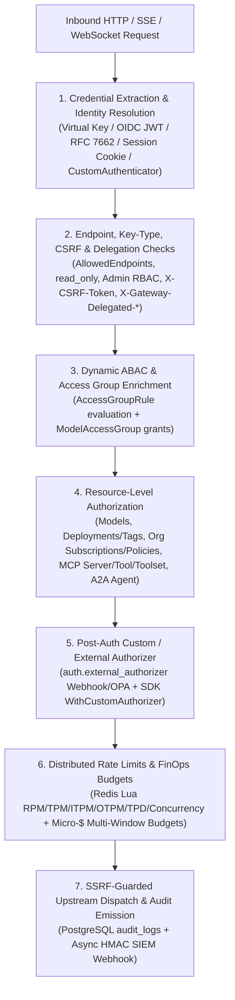

# GoRoute AI Gateway — Authorization & Access Control Guide

This guide is the authoritative reference for GoRoute AI Gateway's **19 enterprise authorization, multi-tenant governance, quota, and audit capabilities** across the Data Plane (`/v1/*`, `/mcp*`, `/a2a/*`), Control Plane (`/admin/v1/*`, `/auth/*`, `/scim/v2/*`), Embedded Operator Web UI (`/ui/*`), and Embedded Go SDK (`pkg/gateway`).

---

## 1. End-to-End Enforcement Pipeline

Every request passes through a strict **fail-closed** authorization pipeline. Adaptive routing signals may degrade locally, but authentication, RBAC, allowlists, external policy checks, quotas, and budgets **never** fail open unless an explicit operator override (such as `auth.external_authorizer.fail_mode: "open"`) is configured.



---

## 2. Role Hierarchy & Scope Matrix

GoRoute enforces a 7-role RBAC hierarchy across Control Plane and Data Plane operations:

| Privilege Rank | GoRoute Role | Control Plane Scope (`/admin/v1/*`) | Data Plane Scope (`/v1/*`, `/mcp*`, `/a2a/*`) |
| :---: | :--- | :--- | :--- |
| 70 | `platform_admin` | Full global & cross-org read/write, `/admin/v1/config`, KEK rotation, global models | Allowed (subject to key/policy scopes) |
| 60 | `org_admin` | Full read/write strictly inside own `org_id`; **cannot** mutate/rotate `platform_admin` users or keys (`SEC-03`) | Allowed within own `org_id` |
| 50 | `team_admin` | Scoped CRUD on own `team_id` (keys, projects, members); **cannot** cross teams, grant `can_impersonate`, wildcard `/admin`/`/scim` endpoints, or privileged roles | Allowed within own `team_id` |
| 40 | `org_viewer` | Read-only (`GET`) strictly inside own `org_id`; all writes return `403 read_only_role` | Allowed within own `org_id` |
| 30 | `developer` | Denied (`/admin/v1/*` → `403`); may use governed self-service `/v1/self/keys` | Allowed within assigned scopes |
| 20 | `service_account` | Denied (`/admin/v1/*` → `403`) | Machine-to-machine data plane within assigned scopes |
| 10 | `viewer` | Denied by default (`/admin/v1/*` → `403`, least privilege; set `auth.allow_viewer_control_plane_read: true` only for legacy migration to `org_viewer` read-only) | Read/inference within assigned scopes |

---

## 3. Tri-State Allowlist Semantics (`null` vs `[]` vs `[...]`)

For MCP servers, MCP tools, MCP toolsets, A2A agents, and client applications, GoRoute preserves strict **tri-state JSON semantics** across `VirtualKey`, `Project`, and `Team` (without `,omitempty` on JSON tags, using `optionalStringSlice` on `PUT` updates):

| JSON Value | Go Representation | Meaning | Precedence Behavior |
| :--- | :--- | :--- | :--- |
| `[]` | `[]string{}` (non-nil empty) | **Explicit Deny All** | Immediately blocks access (`403`), **overriding** Project, Team, Unified Access Group, and Dynamic `AccessGroupRule` grants. |
| `["a", "b"]` | `[]string{"a", "b"}` | **Explicit Allowlist** | Permits matching entries (exact or wildcard) intersected with parent scopes or augmented by eligible Access Group grants. |
| `null` | `nil` | **Inherit** | Defers to the next parent scope (`Key → Project → Team`) and permits grants from Unified Access Groups and Dynamic `AccessGroupRule`s. |

> **Single-Call Tri-State Creation Default**: `POST /admin/v1/keys` defaults **omitted** `allowed_mcp_servers`, `allowed_a2a_agents`, and `allowed_client_apps` to `[]` (**Deny All**, fail-closed). Passing explicit JSON **`null`** (e.g., `"allowed_mcp_servers": null`) creates the key as SQL `NULL` (**Inherit** from Project, Team, Unified Access Group, or Dynamic `AccessGroupRule`) in a single API call without needing a follow-up `PUT`. Passing explicit `[]` persists **Deny All**.

---

## 4. Reference for All 19 Enterprise Access-Control Capabilities

### 4.1 Model Access Control
- **Implementation**: `internal/auth/rbac.go` (`AuthorizeRequestedModelWithEval`, `AuthorizeDeployment`, `MatchesModelPattern`).
- **4 Enforcement Layers**:
  1. **Tenant Allowlists**: Virtual Key (`allowed_models`), Project (`allowed_models`), Team Member (`team_member_permissions.allowed_models`), and Team (`allowed_models`). Supports linear-time `*` wildcards (e.g., `openai/*`, `residency-*`).
  2. **Model Access Groups & Dynamic Rules**: Gated `ModelAccessGroup`s reject non-members (`403 model_access_group_denied`); dynamic `AccessGroupRule`s can expand eligible models.
  3. **Organization Provider Subscriptions** (`POST /admin/v1/organizations/{orgID}/subscriptions`): Disabling a provider prunes deployments backed by that provider while allowing multi-provider model groups to fail over to authorized siblings; when all active deployments are pruned solely by org policy, routing returns **`403 provider_not_subscribed`** directly (non-retryable, zero upstream contact).
  4. **Organization Model Availability Policies** (`POST /admin/v1/organizations/{orgID}/models`): Disabling a `global_model_id` prunes that concrete model across all aliases (including smart routing aliases `auto`, `fast`, `reasoning`, `coding`); when all active deployments are pruned solely by org policy, routing returns **`403 model_disabled_by_org_policy`** directly.
- **Cache Invalidation**: Mutations immediately evict L1 memory + L2 Redis (`gw:rbac:subs:*`, `gw:rbac:policies:*`) and broadcast Redis Pub/Sub invalidation across all replicas.

### 4.2 Deployment Access Control
- **Implementation**: `internal/router/filters.go` (`DeploymentAccessPolicy`, `FilterPipeline`), `migrations/0041_authorization_parity.up.sql`.
- **Controls**:
  - `allowed_deployments`: Supported on Virtual Keys, Projects, and Teams. Evaluated as a **strict intersection** (`Key ∩ Project ∩ Team`); an empty intersection fails closed with `403 deployment_restricted`.
  - `allowed_routing_tags`: Supported on Virtual Keys, Projects, and Teams. Unconditionally filters candidate deployments in `FilterPipeline` **even when the caller sends zero `X-Gateway-Tags` headers**. Sending a disallowed `X-Gateway-Tags` header returns `403 routing_tag_not_allowed`.
- **Endpoint Parity**: Enforced uniformly across `/v1/chat/completions`, `/v1/responses`, `/v1/embeddings`, `/v1/messages`, `/v1/completions`, audio, images, and batch execution.

### 4.3 MCP Server Access Control
- **Implementation**: `internal/auth/rbac.go` (`AuthorizeMCPServer`), `internal/mcp/hub.go`.
- **Controls**: 3-state `allowed_mcp_servers` across `Key → Project → Team` plus Unified Access Group / Dynamic Rule grants.
- **Routes Enforced**:
  - Virtual Hub (`POST /mcp`): `tools/list` aggregates **only** tools from authorized servers within the caller's `org_id`; unauthorized servers are completely hidden.
  - Scoped Server (`POST /mcp/{serverSlug}`): Unauthorized server slugs return a `Forbidden` JSON-RPC / `403 mcp_server_restricted` error and emit an `mcp.rbac.denied` audit record.

### 4.4 MCP Tool-Level Permissions
- **Implementation**: `internal/auth/rbac.go` (`AuthorizeMCPTool`, `AuthorizeMCPToolset`), `internal/mcp/tool_authz.go`.
- **Controls**:
  - **Positive Allowlists (`allowed_mcp_tools`)**: 3-state across `Key → Project → Team` + Access Groups. Supports `*`, exact `server:tool`, exact `tool`, `server:*`, and prefix wildcards (`github:get_*`, `list_*`). Unauthorized invocations return `403 mcp_tool_restricted`.
  - **Curated Toolsets (`allowed_mcp_toolsets`)**: 3-state allowlists restricting `/mcp/toolsets/{toolsetSlug}` (`403 mcp_toolset_restricted`).
  - **Per-Key Cache Isolation**: Scoped `tools/list` results are filtered per caller identity and never mutated in place in shared caches.

### 4.5 Agent Access Control (A2A v1.0)
- **Implementation**: `internal/auth/rbac.go` (`AuthorizeA2AAgent`), `internal/a2a/router_service.go`, `internal/server/handlers_a2a.go`.
- **Controls**:
  - 3-state `allowed_a2a_agents` across `Key → Project → Team` + Unified Access Group / Dynamic Rule grants (`403 a2a_agent_restricted`, auditing `a2a.rbac.denied`).
  - **Task Visibility Isolation (`task_visibility_mode`)**: `key_strict` (default), `user_strict`, `team`, or `org_admin` — enforced on `GET /tasks/{taskID}`, `GET /tasks`, `POST /tasks/{taskID}:cancel`, and `GET /tasks/{taskID}:subscribe` (non-owners receive `404` to prevent task ID enumeration).
  - **Emergency Kill-Switch (`POST /admin/v1/a2a/agents/{id}/kill-switch`)**: Immediately rejects invocations with `503 agent_killed` and records `a2a_agent.kill_switch_updated`.
  - **Uniform Endpoint Enforcement**: `handleA2AAgentMessage`, `handleA2AGetTask`, `handleA2AListTasks`, `handleA2ACancelTask`, and `handleA2ASubscribeTask` all enforce identity, A2A RBAC, and `CustomAuthorizer`.

### 4.6 Virtual Key Permissions
- **Implementation**: `internal/auth/service.go`, `internal/auth/rotation.go`, `internal/auth/middleware.go`, `internal/auth/impersonation.go`.
- **Controls**:
  - `key_type`: `default`, `llm_api` (blocked from `/admin/v1/*`), `read_only` (GET/HEAD/OPTIONS only; mutations return `403 read_only_key`), `management` (Control Plane).
  - `allowed_endpoints`: Exact or prefix-wildcard path list (e.g., `["/v1/embeddings", "/v1/models"]`); unmatched paths return `403 endpoint_not_allowed`.
  - `expires_at`: Automatic rejection (`401`) after expiry.
  - **Grace-Period Rotation (`POST /admin/v1/keys/{keyID}/rotate`)**: Both old key (returning `X-Gateway-Key-Deprecated: true` and `X-Gateway-Key-Revoke-At`) and new key work during `grace_period_seconds`. Revocation (`DELETE /admin/v1/keys/{keyID}`) invalidates both primary and grace hashes immediately across all replicas via Redis Pub/Sub.
  - **Delegation Narrowing (`can_impersonate: true`)**: Honors `X-Gateway-Delegated-User-Id` and `X-Gateway-Delegated-Team-Id` strictly by **narrowing** (intersecting allowlists and taking the minimum of rate/budget limits — never escalating).
  - **Client Application Restrictions (`allowed_client_apps` + `X-Gateway-Client-App`)**: Evaluated in `DataPlaneMiddleware` (after delegation narrowing) using header `X-Gateway-Client-App` (fallback `X-Client-App`). Any supplied header is checked against tri-state `Key → Team` `allowed_client_apps` (`403 client_app_restricted`). Keys/teams with an explicit non-wildcard allowlist (e.g. `["cursor"]`) reject omitted headers with `403 client_app_required` to prevent header-omission bypass; set `auth.require_client_app_header: true` to require the header globally for all non-master requests.

### 4.7 Team-Based Authorization
- **Implementation**: `internal/auth/rbac.go` (`AuthorizeTeamAdminAction`), `internal/server/handlers_admin.go`, `internal/server/handlers_projects.go`.
- **Controls**:
  - Team-level `allowed_models`, `allowed_deployments`, `allowed_routing_tags`, `allowed_mcp_servers`/`tools`/`toolsets`, `allowed_a2a_agents`, `max_budget_micros`, `rpm_limit`, `tpm_limit`, `max_concurrent_requests`.
  - **`team_admin` Isolation**: Scoped strictly to `op.OrgID == targetOrgID && op.TeamID == targetTeamID`. Blocked from cross-team access (`403 cross_team_access_denied`), `can_impersonate`, wildcard/`/admin`/`/scim` endpoints, and org/platform roles.
  - **Per-Member Permissions (`POST /admin/v1/teams/{teamID}/members`)**: Restrict individual users within a team via `allowed_models` (`403 team_member_model_restricted`), per-member budgets, and self-service policies. Accepts `"member"` as a normalized input alias for canonical `"developer"`.

### 4.8 Organization-Level Authorization
- **Implementation**: `internal/auth/rbac.go` (`AuthorizeAdminAction`), `internal/server/handlers_admin.go`.
- **Controls**:
  - Hard tenant isolation by `org_id` across all Data Plane, MCP, A2A, Admin, SCIM, and Audit APIs (`403 cross_org_access_denied`).
  - **Organization Kill-Switch (`PUT /admin/v1/organizations/{orgID}` with `is_active: false`)**: Immediately halts all Virtual Key, JWT, and operator traffic for that organization across all replicas.
  - Organization-wide hard/soft budgets, RPM/TPM/concurrency ceilings, provider subscriptions, and model availability policies.

### 4.9 Project-Level Authorization
- **Implementation**: `internal/server/handlers_projects.go`, `internal/auth/rbac.go`, `migrations/0041_authorization_parity.up.sql`.
- **Controls**:
  - Projects live inside `(org_id, team_id)` and carry independent `allowed_models`, `allowed_deployments`, `allowed_routing_tags`, `allowed_mcp_servers`, `allowed_mcp_tools`, `allowed_mcp_toolsets`, `allowed_a2a_agents`, `max_budget_micros`, `rpm_limit`, `tpm_limit`, and `max_concurrent_requests`.
  - **`enforce_project_model_quota: true`** (input alias `enforce_model_quota` also accepted on create/update): Rejects inference (`403 project_model_quota_required`) unless the key or project has a positive RPM/TPM/ITPM/OTPM/TPD quota policy declared for the requested model.
  - Keys bound to a `project_id` must belong to the same `org_id` and `team_id`; spend logs record `project_id` for chargeback.

### 4.10 Role-Based Access Control (RBAC)
- **Implementation**: `internal/domain/identity.go`, `internal/auth/rbac.go`, `internal/server/handlers_admin.go`.
- **Security Invariants**:
  - **SEC-03 Privilege Ceiling**: `org_admin` cannot create, update, rotate, or revoke any `platform_admin` user or key (`403 platform_admin_required`).
  - **Read-Only Viewer**: `org_viewer` can perform `GET` queries inside its own org and receives `403 read_only_role` on any mutation.
  - **Privilege Escalation Prevention**: Operators can never grant roles higher than their own boundary.

### 4.11 Access Groups (Unified Static & Dynamic ABAC)
- **Implementation**: `internal/auth/rbac.go` (`EvaluateModelAccessGroupsWithCache`), `internal/auth/access_rules.go`, `internal/server/handlers_quota_scopes.go`, `internal/server/handlers_access_rules.go`.
- **Two Complementary Mechanisms**:
  1. **Unified Access Groups (`POST /admin/v1/access-groups`, alias `/admin/v1/model-access-groups`)**: Reusable bundles attaching models, `allowed_mcp_servers`, `allowed_mcp_tools`, `allowed_a2a_agents`, and shared budgets/quotas to members (`key`, `team`, `user`, `project`, `org`). When a group has principal members attached, its models become **gated** (non-members receive `403 model_access_group_denied`).
  2. **Dynamic Access Group Rules (`POST /admin/v1/access-group-rules`)**: Priority-ordered ABAC rules matching trusted identity attributes (`jwt_claims.<path>`, `user_id`, `email`, `user_role`, `team_id`, `issuer`) with operators `equals`, `contains`, `prefix`, or `in_list` to grant `access_group_id`, `allowed_models`, `allowed_mcp_servers`, `allowed_mcp_tools`, and `allowed_a2a_agents` dynamically. Mutations evict caches across replicas via Redis Pub/Sub (`rbac_mag`, `rbac_access_rules`).

### 4.12 SSO Role Mapping
- **Implementation**: `internal/auth/role_mapping.go`, `internal/auth/sso.go`.
- **Configuration** (under `auth.sso_providers[]` and `auth.oidc_issuers[]`):
  ```yaml
  claim_mapping:
    org_id: "org_id"
    role: "role"
    groups: "groups"
  group_role_mappings:
    - group: "goroute-platform-admins"
      role: "platform_admin"
    - group: "goroute-org-admins"
      role: "org_admin"
    - group: "goroute-org-viewers"
      role: "org_viewer"
  role_mapping_strategy: "highest_privilege" # or "first_match"
  group_team_mappings:
    goroute-team-alpha: "team-prod-alpha"
  default_role: "org_viewer"
  allow_privileged_role_claims: false # blocks external platform_admin elevation unless true
  sync_roles_on_login: true           # syncs role changes & revokes stale sessions on demotion
  ```
- **Security Invariants**: `platform_admin` is **never** granted from external claims/groups unless `allow_privileged_role_claims: true`. When `sync_roles_on_login: true` detects a role change, GoRoute revokes all existing sessions for that user across all replicas (`RevokeAllUserSessions` + Redis Pub/Sub) and records `sso.role_synced` with `before_value`/`after_value` diff.

### 4.13 JWT-Based Authorization & OAuth 2.0 Introspection
- **Implementation**: `internal/auth/jwt.go`, `internal/auth/resolver.go`, `internal/auth/introspection.go`, `internal/server/handlers_jwt_mappings.go`.
- **Capabilities**:
  - **Asymmetric-Only Multi-Issuer OIDC/JWT**: Supports `RS256`–`PS512`, `ES256`–`ES512`, and `EdDSA` via JWKS discovery with singleflight refresh and stale-JWKS survival during IdP outages. Rejects `HS256`, `alg: "none"`, `oauth-id-jag+jwt`, expired tokens, wrong `aud`, unverified emails, and disallowed email domains (`allowed_email_domains`).
  - **Explicit Federated Binding**: Human identities are bound strictly by `(org_id, oidc_issuer, oidc_subject)` — preventing cross-issuer email takeover.
  - **JWT Claim-to-Virtual-Key Mappings (`POST /admin/v1/jwt-mappings`)**: Maps `(org_id, issuer, claim_name, claim_value)` directly to a governed `virtual_key_id` whose full allowlists, budgets, and quotas apply automatically.
  - **RFC 7662 Token Introspection (`auth.introspection`)**: Validates opaque bearer tokens against the IdP introspection/UserInfo endpoint with configurable short TTL caching.

### 4.14 Custom Authentication & Custom Authorization
- **Implementation**: `internal/auth/authorizer.go`, `pkg/gateway/auth.go`, `pkg/gateway/authz.go`.
- **Standalone Mode (`auth.external_authorizer` in YAML)**:
  - Supports `mode: "webhook"` (posts `AuthzRequest` JSON, expects `{"allow": true|false, "reason": "...", "error_code": "..."}`) and `mode: "opa"` (posts `{"input": AuthzRequest}`, expects `{"result": true|false|{...}}`).
  - Signs outbound payloads with `X-GoRoute-Signature-256: sha256=<hex>` when `hmac_secret` is configured.
  - Enforced across Inference (`inference:invoke`), MCP Tool Calls (`mcp:tool:call`), A2A Agent Invoke/Tasks/Cancel/Subscribe (`a2a:agent:invoke`), and Admin Control Plane (`admin:read`, `admin:write`).
  - Defaults to `fail_mode: "closed"` (returning `503 external_authorizer_unavailable` on outage) and routes strictly through `internal/security/network` SSRF protection.
- **Embedded Go SDK Mode (`pkg/gateway`)**:
  - `gateway.WithCustomAuthenticator(mode, authenticator)` (`CustomAuthModeOn`, `CustomAuthModeAuto`, `CustomAuthModeOff`) returns either a direct `IdentityContext` or a `VirtualKey` string.
  - `gateway.WithCustomAuthorizer(authorizer)` chains after standard RBAC and any configured external authorizer, failing closed with `403` on denial and `503` on error.

### 4.15 Budget-Based Access Control
- **Implementation**: `internal/finops/calculator.go`, `internal/finops/budget_policy.go`, `internal/finops/spend_worker.go`, `internal/server/handlers_quotas.go`.
- **Controls**:
  - Exact **64-bit integer micro-dollars** ($10^{-6}$ USD; zero floating-point drift).
  - **Hierarchical Scopes**: Organization, Team, Project, User, Team Member, Virtual Key, End-User, Tag, and Model Access Group.
  - **Atomic Zero-Lag Redis Settlement**: Completed requests atomically swap pre-dispatch reservations for exact micro-dollar spend in Redis immediately via `reconcile.lua` using the shared `gw:spend:applied:{org:<orgID>}:<event_id>` idempotency key, so subsequent async `SpendWorker` PostgreSQL flushes never double-count while still providing crash-recovery settlement.
  - **Multi-Window Rolling Budgets (`PUT /admin/v1/budget-windows`)**: Supports `hourly`, `daily`, `weekly`, `monthly`, and `rolling_24h` (with PostgreSQL cold recovery). Accepts `"virtual_key"` as a normalized input alias for canonical `"key"`.
  - **Temporary Budget Increases (`POST /admin/v1/keys/{keyID}/temp-budget`)**: Time-bounded `temp_budget_increase_micros` + `ttl_seconds` immediately unblocks an exhausted key across replicas and auto-expires.
  - **Soft Budgets & Fallbacks**: `soft_budget_micros` emits warnings without blocking; `budget_fallbacks` / `throttle_on_budget_exceeded` support graceful downgrade when configured.

### 4.16 Rate-Limit Enforcement (RPM, TPM, TPD & Concurrency)
- **Implementation**: `internal/ratelimit/limiter.go`, `internal/ratelimit/descriptors.go`, `internal/ratelimit/scripts/check_descriptors.lua`.
- **Controls**:
  - Single-roundtrip atomic **Redis Lua** enforcement across all replicas using organization hash tags for Redis Cluster compatibility.
  - Dimensions: `rpm_limit`, `tpm_limit`, `itpm_limit` (input TPM), `otpm_limit` (output TPM), `tpd_limit` (tokens/day), and `max_concurrent_requests` (distributed lease with automatic release & renewal).
  - **Per-Model Quota Policies (`PUT /admin/v1/quotas`)**: Apply fine-grained limits per `scope_type` (`org`, `team`, `team_member`, `project`, `user`, `key`, `model_per_key`, `model_per_team`, `model_per_project`, `model_per_user`, `model_per_org`, `model_per_end_user`, `end_user`, `tag`, `model_access_group`, `agent_session`, `mcp_server`) and `model_pattern`.
  - Fail-closed in production (`rate_limit.fallback_to_local_on_outage: false`).

### 4.17 User and Team Ownership
- **Implementation**: `internal/server/handlers_governance.go` (`/v1/self/keys`), `internal/server/handlers_scim.go`, `internal/finops/spend_worker.go`.
- **Controls**:
  - Keys, projects, and tasks explicitly bind to `(org_id, team_id, project_id, user_id)` and persist full ownership attribution in PostgreSQL `spend_logs`.
  - **Self-Service Key Ownership (`/v1/self/keys`)**: Opt-in per organization (`developer_self_serve_keys: true` via `PUT /admin/v1/organizations/{orgID}`; fails closed with `403 self_service_disabled` by default). Once enabled, authenticated users can list, issue, rotate, and revoke **only** their own keys; attempts to touch another user's keys are rejected (`403`/`404`).
  - **Lifecycle Coupling**: Deactivating a user via Admin API or SCIM v2 (`scim_active: false`) immediately blocks all of that user's virtual keys, JWT access, and browser sessions across every replica.

### 4.18 Administrative API Authorization
- **Implementation**: `internal/server/handlers_admin.go`, `internal/auth/middleware.go`, `internal/server/security_headers.go`.
- **Controls**:
  - Dual-boundary separation: `auth.allow_master_key_data_plane: false` keeps emergency break-glass `GATEWAY_MASTER_ADMIN_KEY` strictly on `/admin/v1/*` and rejects it (`401`) on `/v1/*`.
  - `key_type: "llm_api"` keys are blocked from `/admin/v1/*`.
  - **Browser Session Security**: Cookie-authenticated (`HttpOnly`, `Secure`, `SameSite`) control-plane mutations strictly require a matching `X-CSRF-Token` header (`403` when missing/invalid).
  - Strict CSP (`default-src 'self'; script-src 'self'; style-src 'self'; frame-ancestors 'none'`) and HSTS on `/ui/*` and `/admin/v1/*`.

### 4.19 Audit Logging & SIEM Webhook Export
- **Implementation**: `internal/server/handlers_governance.go` (`auditWithDiff`, `redactAuditMap`), `internal/server/audit_siem_sink.go`, `internal/storage/audit_cursor.go`.
- **Query API**: `GET /admin/v1/audit/logs?org_id={org}&actor_id={actor}&action={action}&resource={res}&from={rfc3339}&to={rfc3339}&limit={n}&cursor={token}` — backed by composite PostgreSQL indexes (`0041`) with deterministic cursor pagination and strict cross-org isolation.
- **Automatic Secret Redaction**: `before_value` and `after_value` snapshots automatically scrub `raw_key`, `key_hash`, `api_key`, `password*`, `auth_secret`, `auth_token`, `token`, `secret`, `csrf_token`, `authorization`, `x-api-key`, `encrypted_*`, `decrypted_*`, and nonces to `[REDACTED]`.
- **Async SIEM Webhook (`audit.siem_webhook`)**: Batches audit events asynchronously over SSRF-protected HTTPS with `X-GoRoute-Signature-256: sha256=<hex>` HMAC-SHA256 signatures.
- **Core Audited Actions**:
  - Identity & Sessions: `sso.role_synced`, `operator.impersonated`, `user.created`/`updated`/`deleted`, SCIM provisioning/deprovisioning.
  - Keys & Access: `virtual_key.issued`/`updated`/`rotated`/`revoked`/`blocked`/`unblocked`/`spend_reset`/`bulk_updated`/`temp_budget_updated`/`self_service_*`, `organization.updated`, `project.created`/`updated`/`deleted`, `team_membership.upserted`/`deleted`/`spend_reset`, `jwt_mapping.created`/`deleted`, `model_access_group.upserted`/`deleted`, `model_access_group_member.added`/`removed`, `access_group_rule.created`/`deleted`.
  - Quotas & Security: `quota_policy.upserted`/`deleted`, `budget_window.upserted`, `end_user.upserted`/`deleted`, `tag.upserted`/`deleted`, `security.kek_rotated`.
  - MCP & A2A Control/Data Plane: `mcp_server.created`/`updated`/`synced`, `mcp_toolset.created`, `mcp_user_credential.saved`, `mcp.spec.updated`, `mcp.rbac.denied`, `mcp.tool_policy.blocked`, `a2a_agent.created`, `a2a_agent.kill_switch_updated`, `a2a_push_config.created`, `a2a.rbac.denied`.

---

## 5. Dockerized Production Deployment & Verification Runbook

### Quick Single-Node Docker Stack (Local Evaluation)
```bash
docker compose -f deployments/docker-compose.yml up -d --build
curl -fsS http://localhost:8080/readyz
# Operator Web UI available at http://localhost:8080/ui/
docker compose -f deployments/docker-compose.yml down -v --remove-orphans
```

### Full 2-Replica Production-Topology Verification (All 19 Capabilities)
Boots 2 read-only non-root `GATEWAY_ENV=production` GoRoute replicas behind Caddy TLS 1.3, PostgreSQL 16 (TLS `verify-full`), Redis 8 (`--requirepass`), live Keycloak 26, SSRF trap, and deterministic LLM/MCP/A2A/Authorizer/SIEM fixtures, runs Suites `1`–`11` + `99` + Playwright Chromium UI + `goroute` CLI + zero-secret log scan, and tears down cleanly:

```bash
# Deterministic offline verification (zero external API keys required)
make test-prod-docker

# Optional: include live upstream LLM provider verification (Suite 10) using ephemeral shell env vars
PROD_LIVE_OPENAI_API_KEY="$OPENAI_API_KEY" \
PROD_LIVE_ANTHROPIC_API_KEY="$ANTHROPIC_API_KEY" \
PROD_LIVE_GROQ_API_KEY="$GROQ_API_KEY" \
PROD_LIVE_OPENROUTER_API_KEY="$OPENROUTER_API_KEY" \
PROD_LIVE_GEMINI_API_KEY="$GEMINI_API_KEY" \
make test-prod-docker
```

> Never commit real API keys into `.env`, `configs/config.yaml`, or git history. Always pass live credentials as ephemeral shell environment variables or secrets-manager injections (`os.environ/...`).
