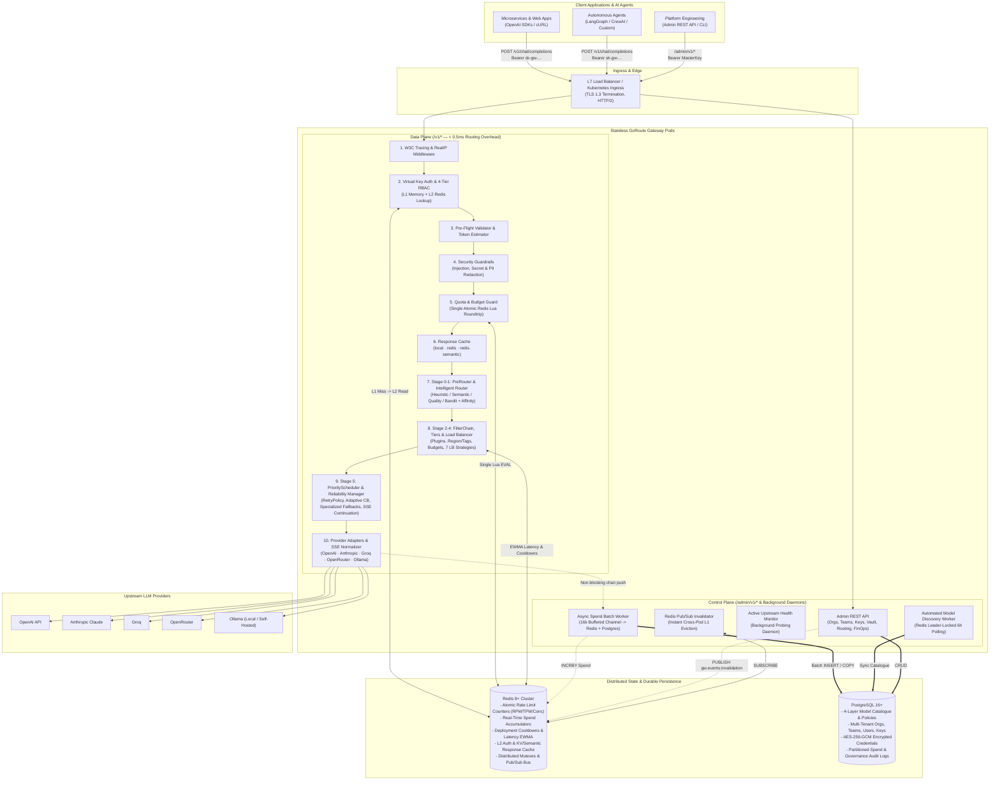
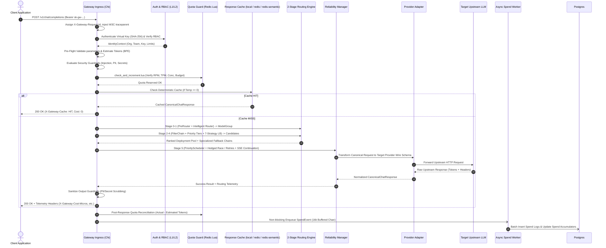
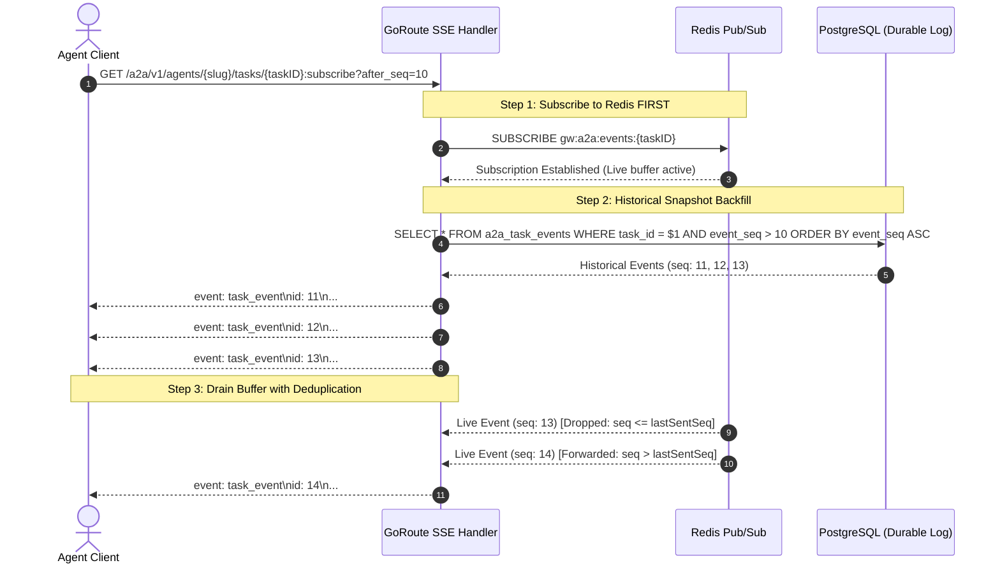
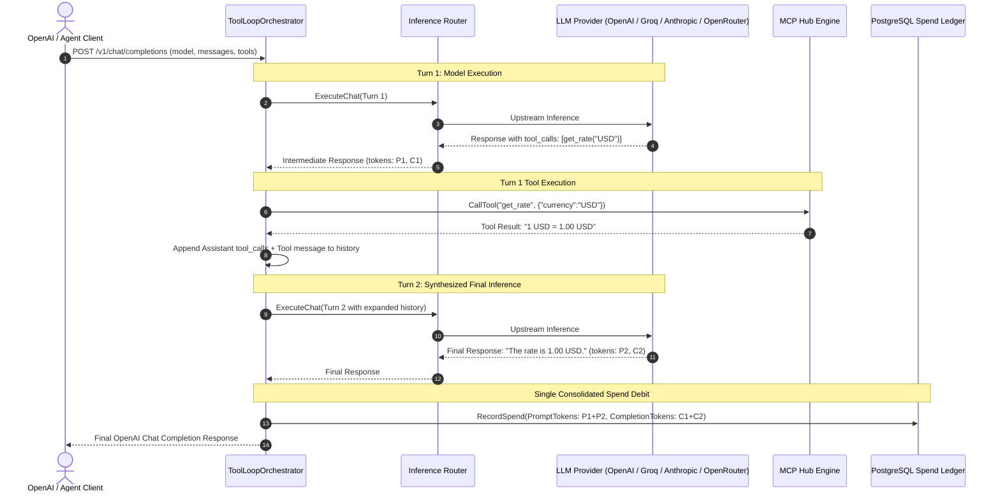
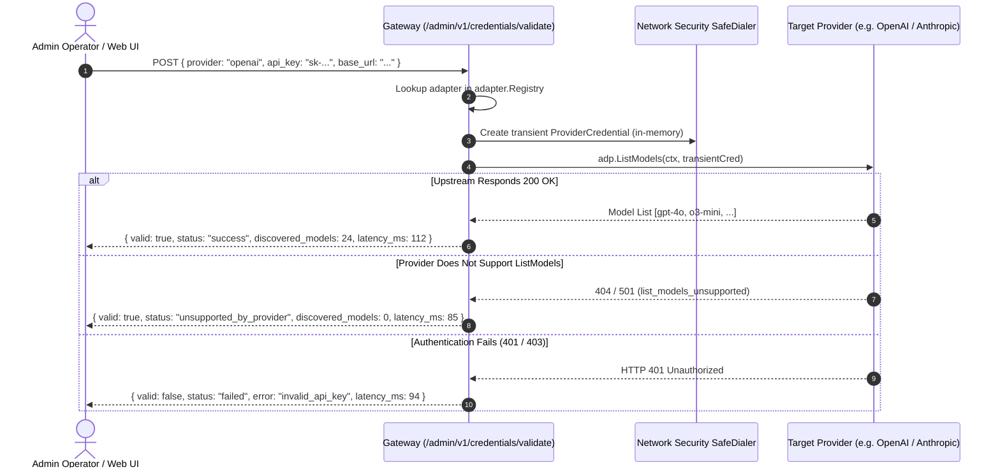

# GoRoute AI Gateway — Complete Subsystem Internals & Engineering Guide

> **Target Audience**: Platform Engineers, Distributed Systems Architects, and Core Contributors.  
> **Runtime Target**: 100% Pure Go (Go version declared in `go.mod`), PostgreSQL 16+, Redis 8+.  
> **Key Metric**: Sub-millisecond data plane routing overhead (< 0.5 ms), zero synchronous database queries on the inference hot path, and zero Cgo/external runtime dependencies.

---

## Table of Contents

1. [Architectural Principles & Topology](#1-architectural-principles--topology)
2. [Data Plane Execution Lifecycle (Step-by-Step)](#2-data-plane-execution-lifecycle-step-by-step)
3. [Stage 0 Pre-Router Engine: Heuristic, Semantic, Quality & Adaptive Bandit](#3-stage-0-pre-router-engine-heuristic-semantic-quality--adaptive-bandit)
4. [Stages 2–5: Candidate Filters, Priority Tiers, 7 Load-Balancing Algorithms & Scheduling](#4-stages-25-candidate-filters-priority-tiers-7-load-balancing-algorithms--scheduling)
5. [Dual-Boundary Security & Envelope Cryptography](#5-dual-boundary-security--envelope-cryptography)
6. [Reliability Manager: RetryPolicy, Adaptive Circuit Breakers, Specialized Fallbacks & SSE Continuation](#6-reliability-manager-retrypolicy-adaptive-circuit-breakers-specialized-fallbacks--sse-continuation)
7. [FinOps Micro-Dollar Accounting & Asynchronous Batch Pipeline](#7-finops-micro-dollar-accounting--asynchronous-batch-pipeline)
8. [Distributed Rate Limiting, Descriptor Quotas, PTU Sharing & Pre-Flight Tokenizer](#8-distributed-rate-limiting-descriptor-quotas-ptu-sharing--pre-flight-tokenizer)
9. [Single-Backend Response Caching (`local`, `redis`, `redis-semantic`)](#9-single-backend-response-caching-local-redis-redis-semantic)
10. [Cross-Cutting Platform Modules](#10-cross-cutting-platform-modules)
11. [Storage Architecture: PostgreSQL Schema & Redis Keyspace Matrix](#11-storage-architecture-postgresql-schema--redis-keyspace-matrix)
12. [Model Context Protocol (MCP Multi-Release Spec-Generated) Subsystem Internals](#12-model-context-protocol-mcp-multi-release-spec-generated-subsystem-internals)
13. [Agent-to-Agent Protocol (A2A v1.0) Subsystem Internals](#13-agent-to-agent-protocol-a2a-v10-subsystem-internals)
14. [Server-Side Autonomous Tool Loop Orchestration](#14-server-side-autonomous-tool-loop-orchestration)
15. [Progressive Tool Discovery & Opaque Handles](#15-progressive-tool-discovery--opaque-handles)
16. [Native A2A gRPC & OpenAI Compatibility Bridge](#16-native-a2a-grpc--openai-compatibility-bridge)
17. [Enterprise Upstream Authentication & Cloud IAM Strategies](#17-enterprise-upstream-authentication--cloud-iam-strategies)
18. [Embedded Operator Web UI Architecture & Static Serving Mechanics](#18-embedded-operator-web-ui-architecture--static-serving-mechanics)
19. [Stateless Guardrails Simulation & Preflight Credential Validation Mechanics](#19-stateless-guardrails-simulation--preflight-credential-validation-mechanics)

---

## 1. Architectural Principles & Topology

GoRoute AI Gateway is engineered as an enterprise-grade control plane and high-throughput data plane for frontier and local Large Language Models.

### Core Engineering Invariants
- **100% Pure Go**: Compiles to a single static binary (< 35 MB) with zero Cgo, minimal memory footprint, and native Go goroutine concurrency capable of sustaining 10,000+ concurrent streaming SSE connections.
- **Zero Synchronous Database Queries on the Hot Path**: All authorization, routing, and rate-limiting decisions on `/v1/*` are resolved using a two-tier in-memory (L1) and Redis (L2) cache.
- **Strict Integer Micro-Dollar Accounting**: All token spend calculations use 64-bit integer micro-dollars ($1\text{ USD} = 1,000,000\ \mu\$$) with pico-dollar ($10^{-12}\text{ USD}$) intermediate precision, eliminating floating-point rounding drift.
- **Dual Deployment Architecture**: Operates as a standalone proxy microservice or can be imported directly into Go microservices as an in-process library via `pkg/gateway`.



---

## 2. Data Plane Execution Lifecycle (Step-by-Step)

### 2.1 Synchronous Chat Completion Lifecycle



### 2.2 Real-Time SSE Streaming Data Flow

When `stream: true` is requested:
1. The gateway initializes `sse.NewWriter(w)`, setting `Content-Type: text/event-stream`, `Cache-Control: no-cache`, and `Connection: keep-alive`.
2. As the upstream provider emits chunks:
   - **OpenAI, Groq, and OpenRouter**: OpenAPI-first adapters normalize standard `data: {...}` `chat.completion.chunk` (and OpenAI Responses) SSE frames, extracting reasoning/content deltas and token usage.
   - **Anthropic Claude**: Typed events (`message_start`, `content_block_delta`, `message_delta`, `message_stop`) are parsed and synthesized into standard OpenAI `chat.completion.chunk` SSE frames in real time.
3. Every SSE frame is immediately dispatched to the client using `http.Flusher.Flush()` with zero intermediate buffer lag.
4. **2MB High-Capacity Scanner Buffers**: All SSE line scanners (`pkg/gateway/sdk.go`, `internal/adapter/sse`, and MCP Stdio transports) allocate a custom 2MB line buffer (`scanner.Buffer(buf, 2*1024*1024)`) instead of Go's default 64KB `bufio.MaxScanTokenSize`. This prevents `bufio.ErrTooLong` truncation when processing long reasoning chains (e.g. OpenAI `o1`/`o3`, Claude thinking deltas), expanded tool arguments, or multi-kilobyte MCP responses.
5. **Mid-Stream SSE Continuation (`StreamContinuationManager`, `internal/router/stream_continuation.go`)**: When `router.enable_mid_stream_continuation` is `true` and an upstream plain-text SSE stream fails mid-generation (without active tool-call deltas or non-text chunks), GoRoute captures emitted output text, adjusts `max_tokens` (`original_max - estimated_emitted_tokens`), appends an assistant prefill message, and seamlessly continues via an alternate deployment/fallback while setting `X-Gateway-Stream-Continued: true` (bounded by `max_stream_continuations`). If continuation is ineligible or exhausted, the gateway emits a structured error SSE event (`event: error\ndata: {"error":{"message":"..."}}\n\n`) followed by `data: [DONE]\n\n`, allowing client SDKs to fail gracefully without JSON decoding panics.

---

## 3. Stage 0 Pre-Router Engine: Heuristic, Semantic, Quality & Adaptive Bandit

`PreRouterRegistry` (`internal/router/prerouter.go`) supports multiple pluggable virtual pre-routing modes alongside custom Go `PreRouter` extensions:
- **`"auto"` / `"router/heuristic"`**: Traditional approaches often call a secondary LLM to classify prompts, introducing 300ms–800ms of latency and extra token spend. GoRoute's default classifier executes in `< 0.1 ms` in pure Go.
- **`"router/semantic"` (`prerouter_semantic.go`)**: Computes cosine similarity between the incoming prompt embedding and pre-warmed intent route centroids (`gw:router:semantic:{org:<org_id>}:centroids`), routing matches above `similarity_threshold` to the configured `target_model`.
- **`"router/quality"` (`prerouter_quality.go`)**: Selects targets across `GlobalModel.QualityTier` levels based on request hints, tool requirements, and prompt signals.
- **`"router/adaptive"` (`prerouter_bandit.go`)**: Contextual **Thompson Sampling Bandit** sampling Beta(`alpha`, `beta`) posteriors per candidate arm stored in Redis (`gw:router:bandit:{org:<org_id>}:{bucket}`) with multi-objective reward updates shaped by success, latency (`latency_weight`), cost (`cost_weight`), and exponential decay (`decay_half_life`).
- **Comma-Separated Racing (`"model-a,model-b"`)**: Expands comma-delimited targets into concurrent hedged execution candidates.

```
                  +----------------------------------------------+
                  |               Incoming Prompt                |
                  +----------------------------------------------+
                                         |
                                         v
                  +----------------------------------------------+
                  |         Tier 1: Deterministic Rules          |
                  |  - Context > 32k tokens?                     |
                  |  - Explicit reasoning_effort?                |
                  +----------------------------------------------+
                                    /          \
                         (Matched) /            \ (No Match)
                                  v              v
            +---------------------------+  +-------------------------------+
            | Route to Reasoning Tier   |  | Tier 2: Complexity Scorer     |
            | (default_reasoning_alias) |  | S in [0.0, 1.0]               |
            +---------------------------+  +-------------------------------+
                                                         |
                                                         v
                                           +-------------------------------+
                                           | S >= ComplexityThreshold?     |
                                           +-------------------------------+
                                                 /                   \
                                         (Yes)  /                     \ (No)
                                               v                       v
                              +---------------------------+  +----------------------+
                              | Route to Reasoning Tier   |  | Route to Fast Tier   |
                              +---------------------------+  +----------------------+
```

### Multi-Feature Complexity Scoring Formula

```latex
\text{Score} = \min\left(1.0,\ \text{LengthScore} + \text{ReasoningScore} + \text{CodeScore} + \text{TurnScore}\right)
```

In plain algorithmic notation:
```text
Score = min(1.0, LengthScore + ReasoningScore + CodeScore + TurnScore)
```

Where:
- **Length Contribution**:
  $$\text{LengthScore} = \min\left(\frac{\text{EstimatedTokens}}{1000},\ 1.0\right) \times 0.25$$
- **Reasoning Keyword Density**:
  Scans for technical and analytical markers (`"step by step"`, `"analyze"`, `"architect"`, `"prove"`, `"theorem"`, `"optimize"`, `"trade-off"`, `"design"`, `"root cause"`, `"debug"`, `"concurrency"`, `"distributed"`, `"mathematical"`, `"algorithm"`):
  $$\text{ReasoningScore} = \min(\text{MatchCount} \times 0.22,\ 0.55)$$
- **Code Syntax Density**:
  Detects fenced code blocks (```` ``` ````) and code syntax tokens (`func `, `select `, `class `, `def `):
  $$\text{CodeScore} = 0.30\ \text{if present, else } 0.0$$
- **Turn & Tool Depth**:
  $$\text{TurnScore} = \min(\text{len}(\text{Messages}) \times 0.03,\ 0.15) + (0.15\ \text{if len}(\text{Tools}) > 0)$$

If $\text{Score} \ge \text{ComplexityThreshold}$ (default `0.40`), the request routes to `default_reasoning_alias` (`"reasoning"`). Otherwise, it routes to `default_fast_alias` (`"fast"`).

---

## 4. Stages 2–5: Candidate Filters, Priority Tiers, 7 Load-Balancing Algorithms & Scheduling

Before selection, Stage 2 runs `DeploymentFilterChain` (`filters.go`):
1. **Health & Staleness Gate**: Excludes disabled/cooldown deployments and deployments exceeding `router.health_staleness_threshold`.
2. **RBAC & Context Window Gate**: Verifies `RBACEngine.AuthorizeDeployment` (fail-closed) and filters out models whose `max_input_tokens` cannot fit the estimated prompt + requested completion tokens (wrapping `ContextWindowExceededError` to trigger `context_window_fallbacks`).
3. **Region & Boolean Tag Filter**: Enforces `allowed_region` and evaluates comma-separated `&` (AND) / `!` (NOT) tag expressions against `Deployment.Tags`.
4. **Deployment Capacity, Budgets & Affinity (`deployment_budgets.go`, `affinity.go`)**: Enforces `rpm_capacity`, `tpm_capacity` (`strict_capacity_filtering`), per-deployment `max_budget_micros`, and `router.provider_budgets`, then boosts sticky deployments from `AffinityStore` (`session_id`, `previous_response_id`, or `prompt_cache_affinity` prefix hashes).
5. **Custom Go `RoutingPlugin` Hooks**: Invokes ordered `RoutingPlugin` filters (exposed publicly via `gateway.WithRoutingPlugin`).

Stage 3 partitions surviving candidates into ascending **`Deployment.Priority` tiers** (`partitionByPriority` in `priority_tiers.go`, using a zero-allocation fast path when all deployments share one tier). Stage 4 selects the winning candidate from the active tier using one of **7 Load-Balancing Strategies**:

| Strategy | Selection Algorithm & Mathematical Model | Primary Use Case |
| :--- | :--- | :--- |
| **`weighted-shuffle`** | Probability proportional to deployment weight:<br>$$P(d_i) = \frac{w_i}{\sum_{j} w_j}$$ | Traffic splitting across accounts or providers (e.g., 80% Groq / 20% OpenAI). |
| **`round-robin`** | Atomic modular counter cycling evenly across healthy tier deployments. | Balanced traffic distribution across homogeneous nodes. |
| **`least-busy`** | Selects deployment minimizing shared in-flight requests:<br>$$d^* = \arg\min_{d} (\text{InFlight}_d)$$ | Long-running streaming and deep reasoning workloads. |
| **`latency-based`** | Selects the lowest shared time-to-first-token EWMA, using 250 ms for deployments without a sample. EWMA uses alpha 0.3:<br>$$\text{EWMA}_{\text{new}} = 0.3 \cdot L + 0.7 \cdot \text{EWMA}_{\text{old}}$$ | Interactive chat requiring minimum perceived latency. |
| **`fastest-response`** | `HedgedExecutor` (`hedged.go`) dispatches staggered parallel requests (`hedge_delay_ms`, `max_hedge_concurrency`) across top candidates and streams/returns the fastest first responder, canceling slower peers. | P99 tail-latency shielding for latency-critical UX. |
| **`usage-based-headroom`**| Selects deployment with highest remaining TPM capacity over a 1-minute window:<br>$$\text{Headroom} = 1 - \frac{\text{TPM}_{1\text{m}}}{\text{TPM}_{\text{cap}}}$$<br>TPM counters reset when the minute window expires. | Multi-region deployments to avoid approaching provider token limits. |
| **`lowest-cost`** | Selects deployment with lowest combined micro-dollar token rate:<br>$$d^* = \arg\min_{d} (\text{InCost} + \text{OutCost})$$ | High-volume offline batch processing and background pipelines. |

When `router.scheduler.enabled` is `true`, Stage 5 passes requests through `PriorityScheduler` (`scheduler.go`) — a bounded priority queue ordered by `X-Gateway-Priority` / `goroute_extensions.priority` that caps overload (`max_queue_depth`, `max_wait_time`).

Adaptive strategies (`least-busy`, `latency-based`, and `usage-based-headroom`) share their deployment observations through Redis hashes keyed by a SHA-256 digest of deployment ID (`gw:routing:signals:<sha256>`). Each hash expires after 10 minutes without a signal update, so retired deployments do not leave permanent keys. Lua scripts update in-flight counts, minute-window usage, and latency EWMA atomically. When Redis cannot be read or updated, the load balancer degrades gracefully to process-local observations, increments the `gateway.routing.signal_degraded` OTLP counter, and emits a structured `routing_signal_store_unavailable` warning (`LoadBalancer.SharedSignalsAvailable()` reports current signal path health).

---

## 5. Dual-Boundary Security & Envelope Cryptography

GoRoute AI Gateway enforces dual security boundaries alongside enterprise federation, operator session controls, SCIM provisioning, and key rotation grace windows:

```
+-----------------------------------------------------------------------------------------+
|                               BOUNDARY 1: Client -> Gateway                             |
|  - Virtual API Keys: sk-gw-<8char_id>-<36char_secret> (multi-header + conflict reject)  |
|  - Persistent Storage: Only SHA-256(full_key) is stored in PostgreSQL                   |
|  - Verification: crypto/subtle.ConstantTimeCompare against L1/L2 cached hash             |
|  - Federated OIDC/JWT & Introspection: bound by (org_id, oidc_issuer, oidc_subject)      |
|  - Operator Sessions: HMAC goroute_session cookie + X-CSRF-Token + OIDC id_token_hint  |
|  - Embedded SDK: CustomAuthenticator (CustomAuthModeOff / On / Auto, RunPostChecks)     |
|  - Key revocation broadcasts L1 eviction through gw:events:invalidation                   |
+-----------------------------------------------------------------------------------------+
                                             |
                                             v
+-----------------------------------------------------------------------------------------+
|                               BOUNDARY 2: Gateway -> Provider                           |
|  - Provider Credentials encrypted using 2-Tier AES-256-GCM Envelope Encryption          |
|  - Tier 1 (DEK): Fresh 256-bit Data Encryption Key generated per credential             |
|  - Tier 2 (KEK): 256-bit Master Key Encryption Key wraps the DEK                        |
|  - Opt-in Cloud IAM & DistributedTokenCache across replicas                             |
|  - In-Memory Security: Plaintext keys zeroed out after request construction             |
+-----------------------------------------------------------------------------------------+
```

Virtual-key expiry metadata is stored with each cached identity and checked on every L1 and Redis L2 cache hit. Key revocation deletes the shared L2 entry and publishes a key-hash invalidation event; gateway workers evict matching L1 identities when they receive it. If Redis cannot deliver the event, another worker can retain its L1 identity only until its configured L1 cache TTL expires.

### 5.1 Identity Federation, Sessions, SCIM & Key Rotation Mechanics
- **Federated OIDC & Strict Issuer Binding (`internal/auth/jwt.go`, `internal/auth/sso.go`, `migrations/0034`)**: Both Data Plane JWTs (`auth.enable_data_plane_jwt`) and Operator/CLI OIDC SSO authenticate users strictly by `(org_id, oidc_issuer, oidc_subject)`. Implicit cross-issuer email linking is disabled; legacy subject-only records resolve only when an organization has one unambiguous trusted issuer. Explicit `(org_id, issuer, claim_name, claim_value) -> virtual_key_id` (`jwt_key_mappings`) and ABAC `access_group_rules` remain isolated inside the verified tenant.
- **Operator Sessions, CSRF & OIDC Logout (`internal/auth/session.go`, `internal/auth/sso.go`)**: Browser OIDC SSO login (`/auth/sso/{provider}/login` + `/callback`) issues `HttpOnly` signed `goroute_session` cookies backed by `operator_sessions` (storing `provider_id` and Vault-encrypted `id_token` for RP-Initiated Logout) and Redis `gw:auth:session:{active,revoked}:{jti}` state with Pub/Sub multi-replica eviction (`session_revoked`). Cookie-authenticated state-changing requests require `X-CSRF-Token`. Active sessions fail closed on user deactivation, SCIM deprovisioning, or DB lookup failures.
- **SCIM 2.0 Atomic Provisioning & Key Rotation (`internal/server/handlers_scim.go`, `internal/auth/rotation.go`)**: `/scim/v2/Users` and `/scim/v2/Groups` apply group name and membership updates inside one tenant-scoped PostgreSQL transaction, blocking cross-org user attachment. Key rotation (`POST /admin/v1/keys/{keyID}/rotate` and scheduled webhook delivery under `gw:lock:key_rotation`) keeps deprecated hashes active in `virtual_key_deprecated_hashes` through their grace window (`X-Gateway-Key-Deprecated: true`, `X-Gateway-Key-Revoke-At`).
- **Embedded `CustomAuthenticator` (`pkg/gateway/auth.go`)**: Supports `CustomAuthModeOff`, `CustomAuthModeOn` (fail closed), and `CustomAuthModeAuto` (abstain -> fall back to standard auth); when returning a direct `Identity` with `RunPostChecks: true`, RBAC model/endpoint policies and quota limits still run through standard enforcement.

### Envelope Encryption Specification
For every stored upstream provider API key:
1. A cryptographically secure 256-bit **Data Encryption Key (DEK)** and 12-byte `DataNonce` are generated via `crypto/rand`.
2. The raw upstream key is encrypted using AES-256-GCM with the DEK.
3. The DEK itself is encrypted using AES-256-GCM with the gateway's 256-bit **Master Key Encryption Key (KEK)** and a fresh 12-byte `DEKNonce`.
4. Plaintext DEK buffers in memory are wiped (`b[i] = 0`) immediately following encryption.
5. **Zero-Downtime Key Rotation**: Calling `POST /admin/v1/credentials/{id}/rotate` decrypts the credential, generates a fresh DEK, re-encrypts, increments `key_version`, and updates the audit log without interrupting live traffic.

### 5.3 Fail-Closed Authorization & Dispatch Guarantees
GoRoute enforces strict **fail-closed** authorization boundaries across all execution layers:
- **Stage 1 (Routing Time)**: In `IntelligentRouter.resolveDynamicProviderModel`, reading Layer 2 Provider Subscriptions or Layer 3 Model Policies must succeed. If the repository returns an error (e.g. database timeout or connection pool exhaustion), dynamic provisioning immediately aborts and returns `nil`, falling through to explicit model verification. Explicit requests for unconfigured or unauthorized models strictly return `HTTP 404 model_group_not_found` and never fall through to unrelated tenant model groups.
- **Stage 2 (Dispatch Time)**: In `RBACEngine.AuthorizeDeployment`, checking Layer 2 subscriptions and Layer 3 policies is mandatory. If `GetOrgProviderSubscriptions` or `GetOrgModelPolicies` yields an error, `AuthorizeDeployment` immediately returns `HTTP 500 auth_repository_error`, causing the load balancer to exclude the deployment and preventing unauthorized execution during database failure modes.

---

## 6. Reliability Manager: RetryPolicy, Adaptive Circuit Breakers, Specialized Fallbacks & SSE Continuation

The Reliability Manager wraps upstream execution with per-exception retry policies, exponential backoff, distributed/adaptive circuit breakers, priority tier walks, specialized fallback chains, and mid-stream SSE continuation.

### 6.1 Upstream Error Classification & Per-Exception `RetryPolicy`

| HTTP Status / Condition | Classification | Action Taken |
| :--- | :--- | :--- |
| `429 Too Many Requests` | **Retryable (`rate_limit_retries`)** | Full-jitter backoff; honors `Retry-After` header if within `max_retry_delay`. |
| Upstream timeout | **Retryable (`timeout_retries`)** | Records failure sample; retries alternate tier/deployment up to `timeout_retries`. |
| `500`, `502`, `503`, `504`, `529` | **Retryable (`server_error_retries`)** | Records failure against deployment; retries alternative deployment in tier/group. |
| `401 Unauthorized`, `403 Forbidden` | **AuthFailure (`auth_error_retries`)** | **Immediately trips circuit breaker to `OPEN`** (unless lone-deployment safety applies differently); prevents wasting retry attempts on bad credentials. |
| `404 Not Found` | **NotFound (`not_found_retries`)** | Fails fast (`0` retries by default) or steps to fallback targets. |
| `400 Bad Request` (`context_length_exceeded` / content policy) | **SpecializedFallbackEligible** | Skips intra-group retries and jumps directly to `context_window_fallbacks` or `content_policy_fallbacks`. |
| Other `400 Bad Request` | **ClientError (`bad_request_retries`)** | Non-retryable by default; fails fast and returns normalized error to caller. |

### 6.2 3-State Adaptive Circuit Breaker & Lone-Deployment Safety Net

```mermaid
stateDiagram-v2
    [*] --> CLOSED: Deployment Registered

    CLOSED --> OPEN: Failures >= threshold / allowed_fails OR FailureRate >= threshold OR AuthFailure
    note right of CLOSED: Handles normal inference traffic\n(Lone-deployment safety net prevents total lockout on transient errors)

    OPEN --> HALF_OPEN: Cooldown period expires (default 60s, capped at max_cooldown_seconds)
    note right of OPEN: Excluded from candidate pool;\ntraffic routes to healthy tiers or fallbacks

    HALF_OPEN --> CLOSED: Single probe request succeeds
    HALF_OPEN --> OPEN: Single probe request fails

    CLOSED --> [*]
```



- **Distributed Cooldown & Failure-Rate Triggers (`retry_policy.go`)**: Redis stores cluster-tagged state under `gw:router:{dep:<dep_id>}:{circuit,cooldown,probe,failures,reqs_1m,fails_1m}`. In addition to consecutive `failure_threshold` (`3`) or class-specific `CooldownPolicy.allowed_fails`, deployments trip if the 1-minute failure ratio `fails_1m / reqs_1m >= failure_rate_threshold` at or above `min_requests_per_minute`.
- **Lone-Deployment Safety Net**: When a deployment is the sole eligible candidate in its group without alternatives, non-auth transient errors avoid opening a hard blackout circuit so temporary upstream jitter self-heals immediately.
- **Trial Recovery (`HALF_OPEN`)**: After cooldown expiration, an atomic Redis script grants one 5-minute probe lease across pods (`circuit_breaker_scripts.go`). A failed probe restores the cooldown; a successful request clears shared state and lease. If Redis is unavailable, the manager uses local circuit state and cannot coordinate probes across replicas.
- **Streaming Retry & Continuation Safety**: Before the first output chunk, retryable failures use the same bounded full-jitter backoff and `Retry-After` handling as non-streaming calls. Once plain-text chunks have been emitted, `StreamContinuationManager` can seamlessly re-route via assistant prefill (`enable_mid_stream_continuation: true`, `X-Gateway-Stream-Continued: true`) before falling back to structured `event: error` termination.

### 6.3 Multi-Level Failover Hierarchy
- **Level 1 — Intra-Tier Retry**: Retries alternate healthy deployments in the current `Deployment.Priority` tier up to the matching `RetryPolicy` budget.
- **Level 2 — Priority Tier Step-Down (`priority_tiers.go`)**: Exhausting tier `0` steps cleanly to tier `1`, `2`, etc., recording `X-Gateway-Tier-Stepdowns` and `X-Gateway-Route-Reason: priority_tier_stepdown`.
- **Level 3 — Specialized & Generic Fallback Chains (`fallback_chains.go`)**: Classifies failures into `context_window_fallbacks`, `content_policy_fallbacks`, structured `fallback_targets` (applying per-target parameter `overrides`), legacy `fallback_group_ids`, or global `router.default_fallbacks`. Traversal is bounded by `max_fallback_depth` (default `16`), skips cycles and duplicate groups, re-translates across providers, repins session affinity when `session_affinity_repin_on_failover` is enabled, and sets `X-Gateway-Fallback-Attempted: true`.

### 6.4 OpenAPI-First Adapter & Protocol Engines
GoRoute implements OpenAPI-first provider adapters and pure-Go protocol helpers without heavyweight external cloud SDK dependencies:
1. **OpenAI Adapter (`internal/adapter/openai/`)**:
   - Supports OpenAI Chat Completions, Responses API, Embeddings, Audio, Images, Moderations, Batches, Files, and Realtime endpoints backed by generated OpenAPI wire contracts.
2. **Anthropic Adapter (`internal/adapter/anthropic/`)**:
   - Translates canonical requests to Anthropic Messages (`/v1/messages`, `/v1/messages/count_tokens`), normalizes typed SSE events into canonical completion chunks, and preserves prompt caching and thinking blocks.
3. **Groq Adapter (`internal/adapter/groq/`)**:
   - Spec-driven adapter targeting Groq OpenAI-compatible inference and audio endpoints (`groq_types.gen.go`), preserving reasoning content fields (`reasoning_content`, `reasoning`) across streaming and non-streaming responses.
4. **OpenRouter Adapter (`internal/adapter/openrouter/`)**:
   - Spec-driven adapter targeting OpenRouter chat/completions and model routing (`openrouter_types.gen.go`), propagating OpenRouter attribution headers and reasoning deltas.
5. **Ollama Adapter (`internal/adapter/ollama/`)**:
   - Spec-driven adapter targeting Ollama OpenAI-compatible inference (`/v1/chat/completions`, `/v1/completions`, `/v1/embeddings`) and native `/api/tags` discovery (with `/v1/models` fallback) using `ollama_types.gen.go`, optional Bearer auth, root or `/v1` base URL normalization, and `keep_alive` extra-parameter stripping.

### 6.5 Embedded Model Catalogue Engine (`internal/modelcatalog/`)
- Curates 5,493 model/provider records derived from the upstream model catalog snapshot, compressed into a 216 KB embedded binary (`catalog.json.gz`).
- Unpacks at initialization using a single `sync.Once` into lock-free in-memory lookup hash tables (`modelsByID`, `modelsByPN`, `modelsByName`).
- Distinguishes **callable inference routes** (`catalog.IsCallableProvider(prov)`) from metadata-only catalogue entries.
- Lookup benchmark latency: **66.41 ns/op** with zero heap allocations on the hit path.

---

## 7. FinOps Micro-Dollar Accounting & Asynchronous Batch Pipeline

To prevent floating-point accumulation drift over millions of API transactions, all token accounting in GoRoute AI Gateway is computed using **exact 64-bit integer arithmetic**.

### Conversion Formula

```latex
1\text{ USD} = 1,000,000\ \mu\$\ (\text{micro-USD}) = 1,000,000,000,000\ \text{pico-USD}
```

```text
1 USD = 1,000,000 micro-USD (u$) = 1,000,000,000,000 pico-USD
```

Costs are calculated using pico-dollars ($10^{-12}\text{ USD}$) with half-up rounding:

```latex
\text{picos} = (T_{\text{prompt}} \times R_{\text{in}}) + (T_{\text{cached}} \times R_{\text{cache}}) + (T_{\text{comp}} \times R_{\text{out}}) + (T_{\text{reason}} \times R_{\text{reason}})
```

```latex
\text{CostMicros} = \left\lfloor \frac{\text{picos} + 500{,}000}{1{,}000{,}000} \right\rfloor
```

Algorithmic notation:
```text
picos = (PromptTokens * InRate) + (CachedTokens * CacheRate) + (CompletionTokens * OutRate) + (ReasoningTokens * ReasonRate)
CostMicros = floor((picos + 500000) / 1000000)
```

### Asynchronous Persistence Queue (`SpendWorker`)
1. On request completion, `SpendWorker.Enqueue()` performs a **non-blocking channel push** into a `16,384`-slot buffered Go channel.
2. The caller's HTTP response is returned immediately with **0 ms database latency overhead**.
3. Background workers:
   - Increment atomic real-time Redis spend accumulators: `INCRBY gw:spend:{scope}:{id} <CostMicros>`.
   - Batch insert records into PostgreSQL `spend_logs` and update entity `spent_micros` counters every **250 records** or every **500 ms**.

---

## 8. Distributed Rate Limiting, Descriptor Quotas, PTU Sharing & Pre-Flight Tokenizer

Rate limiting and spend budgets are enforced atomically across **Virtual Key**, **Team**, **User**, **Organization**, **End User**, **Tag**, **Model Access Group**, and **Agent Session** scopes (plus per-model `quota_policies` patterns and simultaneous `budget_window_limits`) for RPM, TPM, ITPM, OTPM, TPD, Max Concurrent In-Flight Connections, Agent Session Iterations, and Integer Micro-Dollar Budgets.

### 8.1 Model-Specific Preflight Estimation
Before dispatch, chat inputs are estimated with a model-family text heuristic and message/tool framing. Embeddings, moderation, TTS, legacy completions, and image prompts use the same text estimator over their actual input strings. Image generation adds a fixed work allowance per requested image. Audio transcription uses uploaded byte size (`ceil(bytes / 512)`) plus the optional prompt and a minimum allowance because provider-specific audio tokenization and duration are not reliably available before dispatch.

These are quota-admission estimates, not provider billing tokenizers. Audio, image-generation, and provider-specific multimodal accounting remain approximate; returned provider usage is reconciled where the endpoint exposes it. Operators should size TPM limits with that limitation in mind.

### 8.2 Single-Roundtrip Atomic Redis Lua Scripts (`check_descriptors.lua` & `reconcile_descriptors.lua`)
Multi-descriptor quota evaluation executes all-or-nothing in `internal/ratelimit/scripts/check_descriptors.lua` (alongside `check_and_increment.lua` for fast-path legacy checks, `renew_descriptors.lua` for long-streaming lease renewals, and `reconcile_descriptors.lua` for settlement), with every descriptor key pinned to the same `{org:<org_id>}` Redis Cluster hash slot:
1. Checks an admission receipt key to keep retried Redis commands idempotent.
2. Validates cumulative spend + active in-flight budget reservations (`res_zset` + `res_sum`) across every descriptor and budget window (`hourly`, `daily`, `weekly`, `monthly`, `rolling_24h`, `never`), accounting for active key temporary budget boosts (`temp_budget_increase_micros`).
3. Verifies sliding-window RPM/TPM/ITPM/OTPM/TPD, concurrency, and agent-session iteration ceilings.
4. Only if all descriptors pass Phase 1 does Phase 2 atomically apply increments and write micro-dollar reservations.

### 8.3 Post-Response Token & Budget Reconciliation
Once the upstream provider returns actual usage, `reconcile_descriptors.lua` reconciles:
$$\Delta\text{Tokens} = \text{ActualTotalTokens} - \text{EstimatedTotalTokens}$$
It adjusts minute TPM/ITPM/OTPM/TPD counters by $\Delta$, releases the reservation entry in `res_zset` / `res_amounts`, decrements `conc_key`, and records settled integer micro-dollar spend in `spend_key` (and `r24h_zset` for `rolling_24h` windows).

### 8.4 Redis Availability, `rolling_24h` Recovery & PTU Capacity Sharing
Requests with configured RPM, TPM, concurrency, or spend limits require the shared Redis counters by default (`fallback_to_local_on_outage: false`). If Redis is missing, unreachable, or its operation fails, the gateway rejects the request with `HTTP 503 Service Unavailable` and a `rate_limiter_unavailable` error so replica-local counters cannot violate tenant-wide limits. Requests without configured limits do not require Redis for quota admission.

For `rolling_24h` budget windows, each settled charge expires 24 hours after its recorded millisecond timestamp in `gw:dq:{org:<org_id>}:r24h:<entity>` independently of `window_reset_at`. The initialization sentinel `"__init__:0"` is stored inside `r24h_zset` itself rather than in a separate key, so losing or deleting `r24h_zset` automatically forces cold recovery instead of reading zero spend. When `r24h_zset` is uninitialized (`ROLLING_WINDOW_COLD`), `AcquireDescriptors` loads timestamped spend from PostgreSQL `spend_logs` (plus any unexpired migration `rolling_hold_micros` at its original expiration) and initializes Redis atomically and idempotently with admission while keeping surviving reservations separate from settled spend; if repository loading fails, admission returns `HTTP 503 quota_policy_unavailable`. **Recovery boundary:** PostgreSQL restores persisted spend after complete Redis state loss, whereas reservations and settlements that existed only in Redis cannot be reconstructed from that history.

**Priority Classes & PTU Capacity Borrowing (`internal/router/priority_capacity.go`)**: Below `router.priority_capacity.saturation_threshold`, idle Provisioned Throughput Unit (PTU) deployment capacity is shared dynamically across teams up to each priority class's `max_borrow_multiple` weighted by `weight` / `priority_rank`; when saturated, each team is protected down to its reserved `reserved_rpm` / `reserved_tpm` shares (`deployment_ptu_shares`).

---

## 9. Single-Backend Response Caching (`local`, `redis`, `redis-semantic`)

GoRoute implements a single-backend response cache (`internal/cache/`) selected by `cache.type`, avoiding multi-tier L1+L2 coherence complexity and Lua epoch lookups:

- **`local` (`LocalBackend`, default)**: Process-local bounded LRU map (`cache.max_entries`, `cache.max_item_bytes`) with TTL expiration, strict AND-semantics invalidation (`orgID` + `model`), and multi-replica invalidation broadcast over Redis Pub/Sub (`EntityType: "response_cache"`).
- **`redis` (`RedisBackend`)**: Direct Redis KV storage (`{namespace}:kv:{org_tag}:{sha256}`) via `GET` / `SET EX` and cursor `SCAN` + batched `MGET`/`Pipeline` + `UNLINK` invalidation.
- **`redis-semantic` (`RedisSemanticBackend`)**: Redis 8+ RediSearch vector similarity search over Hash documents (`{namespace}:sem:{org_tag}:{sha256}`, written atomically via `TxPipeline` `HSET` + `EXPIRE`) indexed with `FT.CREATE ... SCHEMA scope TAG org_id TAG model TAG response TEXT embedding VECTOR HNSW|FLAT ... FLOAT32 DISTANCE_METRIC COSINE`.
  - **Strict Tenant, Multi-Turn & Parameter Isolation**: TAG fields (`scope`, `org_id`, `model`) are stored as hex-encoded SHA-256 prefixes to prevent RediSearch tokenizer/punctuation injection; `scope` binds `(org_id, team_id, virtual_alias, model, system_prompt, prior_turns, response_format, tool_definitions, reasoning_effort, temperature, top_p, user, extra_params)`. Requests containing non-text multimodal parts (`image_url`, `document`) or tool-call messages bypass semantic embedding safely.
  - **Single-Embed-Per-Miss Reuse & FinOps Visibility**: On a semantic miss, `LookupChat` returns the computed embedding vector in `LookupResult.Embedding` so `StoreChat` reuses it directly without a second embedding API call. Internal embedding calls are logged to `spend_logs` under `endpoint: "_internal/semantic_cache"`.
  - **Safe Degradation & Schema Verification**: `ensureIndex` validates existing RediSearch vector dimensions via `FT.INFO` and returns an actionable error on mismatch. Missing RediSearch (`unknown command`) or embedding timeouts degrade fail-open to a cache miss and increment `gateway.cache.errors`; `/readyz` remains HTTP `200` with `"cache_status": "degraded"` if a dedicated cache Redis is unreachable.

### Cache Eligibility & Headers
A non-streaming request is eligible when:
1. Its call type (`chat`, `completion`, `embedding`) is not listed in `cache.excluded_call_types` (defaults to `["embedding"]` so bulk embeddings do not evict rate-limit/budget keys in shared Redis).
2. `request.Temperature == 0.0` OR `request.Seed != nil` OR `Cache-Control` / `X-Gateway-Cache-Control` contains `enabled` or `force` (case-insensitive).
3. Client did not send `no-cache`, `no-store`, or `bypass`.

On cache hit, the gateway emits `X-Gateway-Cache: HIT`, `X-Gateway-Cache-Type: exact|semantic`, `X-Gateway-Cache-Similarity` (for semantic hits), and `X-Gateway-Cost-Micros: 0` without calling an upstream provider. Streaming SSE responses are not cached in `v0.1`.

---

## 10. Cross-Cutting Platform Modules

### 10.1 Security Guardrails Pipeline & Driver Engine (`internal/guardrails`)
GoRoute evaluates requests and tool calls through a deterministic two-layer pipeline:
- **Layer 0 Baseline Policy (`Engine`)**: Zero-external-dependency regex, signature, and lexicon checks for prompt injection (`normalizeTextForSignatureCheck`), PII (email, SSN, Luhn-verified cards -> `[REDACTED_EMAIL]`, `[REDACTED_SSN]`, `[REDACTED_CARD]`), API key leaks (`[REDACTED_SECRET]`), blocked keywords, and 5-category toxicity (`toxicity.go`), plus configured `guardrails.Scanner` / `gateway.GuardrailScanner` hooks with independent per-scanner timeouts and fail-open policies.
- **Layer 1 Multi-Hook Pipeline (`Pipeline`, `Resolver`, `RouterLB`)**: Resolves org-scoped `GuardrailDefinition` and hierarchical `GuardrailBinding` rows across **Org -> Team -> Key -> EndUser -> ModelGroup -> Request Tag** (`ModeRule`), preventing `goroute_extensions` request overrides from disabling `default_on` or admin `is_locked` guardrails. Definitions sharing a logical `Name` are load-balanced via weighted shuffle and circuit-breaker cooldowns (`RouterLB`).
- **Execution Lifecycle**: Runs `pre_call`, concurrent `during_call` (via `StartDuringCall`, canceling upstream LLM dispatch immediately upon violation), `post_call` (`modify`, `block`, `flag`), async `logging_only`, and MCP hooks (`pre_mcp_call`, `during_mcp_call`, `post_mcp_call`).
- **15 Built-In Drivers (`internal/guardrails/drivers`)**: Includes `local_content_filter`, sandboxed Starlark `custom_code` (deterministic `50,000` step cap, `ctx` cancellation deadline, zero `import`/FS, SSRF-enforced `http_get`/`http_post`), SSRF-safe `generic_http`, `llm_as_a_judge` & `decision_model` (with `_internal_guardrail_origin` loop guard), 5 external/moderation engines (`openai_moderation`, `presidio`, `lakera_v2`, `guardrails_ai`, `pangea`), and tool/MCP governance (`tool_permission`, `tool_policy` multi-turn taint chain tracking in `ToolLoopOrchestrator`, `block_code_execution`, `mcp_security`, `mcp_end_user_permission`).
- **Streaming Chunk & Tool-Call Windowing (`stream_filter.go`)**: `StreamRedactor` and `StreamWindowEvaluator` hold back bounded byte/rune/token overlap windows across SSE chunks so split PII/secrets/patterns are masked or aborted mid-stream before downstream flush, alongside incremental streamed `tool_calls` JSON delta scanning.

### 10.2 Pre-Flight Validator (`internal/validation`)
Validates request structures before consuming upstream quota:
- Rejects invalid parameters (`temperature` not in `[0, 2]`, `top_p` not in `[0, 1]`, `max_tokens <= 0`).
- Verifies model capability requirements (`supports_streaming`, `supports_tools`, `supports_vision`).
- Rejects requests exceeding model context limits (`estimatedPromptTokens > model.MaxInputTokens`) — **except** when `context_window_fallbacks` (or `default_fallbacks`) are configured on the resolved group, in which case validation defers context checking to Stage 2 `DeploymentFilterChain` + `ReliabilityManager` so requests can route seamlessly to larger-context models before returning `400 context_length_exceeded`.

### 10.3 Active Upstream Health Monitor (`internal/health`)
- Periodic background worker probing configured deployments.
- Classifies deployment states: `healthy`, `degraded`, or `unhealthy`.
- Automatically excludes failing backends from load balancing before client traffic is affected.

### 10.4 OpenTelemetry (OTLP/HTTP) Observability & Distributed Tracing (`internal/observability`)
- **Unified 3-Signal OTLP/HTTP Runtime (`otel.go`, `instruments.go`, `genai_spans.go`)**: GoRoute `v0.1` LTS supports **pure OpenTelemetry OTLP/HTTP only** for telemetry export, emitting **Traces** (`otlptracehttp`), **Metrics** (`otlpmetrichttp`), and opt-in post-scrub **Logs** (`otelslog` + `otlploghttp`) strictly over GoRoute's SSRF-governed outbound transport (`internal/security/network`). Non-OTLP scrape endpoints (such as Prometheus `/metrics`) and vendor-specific exporters are intentionally excluded; external observability stacks integrate on top of OTLP/HTTP directly or via an OpenTelemetry Collector.
- **GenAI Semantic Conventions & Dot-Separated Metrics**: Emits `gen_ai.client.operation.duration`, `gen_ai.client.token.usage`, `gen_ai.server.time_to_first_token`, plus pure dot-separated `gateway.*` counters, histograms, and observable gauges (`gateway.requests`, `gateway.cache.*`, `gateway.guardrail.*`, `gateway.mcp.requests`, `gateway.a2a.requests`, `gateway.finops.outbox.*`, `gateway.audit.siem.*`, `gateway.redis.circuit_breaker.state`, `gateway.deployment.healthy`, `gateway.routing.signal_degraded`, upstream HTTP connection-pool telemetry, and non-STW `runtime/metrics` Go runtime memory/GC gauges).
- **JSON Telemetry Snapshot (`GET /admin/v1/observability/metrics`)**: Admin-authenticated snapshot strictly powering the embedded Operator Web UI (`OverviewView`), using a bounded 1,024-sample sliding latency window (`slidingWindow`) alongside live OTLP 3-signal status, FinOps outbox depth, SIEM delivery counters, and Redis circuit-breaker state.
- **W3C Distributed Tracing & Child Spans**: Generates or propagates standard `traceparent` / `tracestate` headers (using real `spanContext.TraceFlags()`) across all 5 upstream provider adapters (`openai`, `anthropic`, `groq`, `openrouter`, `ollama`), correlates `trace_id`/`span_id`/`org_id`/`virtual_key_id` across structured logs and spend records, and emits low-cardinality route spans plus GenAI (`chat`, `embeddings`, `execute_tool`, `invoke_agent`), `cache.lookup`, and scrubbed `guardrail.evaluate` child spans (`capture_content: false` default).

---

## 11. Storage Architecture: PostgreSQL Schema & Redis Keyspace Matrix

### 11.1 PostgreSQL Relational Hierarchy & Production Durability
All entity operations across migrations `0001` through `0042` (`organizations`, `teams`, `team_memberships`, `projects`, `users`, `operator_sessions` — with legacy `user_credentials` dropped in `0039`, `0040` OIDC session metadata, `0041` authorization parity, and `0042` Ollama catalogue seeding — `virtual_keys`, `virtual_key_deprecated_hashes`, `jwt_key_mappings`, `access_group_rules`, `quota_policies`, `budget_window_limits`, `end_users`, `tags`, `model_access_groups`, `model_access_group_members`, `deployment_ptu_shares`, `priority_classes`, `spend_summaries`, `spend_logs`, `spend_event_outbox`, `budget_resets`, `guardrail_definitions`, `guardrail_bindings`, `tool_policies`, `daily_guardrail_metrics`, `daily_guardrail_usage_units`, `spend_log_guardrails`, and `audit_logs`) execute parameterized SQL queries against PostgreSQL using connection pooling via `jackc/pgx/v5`. Rollback of `0034` (`0034_auth_quota_reconciliation.down.sql`) acquires `LOCK TABLE users IN SHARE ROW EXCLUSIVE MODE` and blocks downgrades if duplicate nonempty `(org_id, oidc_subject)` bindings exist. High-throughput spend flushes execute via `pgx.Batch`, with comprehensive error checking per queued statement to guarantee that constraint violations and connection failures are captured and surfaced rather than silently dropped.

```
[organizations] (+ soft_budget/throttle/reset/windows, 0022-0034)
   |-- [teams] & [team_memberships] (0027) & [projects] (0027)
   |     |-- [users] (+ oidc_issuer, 0034; scim/impersonation, 0028)
   |     |     |-- [operator_sessions] (0033, 0040; user_credentials dropped 0039)
   |     |-- [virtual_keys] ---> [virtual_key_deprecated_hashes] (0025)
   |     |                  ---> [jwt_key_mappings] (0024)
   |     |                  ---> [spend_logs] (+ rolling index, 0034) ---> [spend_log_guardrails]
   |-- [access_group_rules] (0026) & [quota_policies] (0029) & [budget_window_limits] (0030, 0034)
   |-- [end_users], [tags], [model_access_groups] ---> [model_access_group_members] (0031)
   |-- [priority_classes] (0032)
   |-- [org_provider_subscriptions] & [org_model_policies]
   |-- [guardrail_policies] (baseline + toxicity columns, 0016)
   |-- [guardrail_definitions] ---> [guardrail_bindings] (0017)
   |                           ---> [daily_guardrail_metrics] / [daily_guardrail_usage_units] (0019)
   |-- [tool_policies] (0018)
   |-- [provider_credentials] (AES-256-GCM encrypted)
   |-- [model_groups] (+ specialized_fallbacks & retry/cooldown policies, 0020)
         |-- [model_deployments] (+ tags/budgets, 0021) ---> [deployment_ptu_shares] (0032)
               |-- references [global_models] (+ quality_tier, 0021) ---> [model_pricing_history]
```

### 11.2 Redis Keyspace & TTL Matrix

| Key Pattern | Type | TTL | Purpose |
| :--- | :--- | :--- | :--- |
| `gw:auth:key:v2:{sha256}` | `STRING` (JSON) | `300s` | Cached `VirtualKeyContext` (Key, Team, Org quotas & permissions). |
| `gw:auth:{org_epoch,team_epoch}:{id}` | `STRING` (Int64) | Persistent | Tenant/team auth cache invalidation epochs. |
| `gw:auth:session:{active,revoked}:{jti}` | `STRING` | Session TTL | Signed `goroute_session` active & revocation tracking. |
| `gw:auth:login_throttle:{count,lock}:{hash}` | `STRING` | Window | Password login brute-force throttling & lockout counters. |
| `gw:auth:introspect:{sha256}` | `STRING` (JSON) | Configured | Cached RFC 7662 token introspection / UserInfo results. |
| `gw:sso:state:{state}` & `gw:cli:{login,poll}:{id}` | `STRING` (JSON) | Short TTL | OIDC PKCE/state correlation & CLI device login flow state. |
| `gw:rbac:{subs,policies,access_rules}:{org_id}` | `STRING` (JSON) | Cached | Cached tenant provider subscriptions, model policies, and ABAC rules. |
| `gw:lock:key_rotation` & `gw:upstream_token:{hash}` | `STRING` | Lease / TTL | Distributed rotation worker lock and shared Cloud IAM/OAuth2 token cache (`DistributedTokenCache`). |
| `gw:rl:{org:<org_id>}:rpm:{scope}:{id}:{min}` | `STRING` (Int64) | `120s` | Minute sliding window request counter (`scope` $\in \{\text{key}, \text{team}, \text{user}, \text{org}\}$). |
| `gw:rl:{org:<org_id>}:tpm:{scope}:{id}:{min}` | `STRING` (Int64) | `120s` | Minute sliding window token counter. |
| `gw:rl:{org:<org_id>}:conc:{id}` | `STRING` (Int64) | `300s` | Active in-flight concurrent connection counter (Key, Team, Org scopes). |
| `gw:spend:{org:<org_id>}:{scope}:{id}` | `STRING` (Int64) | `3600s` | Real-time accumulated spend accumulator in micro-dollars. |
| `gw:budget:soft_alert:{org:<org_id>}:{scope}:{id}:{period}` | `STRING` | Cooldown | Soft budget webhook notification cooldown lock. |
| `gw:dq:{org:<org_id>}:{rpm,tpm,itpm,otpm,tpd,conc,iter,spend,res}:<entity>` | Mixed | Window/TTL | Multi-descriptor quota & reservation state (`check_descriptors.lua`). |
| `gw:dq:{org:<org_id>}:r24h:<entity>` | `ZSET` (ms score) | `90000s` | Trailing 24h settled spend, migration holds, and `"__init__:0"` initialization marker. |
| `gw:budget:{org:<org_id>}:dep:{dep_id}:{period}` | `STRING` (Int64) | Period | Per-deployment spend window counter (`DeploymentBudgetTracker`). |
| `gw:budget:{org:<org_id>}:prov:{provider}:{period}` | `STRING` (Int64) | Period | Per-provider spend window counter (`router.provider_budgets`). |
| `gw:router:{dep:<dep_id>}:circuit` | `STRING` | `60s` | Cluster-tagged circuit breaker state (`open` / `half_open`). |
| `gw:router:{dep:<dep_id>}:cooldown` | `STRING` | `60s` | Cooldown state for a tripped deployment. |
| `gw:router:{dep:<dep_id>}:probe` | `STRING` | `300s` | Half-open recovery probe lease token. |
| `gw:router:{dep:<dep_id>}:failures` | `STRING` (Int64) | `30s` | Sliding window failure counter. |
| `gw:router:{dep:<dep_id>}:reqs_1m` / `fails_1m` | `STRING` (Int64) | `60s` | Rolling 1-minute request & failure counts for failure-rate cooldowns. |
| `gw:routing:signals:<sha256>` | `HASH` | `600s` | Shared adaptive LB signals (`in_flight`, `used_rpm`, `used_tpm`, `ewma_latency_ms`, `ewma_ttft_ms`). |
| `gw:affinity:{org:<org_id>}:{session,resp,pcache}:*` | `STRING` | `1800s` | Sticky deployment affinity pins across sessions, Responses API, and prompt prefixes. |
| `gw:router:semantic:{org:<org_id>}:centroids` | `HASH` / `STRING` | Cached | Normalized centroid vectors for `SemanticPreRouter`. |
| `gw:router:bandit:{org:<org_id>}:{bucket}` | `HASH` | Persistent | Thompson-sampling Beta distribution parameters for `BanditPreRouter`. |
| `gw:cache:kv:{org_tag}:{sha256}` | `STRING` (JSON) | `3600s` | Direct Redis KV cached inference response (`cache.type: redis`). |
| `gw:cache:sem:{org_tag}:{sha256}` | `HASH` (+ Vector) | `3600s` | RediSearch KNN cosine-similarity cached chat response (`cache.type: redis-semantic`). |
| `gw:lock:discovery` | `STRING` (UUID) | `60s` | Distributed mutex for model discovery synchronization. |
| `gw:events:invalidation` | `PUBSUB` | — | Broadcast channel for instant multi-pod L1 cache eviction (propagates `KeyHash`, `KeyID`, and `OrgID`). |
| `gw:mcp25:sess:{sessionID}` | `STRING` (JSON) | `3600s` | MCP 2025 stateful session mapping isolated by principal digest. |
| `gw:mcp:mrtr:jti:{jti}` | `STRING` | `300s` | Single-use anti-replay token registry for MRTR resumption. |
| `gw:mcp:cache:{bin_hmac}` | `STRING` (JSON) | `300s` | Length-prefixed binary HMAC-SHA256 cache entry. |
| `gw:a2a:events:{taskID}` | `PUBSUB` | — | Redis Pub/Sub broadcast channel for Subscribe-First task event streams. |

---

## 12. Model Context Protocol (MCP Multi-Release Spec-Generated) Subsystem Internals

### 12.1 Spec Generation (`cmd/mcpgen`), `SpecProfile`, & Cross-Release Wire Flow

All 5 official MCP schemas (`2024-11-05`, `2025-03-26`, `2025-06-18`, `2025-11-25`, `2026-07-28`) are stored in YAML under `docs/specs/mcp/<version>/schema.yaml` and embedded/compiled by `cmd/mcpgen` into `internal/mcp/spec` (`internal/mcp/spec/schemas/<version>/schema.yaml`, compiled into Draft-07 and Draft 2020-12 `jsonschema/v6` validators + typed structs). `SpecProfile` (`internal/mcp/spec_profile.go`) drives ingress validation, batching (`2025-03-26` only), strict schema enforcement, and result shaping (`resultType`/`cacheScope`/`ttlMs`). Operators switch the active Gateway spec live via `PUT /admin/v1/mcp/spec` (`mcp_runtime_settings` table + atomic `Hub` reload + Redis Pub/Sub invalidation).

1. **Modern Stateless Core (`2026-07-28`, default)**:
   - Primary transport is pure Streamable HTTP via `POST` with `server/discover` and `subscriptions/listen` `POST` SSE.
   - Protocol-level sessions and `initialize` handshakes are abolished.
   - Mirrored headers (`Mcp-Method`, `Mcp-Name`, and `Mcp-Param-*`) communicate parameters to HTTP-level middleboxes and proxies.
   - Non-ASCII, multi-line, or special characters are framed using RFC 2047-inspired `=?base64?...?=` sentinels.
   - Version negotiation returns `-32022` (HTTP `400`) if caller version is unsupported, and capability negotiation returns `-32021` (HTTP `400`).

2. **Stateful Streamable Transport (`2025-03-26`, `2025-06-18`, `2025-11-25`)**:
   - Implemented in `StatefulStreamableTransport` (`internal/mcp/transport_stateful_streamable.go`), managing stateful `initialize` handshakes and upstream `Mcp-Session-Id` headers.
   - Upstream sessions are stored in Redis (`gw:mcp25:sess:{sessionID}`).
   - To prevent session hijacking across tenants, each session record is cryptographically bound to a SHA-256 digest of the caller's principal (`OrgID:VirtualKeyID:UserID`). Calls with mismatching caller digests are rejected with `-32002` (Unauthorized).
   - If an upstream server returns `404 Not Found` or `410 Gone` on an existing session, the adapter translates this to JSON-RPC `-32025` (Session Expired).

3. **Virtual Hub Aggregation Algorithm**:
   - For `tools/list`, `resources/list`, and `prompts/list`, the Virtual Hub executes parallel goroutines across all servers permitted by the caller's 3-state RBAC allowlist.
   - Results are unified under single list responses, and partial upstream failures are captured in `_meta["goroute.ai/server_outcomes"]` with individual server status (`ok`, `failed`, or `skipped`).
   - For `tools/call`, the Hub resolves the target server from its pinned tool directory or namespaced slug and routes directly.

4. **Length-Prefixed Binary HMAC-SHA256 Caching**:
   - Cache keys are constructed using length-prefixed binary framing rather than string delimiter concatenation, mathematically preventing delimiter injection collisions.
   - Safe caching filter: Responses containing `InputRequiredResult`, `requestState`, or MRTR continuation tokens are strictly prohibited from caching.

---

## 13. Agent-to-Agent Protocol (A2A v1.0) Subsystem Internals

### 13.1 Subscribe-First SSE Task Streaming Pattern

To guarantee zero event loss and zero duplicate deliveries across network reconnections, GoRoute implements the Subscribe-First streaming pattern:



### 13.2 JCS Canonicalization & JWS Signing Pipeline

1. **Card Ingestion & Verification**:
   - Inbound upstream cards are decoded. If signed, their JWS signatures (`ES256`, `RS256`, `EdDSA`) are validated by `UpstreamCardVerifier` against trusted public keys, requiring a valid `kid` header.
2. **Gateway Namespace Rewriting**:
   - External URLs in `supported_interfaces` are rewritten to point to GoRoute Gateway endpoints.
   - Historical signatures are stripped to establish a clean security boundary.
3. **Canonicalization & Re-Signing**:
   - The card payload is canonicalized using RFC 8785 JSON Canonicalization Scheme (JCS), ensuring identical byte representations regardless of key order or whitespace.
   - The gateway signs the JCS payload using its own Vault/KMS key, generating a tamper-proof Gateway Agent Card.

### 13.3 Transactional Outbox & Safety Controls

- Task events and webhook notifications are committed in a single atomic PostgreSQL transaction (`a2a_task_events` + `a2a_outbox_events`).
- The `OutboxWorker` claims pending webhooks using PostgreSQL `FOR UPDATE SKIP LOCKED`.
- Deliveries execute through the outbound SSRF safe HTTP client.
- Failures retry with exponential backoff: $t_{\text{backoff}} = 2^{\text{attempt}} \times 100\text{ ms}$. Events exceeding `MaxRetries` transition to `dead_letter` for operator inspection.
- Administrative kill-switch activations (`POST /admin/v1/a2a/agents/{id}/kill-switch`) immediately revoke agent dispatch rights in storage, rejecting incoming traffic with `HTTP 503 agent_killed`.

---

## 14. Server-Side Autonomous Tool Loop Orchestration

The `internal/orchestrator` package coordinates recursive model-tool execution server-side, eliminating client roundtrip latency and client complexity in autonomous agent loops.



### 14.1 Anti-Double-Billing FinOps Accounting Formula
When models execute multiple tool-call turns, naive gateways debit each turn as an independent billable event, double-charging callers for the prompt history. The GoRoute ToolLoopOrchestrator consolidates token counts strictly:
$$\text{Total Prompt Tokens} = \sum_{i=1}^{N} \text{PromptTokens}_i$$
$$\text{Total Completion Tokens} = \sum_{i=1}^{N} \text{CompletionTokens}_i$$
The total cost in micro-dollars is computed once using 64-bit integer arithmetic:
$$\text{CostMicros} = \frac{\text{Total Prompt Tokens} \times \text{Rate}_{\text{prompt}}}{10^6} + \frac{\text{Total Completion Tokens} \times \text{Rate}_{\text{comp}}}{10^6}$$
This consolidated debit is recorded as a single spend transaction in PostgreSQL, guaranteeing zero float drift and zero double-billing.

### 14.2 Execution Budget Boundaries
Every tool loop executes under strict configurable bounds:
- **`MaxLoopRounds`** (default: 5): Caps recursive turns preventing infinite tool call loops.
- **`CumulativeTimeout`** (default: 60s): Overall context deadline across all turns.
- **`PerToolTimeout`** (default: 10s): Context timeout allocated to individual MCP tool invocations.
- **`MaxToolOutputBytes`** (default: 512 KB): Automatically truncates oversized tool outputs to prevent context window explosion.

---

## 15. Progressive Tool Discovery & Opaque Handles

To support large catalogs of tools without exceeding prompt token budgets, GoRoute implements progressive discovery via `internal/mcp`:

1. **Opaque Handle Generation**:
   $$\text{Handle} = \text{"tool\_hdl\_"} + \text{Hex}(\text{HMAC-SHA256}_{K_{\text{gateway}}}(\text{OrgID} \parallel \text{ServerSlug} \parallel \text{ToolName} \parallel \text{SchemaHash}))$$
2. **Dynamic Invalidation**:
   - The handle embeds the upstream tool schema's cryptographic SHA-256 fingerprint.
   - If an administrator syncs an upstream server and a tool's schema mutates, old handles immediately fail validation, rejecting stale calls with `HTTP 404 / 410` rather than passing malformed inputs to upstream servers.
3. **Registry Endpoint (`GET /v1/goroute/mcp/registry`)**:
   - Emits a lightweight catalog containing only server slugs, tool names, short descriptions, and opaque handles.
   - Models dynamically call meta-tools `search_tools` and `get_tool_schema` to retrieve full schemas only when needed.

---

## 16. Native A2A gRPC & OpenAI Compatibility Bridge

### 16.1 Native gRPC Architecture (`lf.a2a.v1.A2AService`)
The gateway hosts a native gRPC server wired directly into `GatewayServer.A2ARouter()`:
- `SendMessage`: Unmarshals protobuf `SendMessageRequest`, enforces RBAC via gRPC metadata headers, records durable task events in PostgreSQL, and dispatches to upstream agent.
- `SubscribeToTask`: Streams real-time task status updates over bidirectional gRPC streams.
- Zero-Allocation Protobuf Marshalling: Employs `protojson.UnmarshalOptions{DiscardUnknown: false}` for strict schema verification.

### 16.2 A2A OpenAI Compatibility Bridge
Allows any OpenAI SDK client to trigger multi-agent workflows:
- Model Prefix Detection: Requests to `POST /v1/chat/completions` targeting `model: "a2a/{agent_slug}"` bypass LLM inference adapters and route into the A2A subsystem.
- Conversational Context Resumption: If an agent enters `TASK_STATE_INPUT_REQUIRED`, the bridge saves the `taskId` in the completion ID. When the client replies, the bridge resumes the existing task without creating duplicate workflows.

---

## 17. Enterprise Upstream Authentication & Cloud IAM Strategies

The `internal/auth/upstream` package (alongside provider IAM adapters and `internal/storage/rds_iam.go`) strictly isolates caller identity from upstream infrastructure credentials:

1. **AWS SigV4 Signing (`sigv4.go`)**:
   - Computes canonical request hashes ($H(\text{Payload})$), attaches `x-amz-date` and `x-amz-content-sha256` headers, and derives signing keys using AWS Signature Version 4.
2. **CIMD & S256 PKCE (`cimd.go`)**:
   - Generates high-entropy code verifiers, calculates SHA-256 code challenges ($\text{Base64URL}(H(\text{verifier}))$), and verifies Client Identifier Metadata Documents.
3. **RFC 9207 & 8707 Protection (`issuer_check.go`)**:
   - Enforces exact issuer validation ($iss_{\text{response}} == iss_{\text{configured}}$) and resource URI checks to eliminate token theft and mix-up attacks across microservices.
4. **RFC 8693 Token Exchange & `DistributedTokenCache` (`token_exchange.go`, `token_cache.go`)**:
   - Executes OAuth 2.0 token exchanges with SHA-256 digest keying and coalesced L1 + L2 Redis (`gw:upstream_token:{digest}`) token refresh across replicas (`DistributedTokenCache`).
5. **Cloud IAM Token Acquisition (`auth.allow_ambient_cloud_iam` & `storage.rds_iam`)**:
   - Supports explicit credentials and opt-in ambient IAM for PostgreSQL AWS RDS IAM (refreshing short-lived tokens on new database connections and migration runs when `storage.rds_iam.enabled` is true).

---

## 18. Embedded Operator Web UI Architecture & Static Serving Mechanics

The `internal/ui` package embeds the compiled Operator Web UI directly into the Go executable via standard library `embed.FS` (`//go:embed all:dist`), supporting OIDC SSO (`/auth/sso/{provider}/login`), CLI device approval (`/ui/cli`), and emergency Break-Glass Key (`GATEWAY_MASTER_ADMIN_KEY`) authentication via `LoginView`, `CLILoginView`, `OverviewView`, `PlaygroundView`, `OrganizationsView`, `ModelsView`, `KeysView` (`TempBudgetModal`), `FinOpsView` (`QuotasTab`), `GuardrailsView` (`RegistryTab`, `ToolPoliciesTab`, `SimulatorUsageTab`), `CredentialsView`, `AgenticView`, and `ConfigView`.

### 18.1 Route Dispatch & Fallback Lifecycle
```
Client Request (GET /ui/playground)
       │
       ▼
1. Prefix Check: Path starts with /ui?
       │
       ├─ Path is "/ui" ──────────► HTTP 301 Moved Permanently to "/ui/"
       │
       ▼
2. Asset Lookup in embed.FS
       │
       ├─ File exists & !stat.IsDir()? (e.g. /ui/assets/index-CTqmv4_N.css)
       │         │
       │         ▼
       │  Set Cache-Control: public, max-age=31536000, immutable
       │  Serve via http.StripPrefix("/ui", http.FileServer)
       │
       ├─ Directory exists (stat.IsDir(), e.g. /ui/assets/)
       │         │
       │         ▼
       │  Return HTTP 404 Not Found (no directory listings)
       │
       └─ Path does NOT exist (e.g. /ui/playground, /ui/keys)
                 │
                 ▼
          HTML5 History API Fallback
          Open embedded "index.html"
          Set Content-Type: text/html; charset=utf-8
          Set Cache-Control: no-cache
          Serve via http.ServeContent (preserves ModTime & ETag)
```

### 18.2 Zero-Allocation Embedded Serving & Code Splitting
- `fs.Sub(embeddedDist, "dist")` creates a sub-tree filesystem at server bootstrap time.
- Requests never touch the host filesystem or shell out to Node.js.
- Static assets are served from the embedded filesystem; this avoids host filesystem lookups and runtime Node.js processes.
- The React 18 SPA uses route-based `React.lazy` + `Suspense` chunking so views load on demand within the `<= 700 KB` uncompressed / `<= 185 KB` gzipped total bundle budget (`<= 35 KB` CSS uncompressed / `<= 8 KB` gzipped, single JS chunk `<= 150 KB` / `<= 45 KB` gzipped) enforced by `web/scripts/check-budget.mjs`.

---

## 19. Guardrails Simulation, Standalone Apply & Preflight Credential Validation

### 19.1 Guardrails Simulator & `/v1/guardrails/apply` (`internal/server/handlers_guardrails.go`)
Platform engineers and callers can evaluate guardrails without invoking upstream LLMs via two complementary endpoints:

1. **Admin Dry-Run Simulator (`POST /admin/v1/organizations/{orgID}/guardrails/simulate`)**: Evaluates either an ephemeral draft `policy` (`EvaluateInputWithPolicy` / `EvaluateOutputWithPolicy`) or named org guardrails (`guardrail_name`, `tags`, `direction`) across `prompt`, `texts`, structured `messages`, `tools`, and `tool_calls`—including optional split-chunk `stream_chunk_size` windowing simulation (`StreamWindowEvaluator`)—without persisting mutations.
2. **Data Plane Guardrail Apply (`POST /v1/guardrails/apply`)**: Authorizes Virtual API Keys to invoke a specific active `guardrail_name` (or effective hierarchical tenant pipeline) on `request`/`input` (`pre_call`) or `response`/`output` (`post_call`) payloads, returning `blocked`, `decision` (`allow`/`block`/`flag`/`modify`), `modified_texts`/`modified_messages`/`modified_tool_calls`, `violations`, `usage_units`, and integer micro-dollar telemetry.

### 19.2 Preflight Credential Validation (`internal/server/handlers_admin.go`)
To prevent configuration errors and broken deployment routes, `handleAdminPreflightValidateCredential` tests upstream provider credentials before persistence:


