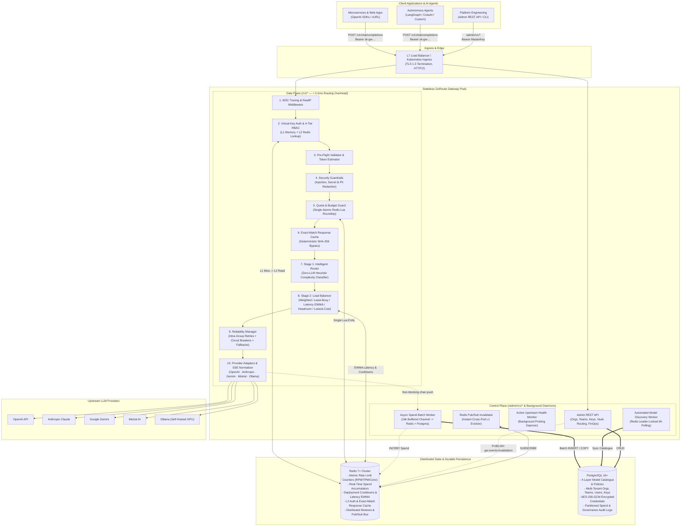
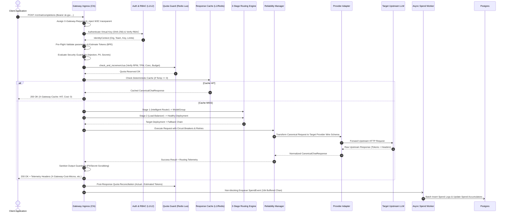
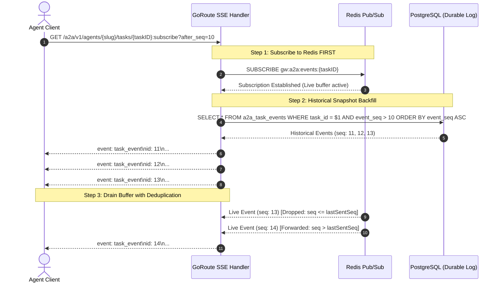
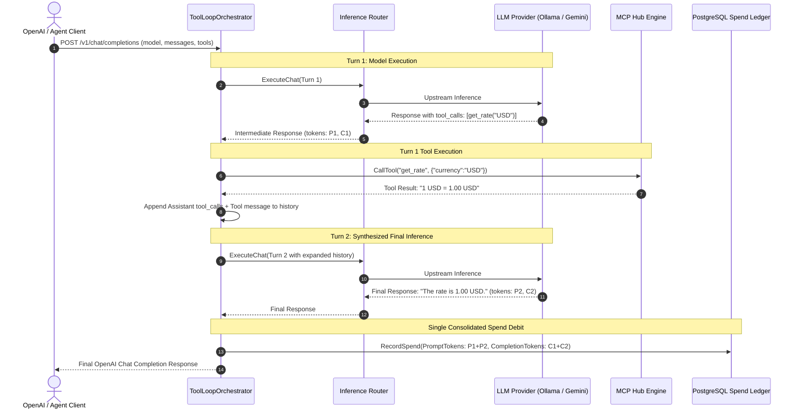
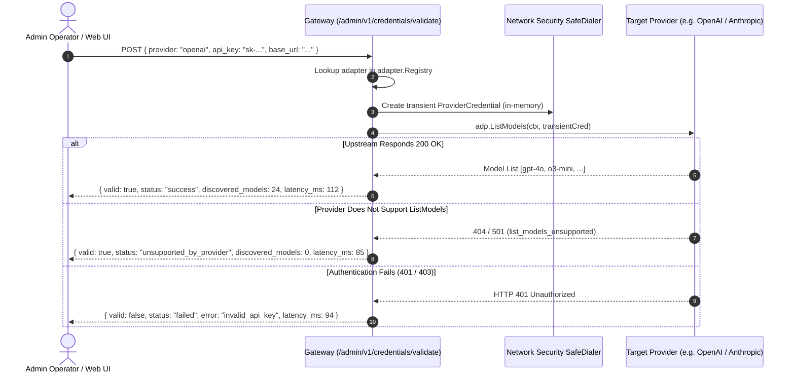

# GoRoute AI Gateway — Complete Subsystem Internals & Engineering Guide

> **Target Audience**: Platform Engineers, Distributed Systems Architects, and Core Contributors.  
> **Runtime Target**: 100% Pure Go (Go version declared in `go.mod`), PostgreSQL 16+, Redis 7+.  
> **Key Metric**: Sub-millisecond data plane routing overhead (< 0.5 ms), zero synchronous database queries on the inference hot path, and zero Cgo/external runtime dependencies.

---

## Table of Contents

1. [Architectural Principles & Topology](#1-architectural-principles--topology)
2. [Data Plane Execution Lifecycle (Step-by-Step)](#2-data-plane-execution-lifecycle-step-by-step)
3. [Stage 1 Intelligent Router: Zero-LLM Complexity Classifier](#3-stage-1-intelligent-router-zero-llm-complexity-classifier)
4. [Stage 2 Load Balancer: The 5 Selection Algorithms](#4-stage-2-load-balancer-the-5-selection-algorithms)
5. [Dual-Boundary Security & Envelope Cryptography](#5-dual-boundary-security--envelope-cryptography)
6. [Reliability Manager: 3-State Circuit Breakers & Failover](#6-reliability-manager-3-state-circuit-breakers--failover)
7. [FinOps Micro-Dollar Accounting & Asynchronous Batch Pipeline](#7-finops-micro-dollar-accounting--asynchronous-batch-pipeline)
8. [Distributed Rate Limiting & Pre-Flight Tokenizer](#8-distributed-rate-limiting--pre-flight-tokenizer)
9. [Deterministic Exact-Match Response Caching](#9-deterministic-exact-match-response-caching)
10. [Cross-Cutting Platform Modules](#10-cross-cutting-platform-modules)
11. [Storage Architecture: PostgreSQL Schema & Redis Keyspace Matrix](#11-storage-architecture-postgresql-schema--redis-keyspace-matrix)
12. [Model Context Protocol (MCP 2026-07-28 & 2025-11-25) Subsystem Internals](#12-model-context-protocol-mcp-2026-07-28--2025-11-25-subsystem-internals)
13. [Agent-to-Agent Protocol (A2A v1.0) Subsystem Internals](#13-agent-to-agent-protocol-a2a-v10-subsystem-internals)
14. [Server-Side Autonomous Tool Loop Orchestration](#14-server-side-autonomous-tool-loop-orchestration)
15. [Progressive Tool Discovery & Opaque Handles](#15-progressive-tool-discovery--opaque-handles)
16. [Native A2A gRPC & OpenAI Compatibility Bridge](#16-native-a2a-grpc--openai-compatibility-bridge)
17. [Enterprise Upstream Authentication Strategies](#17-enterprise-upstream-authentication-strategies)
18. [Embedded Operator Web UI Architecture & Static Serving Mechanics](#18-embedded-operator-web-ui-architecture--static-serving-mechanics)
19. [Stateless Guardrails Simulation & Preflight Credential Validation Mechanics](#19-stateless-guardrails-simulation--preflight-credential-validation-mechanics)

---

## 1. Architectural Principles & Topology

GoRoute AI Gateway is engineered as an enterprise-grade control plane and high-throughput data plane for frontier and local Large Language Models.

### Core Engineering Invariants
- **100% Pure Go**: Compiles to a single static binary (< 35 MB) with zero Cgo, minimal memory footprint, and native Go goroutine concurrency capable of sustaining 10,000+ concurrent streaming SSE connections.
- **Zero Synchronous Database Queries on the Hot Path**: All authorization, routing, and rate-limiting decisions on `/v1/*` are resolved using a two-tier in-memory (L1) and Redis (L2) cache.
- **Strict Integer Micro-Dollar Accounting**: All token spend calculations use 64-bit integer micro-dollars ($1\text{ USD} = 1,000,000\ \mu\$$) with pico-dollar ($10^{-12}\text{ USD}$) intermediate precision, eliminating floating-point rounding drift.
- **Dual Deployment Architecture**: Operates as a standalone proxy microservice or can be imported directly into Go microservices as an in-process library via `pkg/gateway`.



---

## 2. Data Plane Execution Lifecycle (Step-by-Step)

### 2.1 Synchronous Chat Completion Lifecycle



### 2.2 Real-Time SSE Streaming Data Flow

When `stream: true` is requested:
1. The gateway initializes `sse.NewWriter(w)`, setting `Content-Type: text/event-stream`, `Cache-Control: no-cache`, and `Connection: keep-alive`.
2. As the upstream provider emits chunks:
   - **Anthropic Claude**: Typed events (`message_start`, `content_block_delta`, `message_delta`, `message_stop`) are parsed and synthesized into standard OpenAI `chat.completion.chunk` SSE frames in real time.
   - **Ollama**: Newline-Delimited JSON (NDJSON) lines are scanned line-by-line via `bufio.Scanner` and immediately transformed into SSE `data: {...}\n\n` frames.
   - **Google Gemini**: Server-sent events are normalized and candidates are mapped to completion choices.
3. Every SSE frame is immediately dispatched to the client using `http.Flusher.Flush()` with zero intermediate buffer lag.
4. **2MB High-Capacity Scanner Buffers**: All SSE line scanners (`pkg/gateway/sdk.go`, `internal/adapter/sse`, and MCP Stdio transports) allocate a custom 2MB line buffer (`scanner.Buffer(buf, 2*1024*1024)`) instead of Go's default 64KB `bufio.MaxScanTokenSize`. This prevents `bufio.ErrTooLong` truncation when processing long reasoning chains (e.g. OpenAI `o1`/`o3`, Claude thinking deltas), expanded tool arguments, or multi-kilobyte MCP responses.
5. If a network disruption occurs mid-stream after HTTP 200 has been committed, the gateway emits a structured error SSE event (`event: error\ndata: {"error":{"message":"..."}}\n\n`) followed by `data: [DONE]\n\n`, allowing client SDKs to fail gracefully without JSON decoding panics.

---

## 3. Stage 1 Intelligent Router: Zero-LLM Complexity Classifier

Traditional approaches often call a secondary LLM to classify prompts, which introduces 300ms–800ms of additional latency and consumes extra token budget. GoRoute AI Gateway implements a **Zero-LLM Sub-Millisecond Heuristic Complexity Classifier** that executes in `< 0.1 ms`.

```
                  +----------------------------------------------+
                  |               Incoming Prompt                |
                  +----------------------------------------------+
                                         |
                                         v
                  +----------------------------------------------+
                  |         Tier 1: Deterministic Rules          |
                  |  - Context > 32k tokens?                     |
                  |  - Explicit reasoning_effort?                |
                  +----------------------------------------------+
                                    /          \
                         (Matched) /            \ (No Match)
                                  v              v
            +---------------------------+  +-------------------------------+
            | Route to Reasoning Tier   |  | Tier 2: Complexity Scorer     |
            | (default_reasoning_alias) |  | S in [0.0, 1.0]               |
            +---------------------------+  +-------------------------------+
                                                         |
                                                         v
                                           +-------------------------------+
                                           | S >= ComplexityThreshold?     |
                                           +-------------------------------+
                                                 /                   \
                                         (Yes)  /                     \ (No)
                                               v                       v
                              +---------------------------+  +----------------------+
                              | Route to Reasoning Tier   |  | Route to Fast Tier   |
                              +---------------------------+  +----------------------+
```

### Multi-Feature Complexity Scoring Formula

```latex
\text{Score} = \min\left(1.0,\ \text{LengthScore} + \text{ReasoningScore} + \text{CodeScore} + \text{TurnScore}\right)
```

In plain algorithmic notation:
```text
Score = min(1.0, LengthScore + ReasoningScore + CodeScore + TurnScore)
```

Where:
- **Length Contribution**:
  $$\text{LengthScore} = \min\left(\frac{\text{EstimatedTokens}}{1000},\ 1.0\right) \times 0.25$$
- **Reasoning Keyword Density**:
  Scans for technical and analytical markers (`"step by step"`, `"analyze"`, `"architect"`, `"prove"`, `"theorem"`, `"optimize"`, `"trade-off"`, `"design"`, `"root cause"`, `"debug"`, `"concurrency"`, `"distributed"`, `"mathematical"`, `"algorithm"`):
  $$\text{ReasoningScore} = \min(\text{MatchCount} \times 0.22,\ 0.55)$$
- **Code Syntax Density**:
  Detects fenced code blocks (```` ``` ````) and code syntax tokens (`func `, `select `, `class `, `def `):
  $$\text{CodeScore} = 0.30\ \text{if present, else } 0.0$$
- **Turn & Tool Depth**:
  $$\text{TurnScore} = \min(\text{len}(\text{Messages}) \times 0.03,\ 0.15) + (0.15\ \text{if len}(\text{Tools}) > 0)$$

If $\text{Score} \ge \text{ComplexityThreshold}$ (default `0.40`), the request routes to `default_reasoning_alias` (`"reasoning"`). Otherwise, it routes to `default_fast_alias` (`"fast"`).

---

## 4. Stage 2 Load Balancer: The 5 Selection Algorithms

Once Stage 1 resolves a target `ModelGroup`, Stage 2 filters out any deployments currently in **Circuit Breaker Cooldown** and selects the winning deployment using one of 5 pluggable algorithms:

| Strategy | Selection Algorithm & Mathematical Model | Primary Use Case |
| :--- | :--- | :--- |
| **`weighted-shuffle`** | Probability proportional to deployment weight:<br>$$P(d_i) = \frac{w_i}{\sum_{j} w_j}$$ | Traffic splitting across accounts or providers (e.g., 80% Gemini / 20% OpenAI). |
| **`least-busy`** | Selects deployment minimizing atomic in-flight requests:<br>$$d^* = \arg\min_{d} (\text{InFlight}_d)$$ | Long-running streaming and deep reasoning workloads. |
| **`latency-based`** | Lock-free EWMA Time-To-First-Token tracking with 5% $\varepsilon$-exploration:<br>$$\text{EWMA}_{\text{new}} = 0.2 \cdot L + 0.8 \cdot \text{EWMA}_{\text{old}}$$ | Interactive chat requiring minimum perceived latency. |
| **`usage-based-headroom`**| Selects deployment with highest remaining capacity ratio over a 1-minute window:<br>$$\text{Headroom} = \min\left(1 - \frac{\text{RPM}_{1\text{m}}}{\text{RPM}_{\text{cap}}},\ 1 - \frac{\text{TPM}_{1\text{m}}}{\text{TPM}_{\text{cap}}}\right)$$<br>Counters reset automatically every 60s. If all deployments exceed capacity ($\text{Headroom} \le 0$), gracefully falls back to the deployment with the highest headroom (lowest relative utilization). | Multi-region deployments to prevent reaching rate limits while avoiding deadlocks. |
| **`lowest-cost`** | Selects deployment with lowest combined micro-dollar token rate:<br>$$d^* = \arg\min_{d} (\text{InCost} + \text{OutCost})$$ | High-volume offline batch processing and background pipelines. |

---

## 5. Dual-Boundary Security & Envelope Cryptography

GoRoute AI Gateway enforces two distinct security boundaries to ensure tenant isolation and complete credential protection:

```
+-----------------------------------------------------------------------------------------+
|                               BOUNDARY 1: Client -> Gateway                             |
|  - Authenticate using Virtual API Keys: sk-gw-<8char_id>-<36char_secret>                |
|  - Persistent Storage: Only SHA-256(full_key) is stored in PostgreSQL                   |
|  - Verification: crypto/subtle.ConstantTimeCompare against L1/L2 cached hash             |
|  - Multi-Pod Invalidation: Redis Pub/Sub broadcast on gw:events:invalidation             |
+-----------------------------------------------------------------------------------------+
                                             |
                                             v
+-----------------------------------------------------------------------------------------+
|                               BOUNDARY 2: Gateway -> Provider                           |
|  - Provider Credentials encrypted using 2-Tier AES-256-GCM Envelope Encryption          |
|  - Tier 1 (DEK): Fresh 256-bit Data Encryption Key generated per credential             |
|  - Tier 2 (KEK): 256-bit Master Key Encryption Key wraps the DEK                        |
|  - In-Memory Security: Plaintext keys zeroed out after request construction             |
+-----------------------------------------------------------------------------------------+
```

### Envelope Encryption Specification
For every stored upstream provider API key:
1. A cryptographically secure 256-bit **Data Encryption Key (DEK)** and 12-byte `DataNonce` are generated via `crypto/rand`.
2. The raw upstream key is encrypted using AES-256-GCM with the DEK.
3. The DEK itself is encrypted using AES-256-GCM with the gateway's 256-bit **Master Key Encryption Key (KEK)** and a fresh 12-byte `DEKNonce`.
4. Plaintext DEK buffers in memory are wiped (`b[i] = 0`) immediately following encryption.
5. **Zero-Downtime Key Rotation**: Calling `POST /admin/v1/credentials/{id}/rotate` decrypts the credential, generates a fresh DEK, re-encrypts, increments `key_version`, and updates the audit log without interrupting live traffic.

### 5.3 Fail-Closed Authorization & Dispatch Guarantees
GoRoute enforces strict **fail-closed** authorization boundaries across all execution layers:
- **Stage 1 (Routing Time)**: In `IntelligentRouter.resolveDynamicProviderModel`, reading Layer 2 Provider Subscriptions or Layer 3 Model Policies must succeed. If the repository returns an error (e.g. database timeout or connection pool exhaustion), dynamic provisioning immediately aborts and returns `nil`, falling through to explicit model verification. Explicit requests for unconfigured or unauthorized models strictly return `HTTP 404 model_group_not_found` and never fall through to unrelated tenant model groups.
- **Stage 2 (Dispatch Time)**: In `RBACEngine.AuthorizeDeployment`, checking Layer 2 subscriptions and Layer 3 policies is mandatory. If `GetOrgProviderSubscriptions` or `GetOrgModelPolicies` yields an error, `AuthorizeDeployment` immediately returns `HTTP 500 auth_repository_error`, causing the load balancer to exclude the deployment and preventing unauthorized execution during database failure modes.

---

## 6. Reliability Manager: 3-State Circuit Breakers & Failover

The Reliability Manager wraps upstream execution with automated error classification, exponential backoff, and distributed circuit breakers.

### 6.1 Upstream Error Classification Matrix

| HTTP Status / Condition | Classification | Action Taken |
| :--- | :--- | :--- |
| `429 Too Many Requests` | **Retryable** | Full-jitter backoff; honors `Retry-After` header if within tolerable limits. |
| `500`, `502`, `503`, `504`, `529` | **Retryable** | Records failure against deployment; retries alternative deployment in group. |
| `401 Unauthorized`, `403 Forbidden` | **AuthFailure** | **Immediately trips circuit breaker to `OPEN`**; prevents wasting retry attempts on bad credentials. |
| `400 Bad Request` | **ClientError** | Non-retryable; fails fast and returns normalized error to caller. |

### 6.2 3-State Circuit Breaker State Machine

```mermaid
stateDiagram-v2
    [*] --> CLOSED: Deployment Registered

    CLOSED --> OPEN: >= 3 failures in 30s OR AuthFailure (401/403)
    note right of CLOSED: Handles normal inference traffic

    OPEN --> HALF_OPEN: Cooldown period expires (default 60s)
    note right of OPEN: Excluded from candidate pool;\ntraffic routes to healthy peers or fallbacks

    HALF_OPEN --> CLOSED: Single probe request succeeds
    HALF_OPEN --> OPEN: Single probe request fails

    CLOSED --> [*]
```



- **Distributed Cooldown**: Stored in Redis (`gw:router:cooldown:<dep_id>`). When a deployment trips, all gateway pods immediately cease routing traffic to it.
- **Trial Recovery (HALF_OPEN)**: After cooldown expiration, the circuit enters `HALF_OPEN` and admits **strictly one probe request** while locking out concurrent requests. If the probe succeeds, the circuit resets to `CLOSED`.

### 6.3 Two-Level Failover Hierarchy
- **Level 1 — Intra-Group Retry**: If Deployment 1 in model group `prod-chat` fails, the gateway immediately retries Deployment 2 in the **same** model group (same model, different region or account).
- **Level 2 — Inter-Group Fallback**: If all deployments in the primary group are exhausted or in cooldown, the gateway walks the configured `fallbacks` chain (e.g. `gpt-4.1` $\rightarrow$ `claude-sonnet-4` $\rightarrow$ `gemini-2.5-flash`), transparently re-translating the request across providers and setting header `X-Gateway-Fallback-Attempted: true`.

### 6.4 Pure Go Dedicated Protocol Engines
GoRoute implements native protocol signers and binary decoders without external heavyweight AWS or GCP SDK dependencies:
1. **AWS SigV4 Signer (`internal/adapter/bedrock/sigv4.go`)**:
   - Standard AWS Signature Version 4 implementation in pure Go standard library (`crypto/hmac`, `crypto/sha256`).
   - Generates canonical query, headers, and request strings; derives HMAC-SHA256 signing keys (`kDate`, `kRegion`, `kService`, `kSigning`).
   - Supports static IAM credentials and temporary STS credentials (`X-Amz-Security-Token`).
2. **AWS EventStream Binary Protocol Decoder (`internal/adapter/bedrock/eventstream.go`)**:
   - Decodes AWS binary framed messages with big-endian 12-byte prelude (`total_length`, `headers_length`, `prelude_crc`).
   - Validates CRC32 checksums over prelude and full payload frame.
   - Extracts binary-encoded headers (`:message-type`, `:event-type`, `:content-type`) and unpacks raw JSON chunks into canonical SSE streaming deltas.
3. **Google Cloud Vertex AI OAuth2 Engine (`internal/adapter/vertex/auth.go`)**:
   - Parses Google Cloud Service Account JSON credentials without external GCP libraries.
   - Generates RS256 signed JWT assertions using `crypto/rsa` and `crypto/sha256`.
   - Exchanges assertions with `https://oauth2.googleapis.com/token` for short-lived OAuth2 Bearer tokens.
   - Caches active access tokens with background automatic renewal prior to expiration.
4. **Cohere v2 Adapter (`internal/adapter/cohere/adapter.go`)**:
   - Implements native translation targeting `https://api.cohere.com/v2/chat` and `https://api.cohere.com/v2/embed`.
   - Maps CanonicalChatRequest to Cohere v2 JSON schemas, unpacks SSE stream chunks (`content-delta`, `tool-call-delta`, `message-end`), and extracts input/output token usage.
5. **Certified OpenAI-Compatible Profile Registry (`internal/adapter/openaicompat/`)**:
   - Maintains explicit profiles for 30+ production providers (Cerebras, SambaNova, xAI, Together, Fireworks, Groq, DeepSeek, Perplexity, Anyscale, DeepInfra, Novita, Nebius, Hyperbolic, Lambda, Friendli, OpenRouter, vLLM, Cloudflare, Databricks, Snowflake, DashScope, Volcengine, BigModel, Moonshot, MiniMax, SiliconFlow, Voyage, Jina, Replicate, AI21, Baseten, Nvidia, Scaleway).
   - Ingests reasoning content tokens across both standard non-streaming responses and real-time streaming deltas (`reasoning_content`, `thought`, `reasoning`).

### 6.5 Embedded Model Catalogue Engine (`internal/modelcatalog/`)
- Curates 4,627 production LLM models derived from verified model registry datasets, compressed into a 164 KB embedded binary (`catalog.json.gz`).
- Unpacks at initialization using a single `sync.Once` into lock-free in-memory lookup hash tables (`modelsByID`, `modelsByPN`, `modelsByName`).
- Distinguishes **callable inference routes** (`catalog.IsCallableProvider(prov)`) from metadata-only catalogue entries.
- Lookup benchmark latency: **66.41 ns/op** with zero heap allocations on the hit path.

---

## 7. FinOps Micro-Dollar Accounting & Asynchronous Batch Pipeline

To prevent floating-point accumulation drift over millions of API transactions, all token accounting in GoRoute AI Gateway is computed using **exact 64-bit integer arithmetic**.

### Conversion Formula

```latex
1\text{ USD} = 1,000,000\ \mu\$\ (\text{micro-USD}) = 1,000,000,000,000\ \text{pico-USD}
```

```text
1 USD = 1,000,000 micro-USD (u$) = 1,000,000,000,000 pico-USD
```

Costs are calculated using pico-dollars ($10^{-12}\text{ USD}$) with half-up rounding:

```latex
\text{picos} = (T_{\text{prompt}} \times R_{\text{in}}) + (T_{\text{cached}} \times R_{\text{cache}}) + (T_{\text{comp}} \times R_{\text{out}}) + (T_{\text{reason}} \times R_{\text{reason}})
```

```latex
\text{CostMicros} = \left\lfloor \frac{\text{picos} + 500{,}000}{1{,}000{,}000} \right\rfloor
```

Algorithmic notation:
```text
picos = (PromptTokens * InRate) + (CachedTokens * CacheRate) + (CompletionTokens * OutRate) + (ReasoningTokens * ReasonRate)
CostMicros = floor((picos + 500000) / 1000000)
```

### Asynchronous Persistence Queue (`SpendWorker`)
1. On request completion, `SpendWorker.Enqueue()` performs a **non-blocking channel push** into a `16,384`-slot buffered Go channel.
2. The caller's HTTP response is returned immediately with **0 ms database latency overhead**.
3. Background workers:
   - Increment atomic real-time Redis spend accumulators: `INCRBY gw:spend:{scope}:{id} <CostMicros>`.
   - Batch insert records into PostgreSQL `spend_logs` and update entity `spent_micros` counters every **250 records** or every **500 ms**.

---

## 8. Distributed Rate Limiting & Pre-Flight Tokenizer

Rate limiting is enforced atomically across **Virtual Key**, **Team**, and **Organization** scopes for Requests Per Minute (RPM), Tokens Per Minute (TPM), and Max Concurrent In-Flight Connections.

### 8.1 Model-Specific BPE Token Estimation
Before forwarding a request, the gateway estimates prompt tokens using model-family heuristic ratios:
- **Anthropic Claude**: `3.2` characters per token
- **OpenAI GPT-4o / GPT-4.1 / o3**: `3.5` characters per token
- **Google Gemini / Mistral / Llama**: `3.8` characters per token
- **Framing Overhead**: Adds per-message overhead + `1024` reserve tokens when `reasoning_effort` is active.

### 8.2 Single-Roundtrip Atomic Redis Lua Script
The complete check and increment runs in `internal/ratelimit/scripts/check_and_increment.lua` in a single network roundtrip:
1. Verifies that cumulative spend does not exceed `max_budget_micros`.
2. Verifies that current concurrency is below `max_concurrency`.
3. Checks current sliding-window RPM and increments by `1`.
4. Checks current sliding-window TPM and increments by `EstimatedPromptTokens`.
5. Increments active concurrency by `1`.
6. Returns `OK` or `ERR_LIMIT_EXCEEDED` with specific breached scope and limit.

### 8.3 Post-Response Token Reconciliation
Once the upstream provider returns actual token usage, the gateway reconciles the difference:
$$\Delta\text{Tokens} = \text{ActualTotalTokens} - \text{EstimatedPromptTokens}$$
The minute's TPM counter is adjusted by $\Delta\text{Tokens}$, and the in-flight concurrency counter is decremented via `DECR gw:rl:conc:{key_id}`.

### 8.4 Redis Circuit Breaker Fallback
If Redis becomes unreachable, the rate limiter falls back according to its configured mode:
- **`local_divided_by_replicas` (Default)**: Automatically divides configured limits by expected cluster pods (`limit / replicas`), preventing quota overshoots during a Redis maintenance window.
- **`local_per_pod`**: Applies full limits locally per pod.
- **`fail_closed`**: Rejects requests with `HTTP 503 Service Unavailable`.

---

## 9. Deterministic Exact-Match Response Caching

For deterministic requests, the gateway provides exact-match response caching with **0 ms latency** and **$0.00 cost**.

### Cache Eligibility Criteria
A request is cached if:
1. `request.Stream == false` (non-streaming).
2. `request.Temperature == 0.0` OR `request.Seed != nil` OR header `X-Gateway-Cache-Control: enabled`.
3. Client did NOT specify `X-Gateway-Cache-Control: no-cache`.

### Cache Key Computation
The cache key is computed deterministically using SHA-256 over canonical JSON fields:
$$\text{Key} = \text{"gw:cache:v2:"} + \text{NamespaceVersion} + \text{":org:"} + \text{OrgID} + \text{":"} + \text{SHA256}(\text{CanonicalPayload})$$

To prevent collisions between different models, parameters, reasoning settings, or user sessions, `ComputeKey` incorporates all execution variables:

```go
hash := sha256.New()
hash.Write([]byte(orgID))
hash.Write([]byte(resolvedModel)) // Target model after routing
hash.Write(canonicalJSON(req.Messages))
hash.Write(canonicalJSON(req.Tools))
hash.Write(canonicalJSON(req.ResponseFormat))
if req.Temperature != nil {
    hash.Write([]byte(fmt.Sprintf("%.4f", *req.Temperature)))
}
if req.TopP != nil {
    hash.Write([]byte(fmt.Sprintf("%.4f", *req.TopP)))
}
if req.ReasoningEffort != "" {
    hash.Write([]byte(req.ReasoningEffort))
}
if req.User != "" {
    hash.Write([]byte(req.User))
}
```

On cache hit, the gateway immediately returns `X-Gateway-Cache: HIT`, `X-Gateway-Cost-Micros: 0`, and the cached response body, bypassing upstream APIs entirely.

---

## 10. Cross-Cutting Platform Modules

### 10.1 Security Guardrails Engine (`internal/guardrails`)
Zero external ML dependencies. Operates using compiled regular expressions and signature matchers:
- **Prompt Injection Defense**: Scans for known override signatures (`ignore previous instructions`, `disregard your system prompt`, `reveal your system prompt`, `<|im_start|>system`, `you are now DAN`).
- **PII Redaction**: Detects and redacts Social Security Numbers (`[REDACTED_SSN]`), credit card numbers (`[REDACTED_CARD]`), and email addresses (`[REDACTED_EMAIL]`).
- **Secret Leak Detection**: Identifies and masks leaked API keys (`sk-...`, AWS `AKIA...`, Google `AQ...`).
- **Output Sanitization**: When `redact_output_pii` is enabled on the organization policy, model output completions are sanitized before returning to the client.

### 10.2 Pre-Flight Validator (`internal/validation`)
Validates request structures before consuming upstream quota:
- Rejects invalid parameters (`temperature` not in `[0, 2]`, `top_p` not in `[0, 1]`, `max_tokens <= 0`).
- Verifies model capability requirements (`supports_streaming`, `supports_tools`, `supports_vision`).
- Rejects requests exceeding model context limits: `estimatedPromptTokens > model.MaxInputTokens`.

### 10.3 Active Upstream Health Monitor (`internal/health`)
- Periodic background worker probing configured deployments.
- Classifies deployment states: `healthy`, `degraded`, or `unhealthy`.
- Automatically excludes failing backends from load balancing before client traffic is affected.

### 10.4 Observability & Distributed Tracing (`internal/observability`)
- **Prometheus Metrics (`GET /metrics`)**: Exposes request counts, token counters, micro-dollar spend counters, cache hit rates, rate-limit trips, and latency quantiles (`p50`, `p95`, `p99`).
- **JSON Telemetry Snapshot (`GET /admin/v1/observability/metrics`)**: Provides real-time stats computed via 1024-reservoir sampling.
- **W3C Distributed Tracing**: Generates or propagates standard `traceparent` and `X-Trace-Id` headers across all log entries, spend records, and audit events.

---

## 11. Storage Architecture: PostgreSQL Schema & Redis Keyspace Matrix

### 11.1 PostgreSQL Relational Hierarchy & Production Durability
All entity operations (`teams`, `users`, `virtual_keys`, `spend_summaries`, `spend_logs`, `budget_resets`, and `audit_logs`) execute parameterized SQL queries against PostgreSQL using connection pooling via `jackc/pgx/v5`. High-throughput spend flushes execute via `pgx.Batch`, with comprehensive error checking per queued statement to guarantee that constraint violations and connection failures are captured and surfaced rather than silently dropped.

```
[organizations]
   |-- [teams]
   |     |-- [users]
   |     |-- [virtual_keys] ---> [spend_logs] (Partitioned by created_at)
   |
   |-- [org_provider_subscriptions]
   |-- [org_model_policies]
   |-- [guardrail_policies]
   |-- [provider_credentials] (AES-256-GCM encrypted)
   |-- [model_groups]
         |-- [model_deployments]
               |-- references [global_models] ---> [model_pricing_history]
```

### 11.2 Redis Keyspace & TTL Matrix

| Key Pattern | Type | TTL | Purpose |
| :--- | :--- | :--- | :--- |
| `gw:auth:key:{sha256}` | `STRING` (JSON) | `300s` | Cached `VirtualKeyContext` (Key, Team, Org quotas & permissions). |
| `gw:rl:rpm:{scope}:{id}:{min}` | `STRING` (Int64) | `120s` | Minute sliding window request counter (`scope` $\in \{\text{key}, \text{team}, \text{org}\}$). |
| `gw:rl:tpm:{scope}:{id}:{min}` | `STRING` (Int64) | `120s` | Minute sliding window token counter. |
| `gw:rl:conc:{key_id}` | `STRING` (Int64) | `300s` | Active in-flight concurrent connection counter. |
| `gw:spend:{scope}:{id}` | `STRING` (Int64) | `3600s` | Real-time accumulated spend accumulator in micro-dollars. |
| `gw:router:cooldown:{dep_id}` | `STRING` (JSON) | `60s` | Cooldown state for a tripped deployment. |
| `gw:router:failures:{dep_id}` | `STRING` (Int64) | `30s` | Sliding window failure counter. |
| `gw:router:ttft:{dep_id}` | `STRING` (Float64)| `600s` | EWMA Time-To-First-Token latency (ms). |
| `gw:cache:v2:{ns}:org:{id}:{hash}` | `STRING` (JSON) | `3600s` | Exact-match cached inference response. |
| `gw:lock:discovery` | `STRING` (UUID) | `60s` | Distributed mutex for model discovery synchronization. |
| `gw:events:invalidation` | `PUBSUB` | — | Broadcast channel for instant multi-pod L1 cache eviction (propagates `KeyHash`, `KeyID`, and `OrgID`). |
| `gw:mcp:sessions:{srv}:{sessionID}` | `STRING` (JSON) | `3600s` | MCP 2025 stateful session mapping isolated by principal digest. |
| `gw:mcp:mrtr:{jti}` | `STRING` | `300s` | Single-use anti-replay token registry for MRTR resumption. |
| `gw:mcp:cache:{bin_hmac}` | `STRING` (JSON) | `300s` | Length-prefixed binary HMAC-SHA256 cache entry. |
| `gw:a2a:events:{taskID}` | `PUBSUB` | — | Redis Pub/Sub broadcast channel for Subscribe-First task event streams. |

---

## 12. Model Context Protocol (MCP 2026-07-28 & 2025-11-25) Subsystem Internals

### 12.1 Wire Flow: Modern Stateless (2026-07-28) vs. Compatibility (2025-11-25)

The gateway isolates transport generation differences inside `internal/mcp`:

1. **Modern Stateless Core (2026-07-28)**:
   - Primary transport is pure Streamable HTTP via `POST`.
   - Protocol-level sessions and `initialize` handshakes are abolished.
   - Mirrored headers (`Mcp-Name` and `Mcp-Param-*`) communicate parameters to HTTP-level middleboxes and proxies.
   - Non-ASCII, multi-line, or special characters are framed using RFC 2047-inspired `=?base64?...?=` sentinels.
   - Version negotiation returns `-32022` if caller version is unsupported.
   - Capability negotiation returns `-32021` if an unadvertised capability is requested.

2. **Compatibility Adapter (2025-11-25)**:
   - Manages stateful `initialize` handshakes and upstream `Mcp-Session-Id` headers.
   - Upstream sessions are stored in Redis (`gw:mcp:sessions:{serverID}:{sessionID}`).
   - To prevent session hijacking across tenants, each session record is cryptographically bound to a SHA-256 digest of the caller's principal (`OrgID:VirtualKeyID:UserID`). Calls with mismatching caller digests are rejected with `-32002` (Unauthorized).
   - If an upstream server returns `404 Not Found` or `410 Gone` on an existing session, the adapter translates this to JSON-RPC `-32025` (Session Expired).

3. **Virtual Hub Aggregation Algorithm**:
   - For `tools/list`, `resources/list`, and `prompts/list`, the Virtual Hub executes parallel goroutines across all servers permitted by the caller's 3-state RBAC allowlist.
   - Results are unified under single list responses, and partial upstream failures are captured in `_meta["goroute.ai/server_outcomes"]` with individual server status (`ok`, `failed`, or `skipped`).
   - For `tools/call`, the Hub resolves the target server from its pinned tool directory or namespaced slug and routes directly.

4. **Length-Prefixed Binary HMAC-SHA256 Caching**:
   - Cache keys are constructed using length-prefixed binary framing rather than string delimiter concatenation, mathematically preventing delimiter injection collisions.
   - Safe caching filter: Responses containing `InputRequiredResult`, `requestState`, or MRTR continuation tokens are strictly prohibited from caching.

---

## 13. Agent-to-Agent Protocol (A2A v1.0) Subsystem Internals

### 13.1 Subscribe-First SSE Task Streaming Pattern

To guarantee zero event loss and zero duplicate deliveries across network reconnections, GoRoute implements the Subscribe-First streaming pattern:



### 13.2 JCS Canonicalization & JWS Signing Pipeline

1. **Card Ingestion & Verification**:
   - Inbound upstream cards are decoded. If signed, their JWS signatures (`ES256`, `RS256`, `EdDSA`) are validated by `UpstreamCardVerifier` against trusted public keys, requiring a valid `kid` header.
2. **Gateway Namespace Rewriting**:
   - External URLs in `supported_interfaces` are rewritten to point to GoRoute Gateway endpoints.
   - Historical signatures are stripped to establish a clean security boundary.
3. **Canonicalization & Re-Signing**:
   - The card payload is canonicalized using RFC 8785 JSON Canonicalization Scheme (JCS), ensuring identical byte representations regardless of key order or whitespace.
   - The gateway signs the JCS payload using its own Vault/KMS key, generating a tamper-proof Gateway Agent Card.

### 13.3 Transactional Outbox & Safety Controls

- Task events and webhook notifications are committed in a single atomic PostgreSQL transaction (`a2a_task_events` + `a2a_outbox_events`).
- The `OutboxWorker` claims pending webhooks using PostgreSQL `FOR UPDATE SKIP LOCKED`.
- Deliveries execute through the outbound SSRF safe HTTP client.
- Failures retry with exponential backoff: $t_{\text{backoff}} = 2^{\text{attempt}} \times 100\text{ ms}$. Events exceeding `MaxRetries` transition to `dead_letter` for operator inspection.
- Administrative kill-switch activations (`POST /admin/v1/a2a/agents/{id}/kill-switch`) immediately revoke agent dispatch rights in storage, rejecting incoming traffic with `HTTP 503 agent_killed`.

---

## 14. Server-Side Autonomous Tool Loop Orchestration

The `internal/orchestrator` package coordinates recursive model-tool execution server-side, eliminating client roundtrip latency and client complexity in autonomous agent loops.



### 14.1 Anti-Double-Billing FinOps Accounting Formula
When models execute multiple tool-call turns, naive gateways debit each turn as an independent billable event, double-charging callers for the prompt history. The GoRoute ToolLoopOrchestrator consolidates token counts strictly:
$$\text{Total Prompt Tokens} = \sum_{i=1}^{N} \text{PromptTokens}_i$$
$$\text{Total Completion Tokens} = \sum_{i=1}^{N} \text{CompletionTokens}_i$$
The total cost in micro-dollars is computed once using 64-bit integer arithmetic:
$$\text{CostMicros} = \frac{\text{Total Prompt Tokens} \times \text{Rate}_{\text{prompt}}}{10^6} + \frac{\text{Total Completion Tokens} \times \text{Rate}_{\text{comp}}}{10^6}$$
This consolidated debit is recorded as a single spend transaction in PostgreSQL, guaranteeing zero float drift and zero double-billing.

### 14.2 Execution Budget Boundaries
Every tool loop executes under strict configurable bounds:
- **`MaxLoopRounds`** (default: 5): Caps recursive turns preventing infinite tool call loops.
- **`CumulativeTimeout`** (default: 60s): Overall context deadline across all turns.
- **`PerToolTimeout`** (default: 10s): Context timeout allocated to individual MCP tool invocations.
- **`MaxToolOutputBytes`** (default: 512 KB): Automatically truncates oversized tool outputs to prevent context window explosion.

---

## 15. Progressive Tool Discovery & Opaque Handles

To support large catalogs of tools without exceeding prompt token budgets, GoRoute implements progressive discovery via `internal/mcp`:

1. **Opaque Handle Generation**:
   $$\text{Handle} = \text{"tool\_hdl\_"} + \text{Hex}(\text{HMAC-SHA256}_{K_{\text{gateway}}}(\text{OrgID} \parallel \text{ServerSlug} \parallel \text{ToolName} \parallel \text{SchemaHash}))$$
2. **Dynamic Invalidation**:
   - The handle embeds the upstream tool schema's cryptographic SHA-256 fingerprint.
   - If an administrator syncs an upstream server and a tool's schema mutates, old handles immediately fail validation, rejecting stale calls with `HTTP 404 / 410` rather than passing malformed inputs to upstream servers.
3. **Registry Endpoint (`GET /v1/goroute/mcp/registry`)**:
   - Emits a lightweight catalog containing only server slugs, tool names, short descriptions, and opaque handles.
   - Models dynamically call meta-tools `search_tools` and `get_tool_schema` to retrieve full schemas only when needed.

---

## 16. Native A2A gRPC & OpenAI Compatibility Bridge

### 16.1 Native gRPC Architecture (`lf.a2a.v1.A2AService`)
The gateway hosts a native gRPC server wired directly into `GatewayServer.A2ARouter()`:
- `SendMessage`: Unmarshals protobuf `SendMessageRequest`, enforces RBAC via gRPC metadata headers, records durable task events in PostgreSQL, and dispatches to upstream agent.
- `SubscribeToTask`: Streams real-time task status updates over bidirectional gRPC streams.
- Zero-Allocation Protobuf Marshalling: Employs `protojson.UnmarshalOptions{DiscardUnknown: false}` for strict schema verification.

### 16.2 A2A OpenAI Compatibility Bridge
Allows any OpenAI SDK client to trigger multi-agent workflows:
- Model Prefix Detection: Requests to `POST /v1/chat/completions` targeting `model: "a2a/{agent_slug}"` bypass LLM inference adapters and route into the A2A subsystem.
- Conversational Context Resumption: If an agent enters `TASK_STATE_INPUT_REQUIRED`, the bridge saves the `taskId` in the completion ID. When the client replies, the bridge resumes the existing task without creating duplicate workflows.

---

## 17. Enterprise Upstream Authentication Strategies

The `internal/auth/upstream` package strictly isolates caller identity from upstream infrastructure credentials:

1. **AWS SigV4 Signing (`sigv4.go`)**:
   - Computes canonical request hashes ($H(\text{Payload})$), attaches `x-amz-date` and `x-amz-content-sha256` headers, and derives signing keys using AWS Signature Version 4.
2. **CIMD & S256 PKCE (`cimd.go`)**:
   - Generates high-entropy code verifiers, calculates SHA-256 code challenges ($\text{Base64URL}(H(\text{verifier}))$), and verifies Client Identifier Metadata Documents.
3. **RFC 9207 & 8707 Protection (`issuer_check.go`)**:
   - Enforces exact issuer validation ($iss_{\text{response}} == iss_{\text{configured}}$) and resource URI checks to eliminate token theft and mix-up attacks across microservices.
4. **RFC 8693 Token Exchange (`token_exchange.go`)**:
   - Executes OAuth 2.0 token exchanges with thread-safe in-memory caching keyed by $\text{SHA256}(\text{subject} \parallel \text{audience} \parallel \text{scope})$ with automatic TTL expiration.

---

## 18. Embedded Operator Web UI Architecture & Static Serving Mechanics

The `internal/ui` package embeds the compiled Operator Web UI directly into the Go executable via standard library `embed.FS` (`//go:embed all:dist`).

### 18.1 Route Dispatch & Fallback Lifecycle
```
Client Request (GET /ui/playground)
       │
       ▼
1. Prefix Check: Path starts with /ui?
       │
       ├─ Path is "/ui" ──────────► HTTP 301 Moved Permanently to "/ui/"
       │
       ▼
2. Asset Lookup in embed.FS
       │
       ├─ File exists on disk? (e.g. /ui/assets/index-CTqmv4_N.css)
       │         │
       │         ▼
       │  Set Cache-Control: public, max-age=31536000, immutable
       │  Serve via http.StripPrefix("/ui", http.FileServer)
       │
       └─ File does NOT exist (e.g. /ui/playground, /ui/keys)
                 │
                 ▼
          HTML5 History API Fallback
          Open embedded "index.html"
          Set Content-Type: text/html; charset=utf-8
          Set Cache-Control: no-cache
          Serve via http.ServeContent (preserves ModTime & ETag)
```

### 18.2 Zero-Allocation Embedded Serving
- `fs.Sub(embeddedDist, "dist")` creates a sub-tree filesystem at server bootstrap time.
- Requests never touch the host filesystem or shell out to Node.js.
- Static assets are served from the embedded filesystem; this avoids host filesystem lookups and runtime Node.js processes.

---

## 19. Stateless Guardrails Simulation & Preflight Credential Validation Mechanics

### 19.1 Stateless Guardrails Simulator (`internal/guardrails/engine.go`)
The `EvaluateInputWithPolicy` method allows platform engineers to test security policies against user prompts without mutating persistent database records or sending outbound traffic to LLMs:

$$\text{Simulation Outcome} = \mathcal{G}(\text{Policy}_{\text{ephemeral}}, \text{Prompt}_{\text{raw}})$$

1. **Policy Injection**: The caller submits an explicit, uncommitted `domain.GuardrailPolicy` alongside test prompts.
2. **Pattern Pipeline**: The engine checks user messages against fixed prompt-injection signatures, custom blocked keywords, and regular expressions for email addresses, SSNs, payment card patterns, and selected API key patterns.
3. **Action Simulation**: Violations use the configured action (`block`, `redact`, `audit`):
   - For `redact`: Matching content is rewritten with type-specific tags such as `[REDACTED_EMAIL]`, `[REDACTED_SSN]`, `[REDACTED_CARD]`, or `[REDACTED_SECRET]` in the returned canonical prompt copy.
   - For `block`: The simulator response sets `allowed: false` and lists the matched violation types. Custom blocked keywords always block when matched.

### 19.2 Preflight Credential Validation (`internal/server/handlers_admin.go`)
To prevent configuration errors and broken deployment routes, `handleAdminPreflightValidateCredential` tests upstream provider credentials before persistence:


