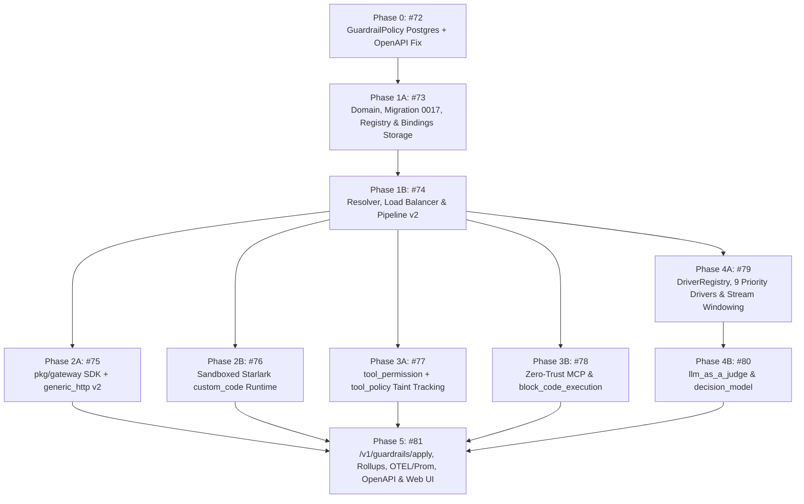

# GoRoute AI Gateway — Guardrails Architecture Roadmap & Task Tracker

This document tracks the six-phase upgrade of GoRoute AI Gateway (`ai-gateway-go`) from a single per-organization baseline guardrail policy into a multi-provider, hierarchical AI governance engine with native extensibility, agentic tool/MCP security, observability, and Operator Web UI management.

> **Repository Invariants (`AGENTS.md`):**
> - Keep public API and provider wire behavior aligned with `docs/openapi/gateway.openapi.yaml` and regenerate via `make specgen` (never hand-edit generated files in `internal/openapi/`).
> - Route 100% of outbound HTTP calls in drivers, webhooks, and custom scripts through `internal/security/network` (`network.NewHTTPClient(ssrfPolicy)`).
> - Preserve tenant isolation, operator RBAC, and fail-closed authorization; request-level `guardrails`/`tags` parameters may opt in or tighten policies, never bypass `default_on` or admin-locked bindings.
> - Use strict integer micro-dollars (`BIGINT`) for all guardrail cost accounting; avoid floating-point financial math.
> - Keep package dependencies pointed inward toward `internal/domain` types and interfaces.

---

## Live GitHub Issues Index

| Phase | Issue | Type | Status | Title | Dependencies |
| --- | --- | --- | --- | --- | --- |
| Phase 0 | [#72](https://github.com/goroute-ai/ai-gateway-go/issues/72) | `bug` | Done (`main` `2207fab`) | Persist `GuardrailPolicy` toxicity filter & content category fields in PostgreSQL and align OpenAPI contract | None |
| Phase 1 | [#73](https://github.com/goroute-ai/ai-gateway-go/issues/73) | `enhancement` | Done (`main` `d2a954c`) | Named `GuardrailDefinition` registry, Vault-encrypted secrets, and hierarchical Org/Team/Key/User/Model/Tag bindings | `#72` |
| Phase 1 | [#74](https://github.com/goroute-ai/ai-gateway-go/issues/74) | `enhancement` | Done (`main` `5492fa6`) | Multi-hook Guardrail Pipeline v2 (`pre_call`, parallel `during_call`, `post_call`, `logging_only`), `stream_scope`, tag modes & load balancing | `#73` |
| Phase 2 | [#75](https://github.com/goroute-ai/ai-gateway-go/issues/75) | `enhancement` | Done (`main` `cc1753f`) | Public Go SDK `GuardrailScanner` plugin API (`pkg/gateway`) and upgraded `generic_http` webhook (`modify` action, rich context, per-scanner failure policy) | `#73`, `#74` |
| Phase 2 | [#76](https://github.com/goroute-ai/ai-gateway-go/issues/76) | `enhancement` | Done (`main` `51d423a`) | Sandboxed Starlark `custom_code` guardrail runtime with SSRF-enforced HTTP primitives and bounded execution | `#73`, `#74` |
| Phase 3 | [#77](https://github.com/goroute-ai/ai-gateway-go/issues/77) | `enhancement` | Done (`main` `046b5d5`) | Rule-based LLM `tool_permission` engine and persistent cross-turn `tool_policy` trust-chain taint tracking | `#73`, `#74` |
| Phase 3 | [#78](https://github.com/goroute-ai/ai-gateway-go/issues/78) | `enhancement` | Done (`main` `dd6697f`) | Zero-trust MCP & code execution guardrails (`mcp_security`, `mcp_end_user_permission`, formalized `mcp_jwt_signer`, `block_code_execution`) | `#73`, `#74` |
| Phase 4 | [#79](https://github.com/goroute-ai/ai-gateway-go/issues/79) | `enhancement` | Done (`main` `5974b47`) | Unified Guardrail Driver Registry with priority cloud/OSS providers & upgraded `local_content_filter` | `#73`, `#74` |
| Phase 4 | [#80](https://github.com/goroute-ai/ai-gateway-go/issues/80) | `enhancement` | Done (`main` `e251b20`) | Internal `llm_as_a_judge` and `decision_model` guardrails via gateway router with recursion loop protection | `#73`, `#74`, `#79` |
| Phase 5 | [#81](https://github.com/goroute-ai/ai-gateway-go/issues/81) | `enhancement` | Open | Standalone `/v1/guardrails/apply` evaluation API, expanded simulator, micro-dollar guardrail usage rollups, OTEL/Prometheus metrics & Operator Web UI | `#72`–`#80` |

---

## Dependency Graph



**Parallel Execution Lanes (after Phase 1 `#73` -> `#74` lands):**
- **Wave 1 (Sequential Foundation):** `#72` -> `#73` -> `#74`
- **Wave 2 (Full Parallelism Across 5 Disjoint File Scopes):**
  - Worker A: `#75` (Public SDK & `generic_http`)
  - Worker B: `#76` (Starlark `custom_code`)
  - Worker C: `#77` (`tool_permission` & `tool_policy`)
  - Worker D: `#78` (Zero-Trust MCP & `block_code_execution`)
  - Worker E: `#79` (Unified `DriverRegistry` & 9 priority providers)
- **Wave 3 (After `#79` Driver Interface & Registry):**
  - Worker F: `#80` (`llm_as_a_judge` & `decision_model`)
- **Wave 4 (Control Plane, Observability, Contracts & UI):**
  - `#81` (integrates all drivers/policies into HTTP routes, usage rollups, OTEL/Prometheus, YAML config, OpenAPI, and Web UI)

---

## Detailed Tasks & Non-Overlapping File Ownership

### Phase 0 — P0 Bugfix: Postgres Persistence & OpenAPI Schema Parity

- [x] **Task 0 (`#72`)**: Persist `GuardrailPolicy` toxicity filter & content category fields in PostgreSQL and align OpenAPI contract ([Issue #72](https://github.com/goroute-ai/ai-gateway-go/issues/72)) — **Landed locally on `main` (`2207fab`)**
  - **Exclusive File Ownership:**
    - `migrations/0016_guardrail_policy_toxicity.up.sql` (new)
    - `migrations/0016_guardrail_policy_toxicity.down.sql` (new)
    - `internal/storage/postgres.go` (`SetGuardrailPolicy` & `GetGuardrailPolicy` only)
    - `docs/openapi/gateway.openapi.yaml` (`#/components/schemas/GuardrailPolicy` only)
    - `internal/openapi/*` (generated via `make specgen`)
    - `internal/storage/storage_roundtrip_test.go`, `internal/storage/postgres_migrations_test.go`, `internal/storage/postgres_migrations_live_test.go` (toxicity persistence assertions)
    - `tests/guardrails/http_flow_test.go` (round-trip HTTP + `/guardrails/simulate` assertions)
  - **Deliverables:**
    - [x] Add `enable_toxicity_filter`, `toxicity_action`, `toxicity_threshold`, `enabled_content_categories`, `content_exceptions` columns in migration `0016` (+ reversible `.down.sql`).
    - [x] Update `SetGuardrailPolicy` and `GetGuardrailPolicy` in `internal/storage/postgres.go` (normalize `nil` slices to `{}`).
    - [x] Update `#/components/schemas/GuardrailPolicy` in `docs/openapi/gateway.openapi.yaml` (`toxicity_threshold` enum `[low, medium, high]`) and run `make specgen`.
    - [x] Add cold PostgreSQL round-trip and HTTP persistence tests.

---

### Phase 1 — Core Guardrail Pipeline v2, Named Registry & Hierarchical Bindings

- [x] **Task 1A (`#73`)**: Named `GuardrailDefinition` registry, Vault-encrypted secrets, and hierarchical bindings ([Issue #73](https://github.com/goroute-ai/ai-gateway-go/issues/73)) — **Landed locally on `main` (`d2a954c`)**
  - **Exclusive File Ownership:**
    - `internal/domain/guardrails.go` (new)
    - `internal/domain/inference.go` (`GoRouteExtensions` additions)
    - `migrations/0017_guardrail_registry_and_bindings.up.sql` (new)
    - `migrations/0017_guardrail_registry_and_bindings.down.sql` (new)
    - `internal/storage/repository.go`, `internal/storage/memory.go`, `internal/storage/postgres.go` (registry & binding CRUD + `RotateGuardrailSecrets`)
    - `internal/storage/guardrail_registry_test.go` (new)
  - **Deliverables:**
    - [x] Define `GuardrailHook`, `StreamScope`, `GuardrailModeRule`, `GuardrailStatus`, `GuardrailDecision`, `GuardrailDefinition`, `GuardrailBinding`, `GuardrailEvalInput`, and `GuardrailEvalResult`.
    - [x] Extend `GoRouteExtensions` with `Guardrails []GuardrailRequestOverride` and `Tags []string`.
    - [x] Create `guardrail_definitions` and `guardrail_bindings` tables in migration `0017` (+ reversible `.down.sql`).
    - [x] Implement CRUD, coalesced org lookup, and Vault DEK rotation (`RotateGuardrailSecrets`) in both `MemoryRepository` and `PostgresRepository`.

- [x] **Task 1B (`#74`)**: Multi-hook Guardrail Pipeline v2, `stream_scope`, tag modes & load balancing ([Issue #74](https://github.com/goroute-ai/ai-gateway-go/issues/74)) — **Landed locally on `main` (`5492fa6`)**
  - **Exclusive File Ownership (starts after `#73` domain/storage types land):**
    - `internal/guardrails/resolver.go` (new)
    - `internal/guardrails/router_lb.go` (new)
    - `internal/guardrails/pipeline.go` (new)
    - `internal/guardrails/pipeline_test.go` (new)
    - `internal/server/guardrails.go`, `internal/server/handlers_inference.go`, `internal/server/handlers_responses.go`, `internal/server/handlers_messages.go` (hook wiring for `pre_call`, `during_call`, `post_call`, `logging_only`, `modify` write-back)
    - `tests/guardrails/pipeline_v2_test.go` (new)
  - **Deliverables:**
    - [x] Build `resolver.go` respecting `EnabledRoles`, `StreamScope`, `ModeRule` tag evaluation, and anti-bypass locks on `default_on` / `is_locked`.
    - [x] Build `router_lb.go` for weighted shuffle + `gobreaker` cooldowns across duplicate `GuardrailDefinition.Name` entries.
    - [x] Build `pipeline.go` executing Layer 0 `GuardrailPolicy` + ordered `Driver` instances, `StartDuringCall(...)` parallel cancellation, async `logging_only`, and `modify` mutations.

---

### Phase 2 — Extensibility: Public Go SDK, Rich `generic_http` & Sandboxed Starlark

- [x] **Task 2A (`#75`)**: Public Go SDK `GuardrailScanner` plugin API and upgraded `generic_http` webhook ([Issue #75](https://github.com/goroute-ai/ai-gateway-go/issues/75)) — **Landed locally on `main` (`cc1753f`)**
  - **Exclusive File Ownership:**
    - `pkg/gateway/guardrails.go` (new)
    - `pkg/gateway/sdk.go` (`WithGuardrailScanner` option & internal bridge)
    - `pkg/gateway/guardrails_test.go` (new)
    - `internal/guardrails/drivers/generic_http.go` (new)
    - `internal/guardrails/drivers/generic_http_test.go` (new)
    - `internal/server/guardrails_http.go` (independent per-scanner `TimeoutMs` & `FailOpen`)
    - `tests/guardrails/custom_scanners_test.go` (SDK & webhook `modify`/per-scanner policy tests)
  - **Deliverables:**
    - [x] Export `GuardrailScanner`, `GuardrailScanRequest`, `GuardrailScanResult`, `GuardrailOption`, and `WithGuardrailScanner` in `pkg/gateway` without leaking `internal/`.
    - [x] Upgrade `generic_http` driver to forward `input_type`, `request_id`, `trace_id`, `model`, `texts`, `structured_messages`, `images`, `tools`, `tool_calls`, redacted/allowlisted `request_headers`, and `metadata`.
    - [x] Support `allow`, `block`, `flag`, and `modify` (`texts`, `tool_calls`) webhook responses.
    - [x] Fix global fail-open/timeout aggregation so each webhook scanner enforces its own `TimeoutMs` and `FailOpen` via `network.NewHTTPClient(ssrfPolicy)`.

- [x] **Task 2B (`#76`)**: Sandboxed Starlark `custom_code` guardrail runtime ([Issue #76](https://github.com/goroute-ai/ai-gateway-go/issues/76)) — **Landed locally on `main` (`51d423a`)**
  - **Exclusive File Ownership:**
    - `go.mod`, `go.sum` (`go.starlark.net`)
    - `internal/guardrails/drivers/custom_code.go` (new)
    - `internal/guardrails/drivers/custom_code_test.go` (new)
    - `tests/guardrails/custom_code_test.go` (new)
  - **Deliverables:**
    - [x] Implement `ScriptRuntime` and `custom_code` driver compiling `def apply_guardrail(inputs, request_data, input_type):`.
    - [x] Provide safe predeclared builtins (`allow`, `block`, `flag`, `modify`, `regex_*`, `json_*`, `sha256`, `http_get`, `http_post`) with zero `load`, filesystem, or env access.
    - [x] Enforce `thread.Cancel` on context deadline and `thread.SetMaxExecutionSteps`, plus SSRF-checked `network.NewHTTPClient(ssrfPolicy)` for `http_get`/`http_post`.

---

### Phase 3 — Tool-Level, Agentic Loop & Zero-Trust MCP Governance

- [x] **Task 3A (`#77`)**: Rule-based LLM `tool_permission` engine and persistent cross-turn `tool_policy` trust-chain taint tracking ([Issue #77](https://github.com/goroute-ai/ai-gateway-go/issues/77)) — **Landed locally on `main` (`046b5d5`)**
  - **Exclusive File Ownership:**
    - `migrations/0018_tool_policies.up.sql` (new)
    - `migrations/0018_tool_policies.down.sql` (new)
    - `internal/guardrails/drivers/tool_permission.go` (new)
    - `internal/guardrails/drivers/tool_policy.go` (new)
    - `internal/guardrails/drivers/tool_governance_test.go` (new)
    - `internal/storage/tool_policy_store.go` (or dedicated methods in `repository.go` / `memory.go` / `postgres.go` coordinated after `#73`)
    - `internal/orchestrator/tool_loop.go` & `internal/orchestrator/tool_loop_test.go` (taint propagation inside `ToolLoopOrchestrator`)
    - `tests/guardrails/tool_governance_test.go` (new)
  - **Deliverables:**
    - [x] Implement `tool_permission` evaluating `tools`, `tool_choice`, and `tool_calls` against ordered `ToolPermissionRule` specs (`name_pattern`, `tool_type`, `allowed_arg_regex`, `blocked_arg_regex`, `action`, `default_action`).
    - [x] Create `tool_policies` table (`0018`) and repository methods for `(org_id, team_id, virtual_key_id, tool_name, input_policy, output_policy)`.
    - [x] Implement two-stage `tool_policy` taint tracking across multi-turn message history (`tool_call_id` mapping) and `ToolLoopOrchestrator`, returning `400 violated_tool_policy` on untrusted-to-trusted chains.

- [x] **Task 3B (`#78`)**: Zero-trust MCP & code execution guardrails (`mcp_security`, `mcp_end_user_permission`, `mcp_jwt_signer`, `block_code_execution`) ([Issue #78](https://github.com/goroute-ai/ai-gateway-go/issues/78)) — **Landed locally on `main` (`dd6697f`)**
  - **Exclusive File Ownership:**
    - `internal/guardrails/drivers/code_execution.go` (new)
    - `internal/guardrails/drivers/mcp_security.go` (new)
    - `internal/guardrails/drivers/mcp_security_test.go` (new)
    - `internal/guardrails/mcp.go` (`mcp_end_user_permission` & MCP hook adapters)
    - `internal/mcp/hub.go` (`pre_mcp_call`, `during_mcp_call`, `post_mcp_call` integration)
    - `internal/mcp/auth_resolver.go` (formalized `mcp_jwt_signer` token exchange, claim validation & transforms)
    - `internal/mcp/hardening_test.go` & `tests/guardrails/tool_and_protocol_test.go`
  - **Deliverables:**
    - [x] Implement `block_code_execution` driver (`block|strip|flag`) for shell/Python/eval tool calls and fenced executable code.
    - [x] Implement `mcp_security` validating LLM request MCP server/URL declarations against tenant-registered `MCPServer` entries.
    - [x] Implement `mcp_end_user_permission` validating caller `UserID`/OIDC claims/team RBAC before `mcp.Hub` dispatch.
    - [x] Formalize `mcp_jwt_signer` (`MCPAuthVaultJWT` verification, `required_claims`/`optional_claims`, claim transforms, per-hop Vault JWT signing) and wire `*_mcp_call` hooks into `mcp.Hub`.

---

### Phase 4 — Unified Driver Registry, Priority Cloud/OSS Providers & LLM Judges

- [x] **Task 4A (`#79`)**: Unified `DriverRegistry`, 9 priority cloud/OSS/local drivers & streaming chunk windowing ([Issue #79](https://github.com/goroute-ai/ai-gateway-go/issues/79)) — **Landed locally on `main` (`5974b47`)**
  - **Exclusive File Ownership:**
    - `internal/guardrails/drivers/registry.go` (new — `Driver` interface & `DriverRegistry`)
    - `internal/guardrails/drivers/openai_moderation.go` (new)
    - `internal/guardrails/drivers/bedrock.go` (new — reuses `internal/adapter/bedrock/sigv4.go`)
    - `internal/guardrails/drivers/azure_content_safety.go` (new — `azure/prompt_shield`, `azure/text_moderations`)
    - `internal/guardrails/drivers/model_armor.go` (new — reuses `internal/adapter/vertex/auth.go`)
    - `internal/guardrails/drivers/presidio.go` (new)
    - `internal/guardrails/drivers/lakera_v2.go` (new)
    - `internal/guardrails/drivers/guardrails_ai.go` (new)
    - `internal/guardrails/drivers/pangea.go` (new)
    - `internal/guardrails/drivers/content_filter.go` (new — wraps `internal/guardrails/toxicity.go`)
    - `internal/guardrails/drivers/drivers_test.go` (new — `httptest` protocol mock suite for all 9 drivers)
    - `internal/guardrails/stream_filter.go` & `internal/guardrails/stream_filter_test.go` (`stream_scope`, bounded overlap windowing for remote drivers, streamed `tool_calls` argument scanning)
  - **Deliverables:**
    - [x] Implement `Driver` interface and `DriverRegistry` using `network.NewHTTPClient(ssrfPolicy)` and `auth.Vault` secret decryption.
    - [x] Implement all 9 priority drivers (`openai_moderation`, `bedrock`, `azure/prompt_shield`, `azure/text_moderations`, `model_armor`, `presidio`, `lakera_v2`, `guardrails_ai`, `pangea`, `local_content_filter`).
    - [x] Upgrade `StreamRedactor` with `stream_scope`, chunk window overlap for remote `post_call` drivers, and incremental `tool_calls` argument scanning.

- [x] **Task 4B (`#80`)**: Internal `llm_as_a_judge` and `decision_model` guardrails via gateway router ([Issue #80](https://github.com/goroute-ai/ai-gateway-go/issues/80)) — **Landed locally on `main` (`e251b20`)**
  - **Exclusive File Ownership (starts after `#79` `DriverRegistry` interface lands):**
    - `internal/guardrails/drivers/llm_judge.go` (new)
    - `internal/guardrails/drivers/decision_model.go` (new)
    - `internal/guardrails/drivers/llm_judge_test.go` (new)
    - `tests/guardrails/llm_judge_test.go` (new)
  - **Deliverables:**
    - [x] Implement `llm_as_a_judge` routing via `router.ReliabilityManager.ExecuteChat` with weighted `0–100` rubric scoring and JSON verdict parsing.
    - [x] Implement `decision_model` evaluating structured boolean predicate `checks[]` via internal router target models.
    - [x] Enforce non-spoofable `_internal_guardrail_origin` loop guard so internal judge/decision calls never re-trigger guardrails recursively.

---

### Phase 5 — Standalone `/v1/guardrails/apply`, Micro-Dollar Rollups, OTEL/Prom, OpenAPI & Operator UI

- [ ] **Task 5 (`#81`)**: Control/data plane APIs, usage rollups, observability, YAML config, OpenAPI & Operator Web UI ([Issue #81](https://github.com/goroute-ai/ai-gateway-go/issues/81))
  - **Exclusive File Ownership (runs after Phases 0–4 land):**
    - `migrations/0019_guardrail_usage_metrics.up.sql` & `.down.sql` (new)
    - `internal/storage/` usage rollup queries (`daily_guardrail_metrics`, `daily_guardrail_usage_units`, `spend_log_guardrails`)
    - `internal/server/handlers_guardrails.go` (new) & `internal/server/server.go` (route registration)
    - `internal/observability/collector.go`, `internal/observability/metrics_otlp.go`, `internal/observability/tracing_otlp.go`
    - `internal/config/config.go` & `configs/config.example.yaml` (`guardrails.definitions[]`, `guardrails.tool_policies[]`)
    - `docs/openapi/gateway.openapi.yaml` & `internal/openapi/*` (`make specgen`)
    - `web/src/views/GuardrailsView.tsx`, `web/src/views/guardrails/*` (lazy-loaded sub-tabs), `web/src/api/admin.ts`, `web/src/types/index.ts`
    - `tests/guardrails/apply_and_usage_test.go` (new) & `tests/e2e/` guardrail integration coverage
  - **Deliverables:**
    - [ ] Implement `/admin/v1/organizations/{orgID}/guardrail-definitions`, `/admin/v1/guardrail-definitions/{guardrailID}`, `/admin/v1/guardrail-bindings`, `/admin/v1/organizations/{orgID}/tool-policies`, `/admin/v1/organizations/{orgID}/guardrail-usage`, expanded `/guardrails/simulate`, and data-plane `POST /v1/guardrails/apply`.
    - [ ] Add migration `0019` and integer micro-dollar (`cost_micros BIGINT`) guardrail usage rollups.
    - [ ] Emit scrubbed OTEL `guardrail.evaluate` spans and Prometheus metrics (`gateway_guardrail_evaluations_total`, `gateway_guardrail_errors_total`, `gateway_guardrail_duration_ms`).
    - [ ] Seed YAML `guardrails.definitions[]` and `guardrails.tool_policies[]` at startup.
    - [ ] Update `docs/openapi/gateway.openapi.yaml` and regenerate `internal/openapi/`.
    - [ ] Add lazy-loaded Operator Web UI sub-tabs (Org Baseline Policy, Named Guardrails & Registry, Tool Policies & Trust Matrix, Simulator & Usage Metrics) passing `web/scripts/check-budget.mjs`.

---

## Verification Commands

Run these checks per phase and before merging:

### 1. Formatting, Static Analysis & OpenAPI Contracts (Every Phase)
```bash
gofmt -l .
go vet ./...
make specgen
git diff --exit-code internal/openapi/ docs/openapi/
```

### 2. Unit & Isolated Guardrails Suite (Every Phase)
```bash
make test-guardrails
go test -race -count=1 ./internal/... ./pkg/...
```

### 3. Live PostgreSQL + Redis & E2E Verification (Verifier Only — Owns Docker Compose Ports)
```bash
make test-live-up
make test-postgres
make test-e2e-strict
make test-live-down
```

### 4. Operator Web UI Build & Bundle Budget Check (Phase 5)
```bash
make ui-build && make ui-check-dist
go test -race -count=1 ./internal/ui/...
```
